# A7 - Finite Element Analysis and Optimization of a Bracket

## Objective

The objective of Assignment A7 is to evaluate and improve the bracket developed during Assignments A5 and A6 using finite element analysis (FEA) in SOLIDWORKS Simulation.

The primary goals are to evaluate maximum von Mises stress, resultant displacement, and factor of safety; investigate mesh convergence; identify critical stress concentrations; and modify the bracket geometry to improve structural performance without changing the selected material.

**Project Status (October 29, 2026):** Six design configurations have been investigated. Additional convergence verification and structural optimization remain in progress.

## Design Requirements

The bracket must support the loading conditions established during Assignment A5 while maintaining the intended attachment geometry and clearance requirements.

| Parameter | Value |
|---|---|
| Material | ASTM A36 Steel |
| Applied force per strap leg | 795 lbf |
| Total applied force | 1,590 lbf |
| Material yield strength | 36.259 ksi |
| Original design factor of safety | 4 |
| Original allowable stress | 9.065 ksi |
| Original feature deflection criterion | 0.005 in |
| Mesh convergence criterion | 7% |

The original analytical design used a factor of safety of 4. During the FEA investigations, the actual factor of safety was evaluated using the calculated maximum von Mises stress.

## CAD Model and Simulation Setup

The bracket was modeled as a single solid body in SOLIDWORKS and assigned ASTM A36 Steel.

The bracket consists of five principal features:

- **Feature A:** Cylindrical strap-loading interface.
- **Feature B:** Structural connection between the cylinder and the main bracket.
- **Feature C:** Central connecting region.
- **Feature D:** Supporting structural members.
- **Feature E:** Upper attachment features that engage the supporting structure.

### Boundary Conditions

Two underside bearing faces of Feature E were assigned fixed-geometry restraints to approximate attachment to a rigid support.

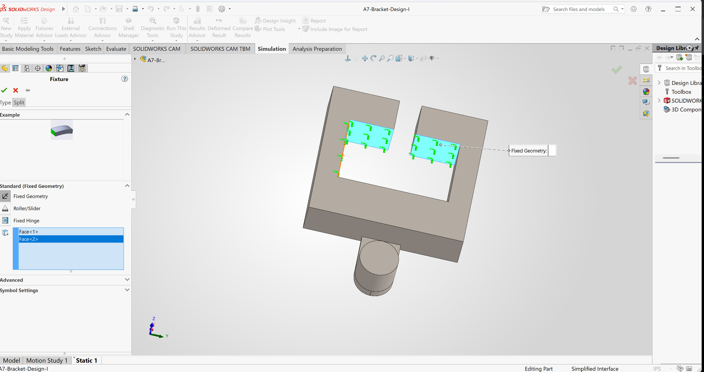

*Figure 1: Fixed geometry applied to the two underside bearing faces of Feature E.*

A total downward force of 1,590 lbf was applied to the curved cylindrical surface of Feature A.

The force was applied in a specified vertical direction rather than radially normal to the cylinder.

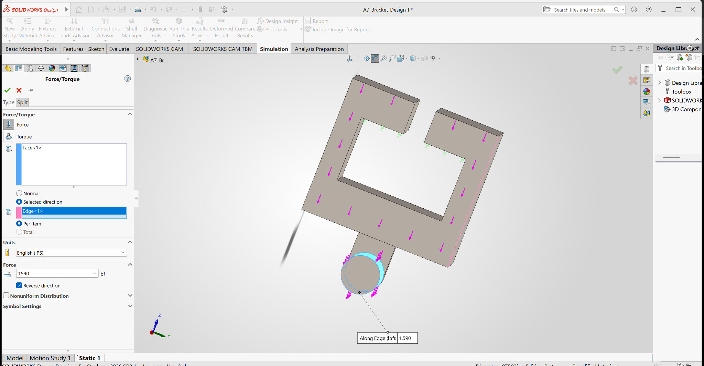

*Figure 2: Distribution and direction of the 1,590 lbf external force applied to Feature A.*

These boundary conditions simplify the physical assembly. The fixed restraints prohibit translation, separation, and sliding of the selected faces, while the distributed cylindrical load approximates the resultant force from the strap.

### Finite Element Mesh

A high-quality blended curvature-based solid mesh was used with 16 Jacobian checking points.

The mesh settings included:

- High-quality solid elements.
- Blended curvature-based meshing.
- Eight minimum elements per circle.
- Element growth ratio of 1.4.
- Local mesh controls when investigating critical stress concentrations.

Meshes were refined to evaluate the sensitivity of the resulting stress and displacement predictions.

## Design Iterations and Analysis

### Design I - Initial Parametric Bracket

The initial bracket retained the geometry developed during A5 and A6.

The first simulation demonstrated that the initial analytical design did not adequately represent all the structural behavior under the applied load.

A coarse-mesh analysis produced a maximum von Mises stress of approximately 132.6 ksi and a maximum resultant displacement of 0.03640 in.

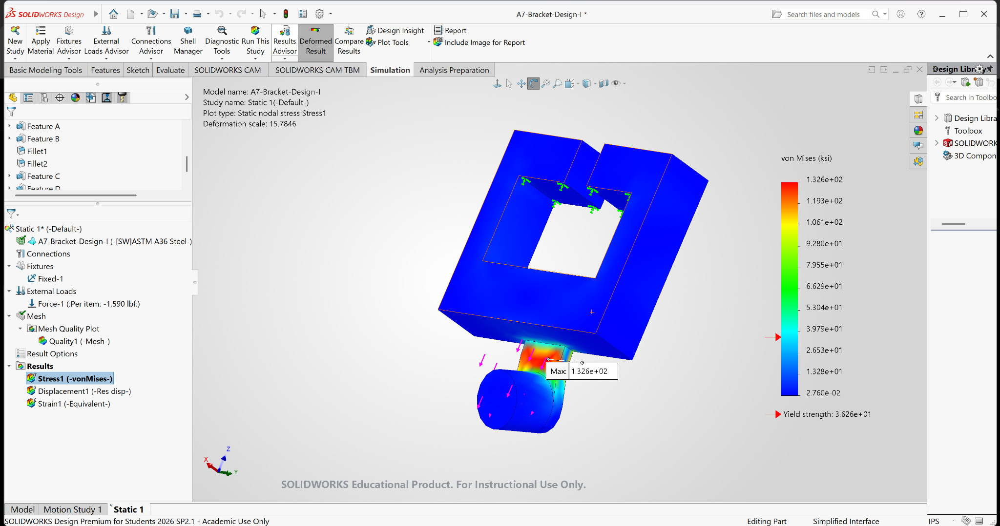

*Figure 3: Initial Design I coarse-mesh von Mises stress distribution.*

The medium-mesh maximum stress increased to approximately 149.4 ksi.

This indicated substantial mesh sensitivity and demonstrated that the original design did not satisfy the intended strength requirements.

The results motivated further investigation of bending effects and revisions to the parametric design.

### Design II - Revised Parametric Geometry

Design II used revised geometry and verified parametric relationships to better represent the mechanical loading and structural connections.

The recorded fine-mesh simulation produced:

- Maximum von Mises stress: 28.41 ksi.
- Maximum resultant displacement: 0.002876 in.
- Minimum factor of safety: approximately 1.28.
- Recorded mass: 2.66 lb.

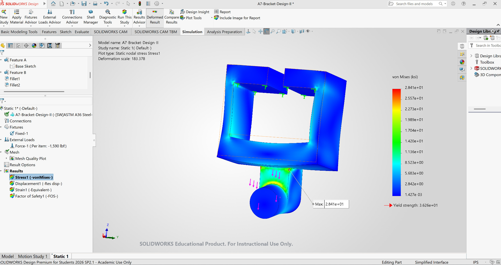

*Figure 4: Design II von Mises stress distribution following geometric and parametric revisions.*

The maximum stress was concentrated near the junction between Features B and C.

Although the results improved substantially, additional mesh refinement was required because the localized maximum stresses remained sensitive to the mesh.

### Stress Hot Spot and Singularity Investigation

SOLIDWORKS Stress Hot Spot Diagnostics and Stress Singularity Diagnostics were used to locate regions with severe stress gradients.

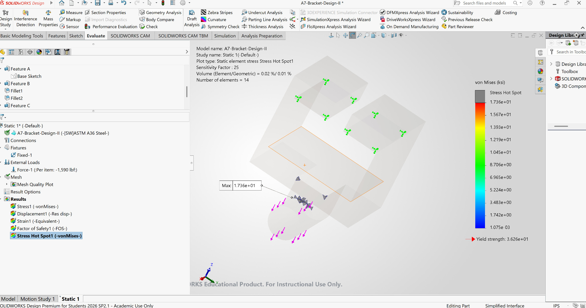

*Figure 5: Stress hot spot investigation identifying regions with elevated stress gradients.*

Four significant transition edges were identified:

1. **Edge 1:** Curved transition between Features A and B.
2. **Edge 2:** Front transition between Features B and C.
3. **Edge 3:** Left transition between Features B and C.
4. **Edge 4:** Right transition between Features B and C.

The highest stresses were initially concentrated near the intersections of Edges 2, 3, and 4.

A stress singularity investigation was performed using two refinement levels.

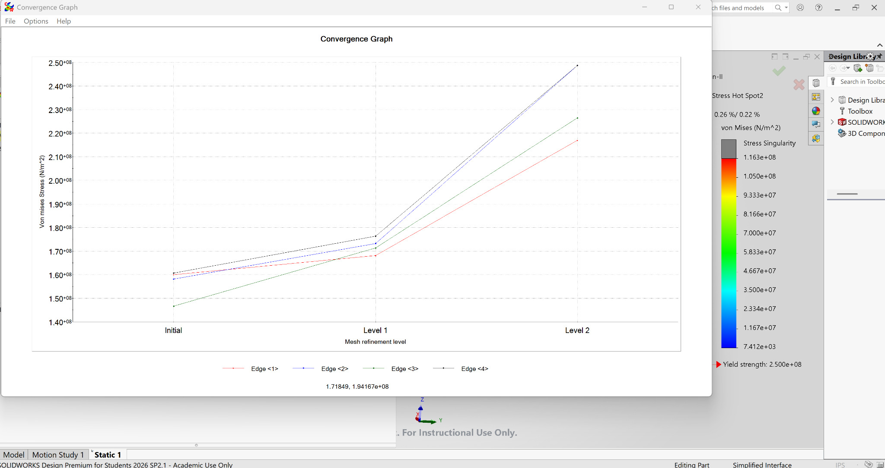

*Figure 6: Maximum von Mises stress along the four investigated edges as the mesh was refined.*

The convergence graph showed increasing maximum stresses rather than convergence toward stable values.

The largest increases occurred during the second refinement level, indicating that the sharp transitions at the critical junctions required further consideration.

### Design III - Addition of B-C Fillets

Design III introduced circular fillets at the three critical B-C transition edges.

The initial fillet radius was 0.125 in, controlled by a parametric variable.

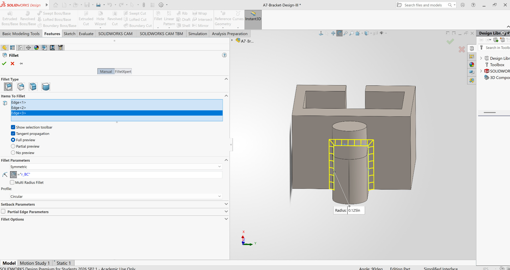

*Figure 7: Preview of the 0.125 in circular fillets applied to Edges 2, 3, and 4.*

The coarse-mesh results were:

- Maximum von Mises stress: 27.38 ksi.
- Maximum resultant displacement: 0.002698 in.
- Minimum factor of safety: approximately 1.32.

The medium-mesh results were:

- Maximum von Mises stress: 31.09 ksi.
- Maximum resultant displacement: 0.002736 in.
- Minimum factor of safety: approximately 1.17.

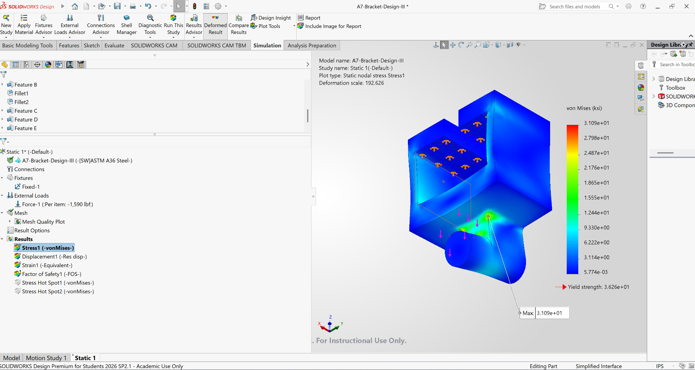

*Figure 8: Design III medium-mesh stress distribution following the addition of B-C fillets.*

Although the fillets reduced the abruptness of the geometry, the maximum stress increased with refinement.

Therefore, satisfactory stress convergence had not been demonstrated.

### Design IV - Increased B-C Fillet Radius

Design IV increased the radius of the previously introduced B-C fillets to provide smoother transitions and reduce local stress concentrations.

A high-quality medium mesh was generated using the blended curvature-based mesh method.

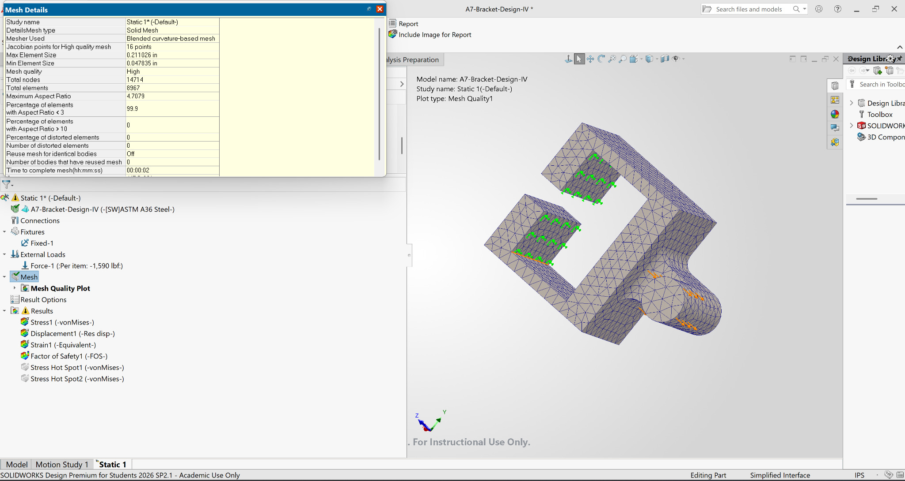

*Figure 9: Design IV generated medium mesh and mesh quality statistics.*

The medium-mesh analysis produced:

- Maximum von Mises stress: 20.15 ksi.
- Maximum resultant displacement: 0.002607 in.
- Minimum factor of safety: approximately 1.80.
- Total elements: 8,967.

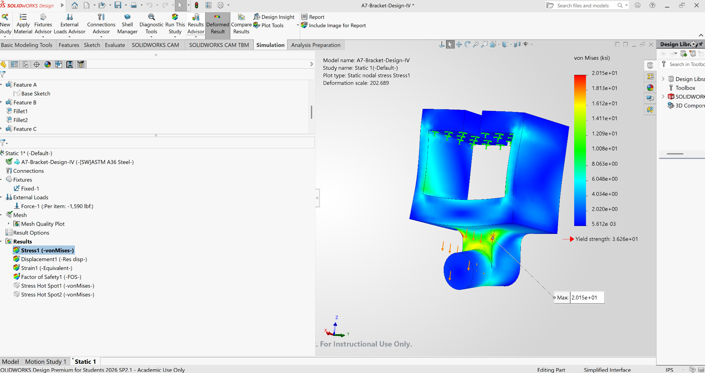

*Figure 10: Design IV maximum von Mises stress distribution after increasing the B-C fillet radius.*

This represented a meaningful improvement in the predicted maximum stress compared with Design III.

However, further investigation was necessary before confirming mesh convergence.

### Design V - Further B-C Fillet Optimization

Design V modified the B-C fillet geometry further.

The medium mesh contained 9,165 elements and used the same general meshing approach.

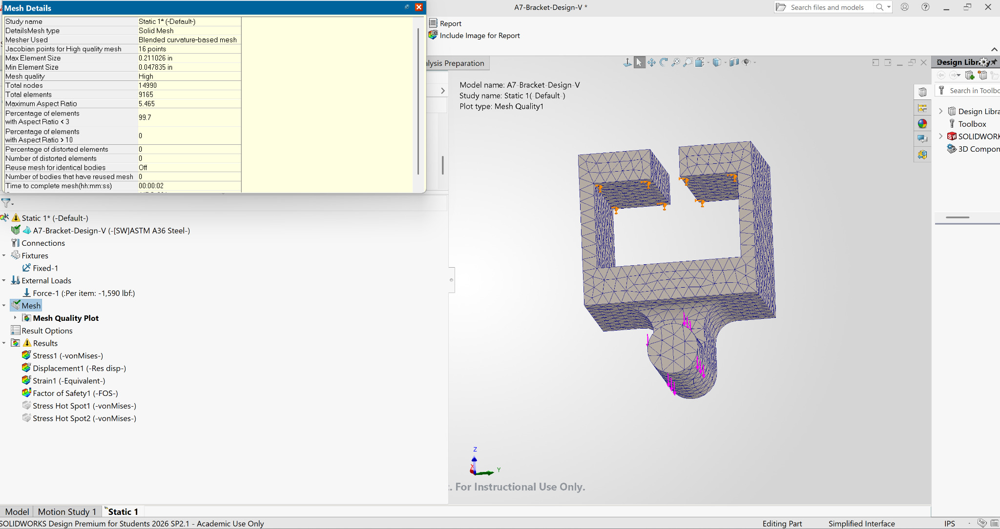

*Figure 11: Design V medium mesh and quality statistics.*

The medium-mesh simulation produced:

- Maximum von Mises stress: 23.46 ksi.
- Maximum resultant displacement: 0.002474 in.
- Minimum factor of safety: approximately 1.55.
- Total elements: 9,165.

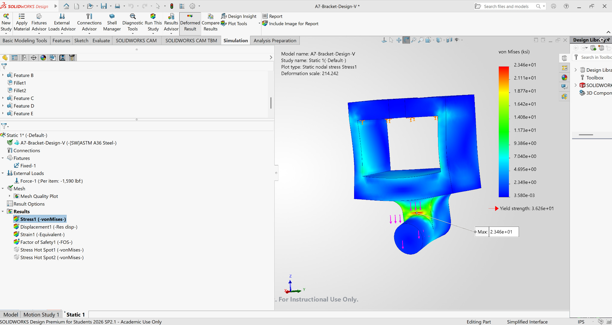

*Figure 12: Design V von Mises stress distribution.*

Although the maximum stress increased relative to Design IV, the maximum displacement decreased.

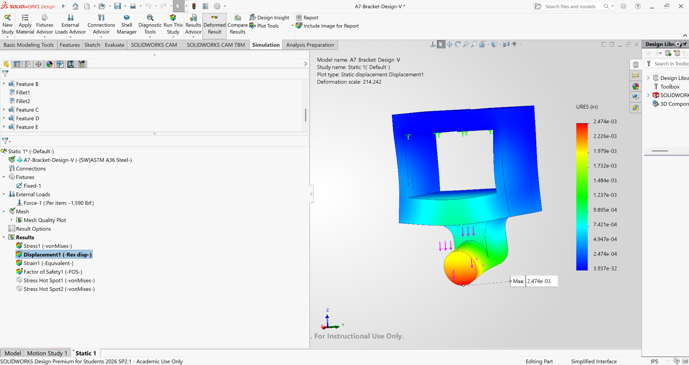

*Figure 13: Design V resultant displacement distribution with maximum displacement at the free cylindrical end of Feature A.*

More importantly, the location of maximum stress shifted from the B-C junction to the curved A-B junction.

This suggested that the B-C fillets had improved the original critical region sufficiently for another stress concentration to become dominant.

### Design VI - Additional A-B Fillet

Design VI introduced a 0.125 in fillet along the curved A-B transition to investigate whether additional geometric smoothing would reduce the newly dominant stress concentration.

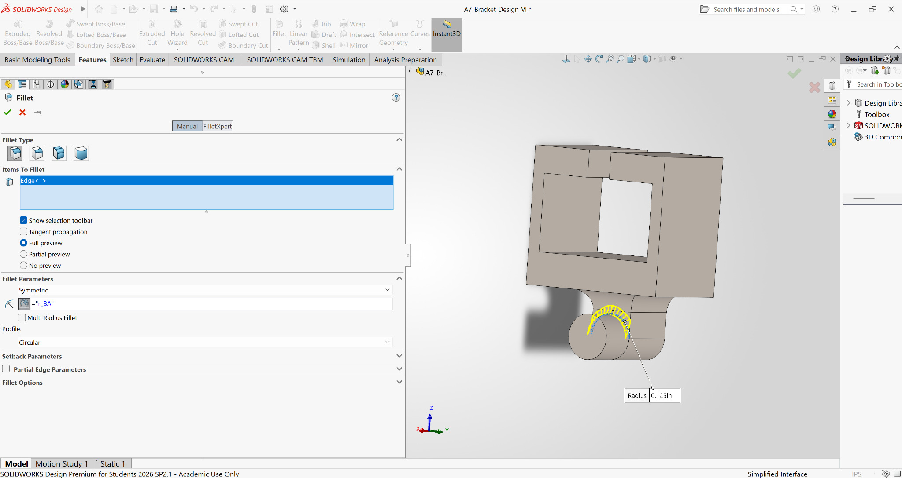

*Figure 14: Preview of the additional 0.125 in fillet along the curved A-B transition.*

The medium-mesh analysis produced:

- Maximum von Mises stress: 26.32 ksi.
- Maximum resultant displacement: 0.002502 in.
- Minimum factor of safety: approximately 1.38.
- Total elements: 10,106.

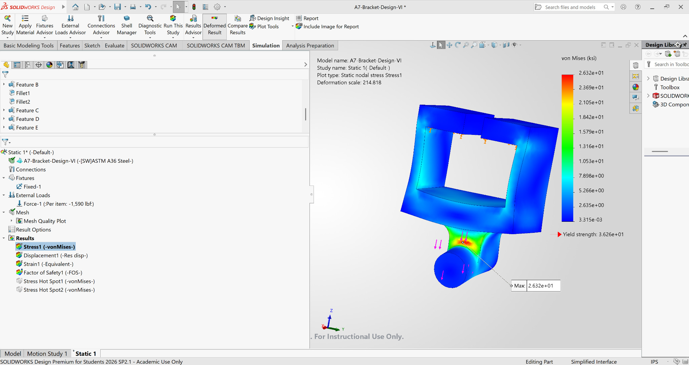

*Figure 15: Design VI von Mises stress distribution following the additional A-B fillet.*

The additional fillet increased the predicted maximum stress compared with Design V and did not significantly improve displacement.

This indicated that adding a fillet was not automatically beneficial and that the interaction between adjacent curved surfaces could create more complex stress distributions.

Design V was therefore retained as the basis for further localized convergence investigation.

## Comparison of Design Results

The table below summarizes the available simulation results. These values are mesh-dependent estimates and are not all based on fully converged meshes.

| Design | Mesh | Max Stress (ksi) | Max Displacement (in) | Min FOS | Elements |
|---|---|---:|---:|---:|---:|
| I | Coarse | 132.60 | 0.036400 | 0.27 | 1,346 |
| I | Medium | 149.40 | — | 0.24 | — |
| II | Fine | 28.41 | 0.002876 | 1.28 | — |
| III | Coarse | 27.38 | 0.002698 | 1.32 | 4,418 |
| III | Medium | 31.09 | 0.002736 | 1.17 | — |
| IV | Medium | 20.15 | 0.002607 | 1.80 | 8,967 |
| V | Medium | 23.46 | 0.002474 | 1.55 | 9,165 |
| VI | Medium | 26.32 | 0.002502 | 1.38 | 10,106 |

The maximum stress occurred primarily at the B-C transition in earlier configurations and shifted toward the A-B junction in the later designs.

The maximum resultant displacement generally occurred near the free cylindrical end of Feature A.

Design IV produced the lowest recorded global maximum stress among the medium-mesh configurations, while Design V produced the lowest recorded maximum displacement.

These comparisons are preliminary because the mesh convergence requirement has not been satisfied for every configuration.

Additionally, none of the recorded minimum safety factors met the original target value of 4.

## Localized Mesh Convergence Investigation

### Investigation Objective

Because Design V exhibited a persistent stress concentration along the curved A-B transition, a localized mesh refinement investigation was performed.

The purpose was to determine whether the calculated maximum stress approached a stable value as the elements around the critical junction were refined.

A local mesh control was applied to the critical transition edge and adjacent faces while maintaining the same material, applied loads, and restraints.

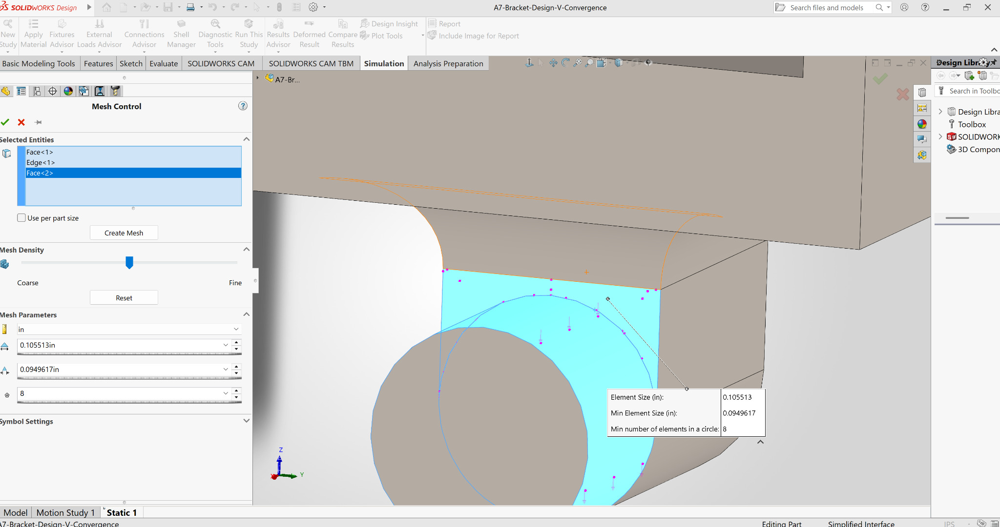

*Figure 16: Local mesh control applied to the A-B junction and adjacent geometry.*

### Refinement 1

The first local mesh refinement used a nominal local element size of 0.10 in.

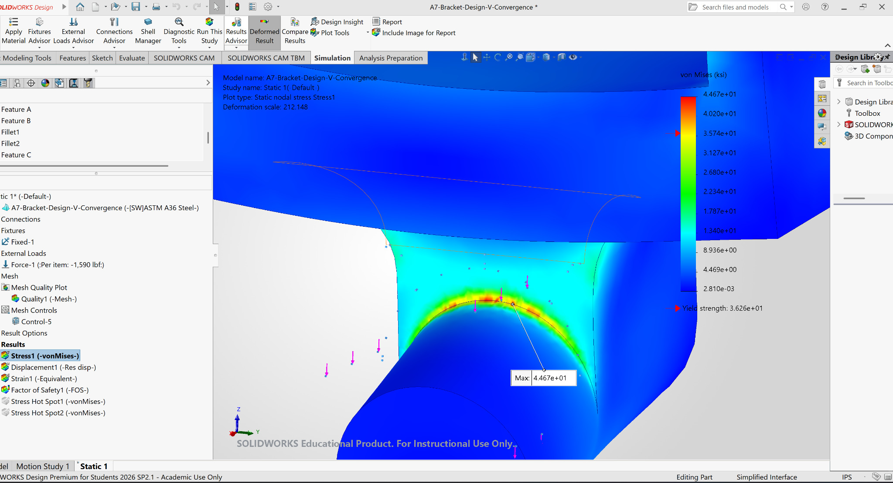

*Figure 17: Maximum nodal von Mises stress for local Refinement 1.*

The maximum nodal von Mises stress was 44.67 ksi, and the maximum resultant displacement was 0.002492 in.

The maximum stress exceeded the material yield strength, producing a calculated minimum factor of safety below unity.

### Refinement 2

The second refinement reduced the local mesh size to 0.07 in.

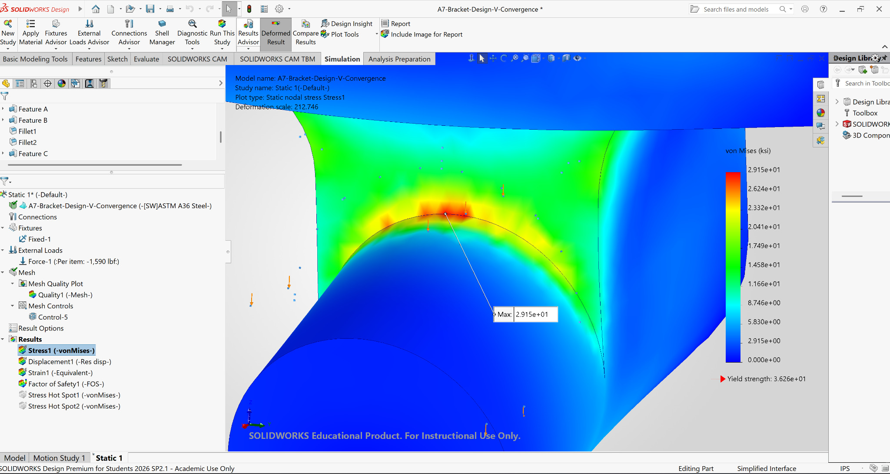

*Figure 18: Maximum nodal von Mises stress for local Refinement 2.*

The maximum nodal von Mises stress decreased to 29.15 ksi, while the maximum resultant displacement was 0.002486 in.

Although this result was more favorable, the substantial change in maximum stress prevented a conclusion of convergence.

### Refinement 3

The third refinement further reduced the local mesh size to 0.05 in.

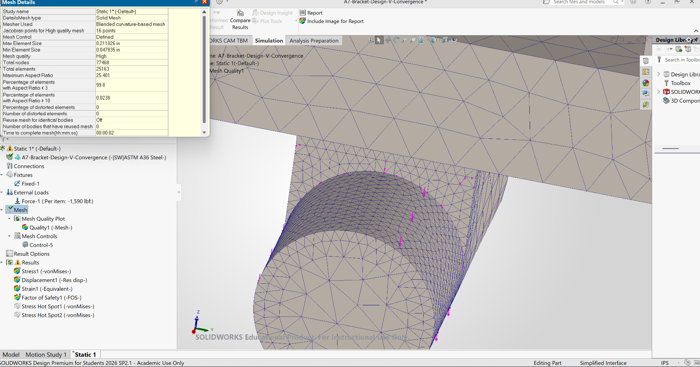

*Figure 19: Locally refined mesh at the curved A-B transition for Refinement 3.*

The resulting maximum nodal von Mises stress increased again to 35.13 ksi.

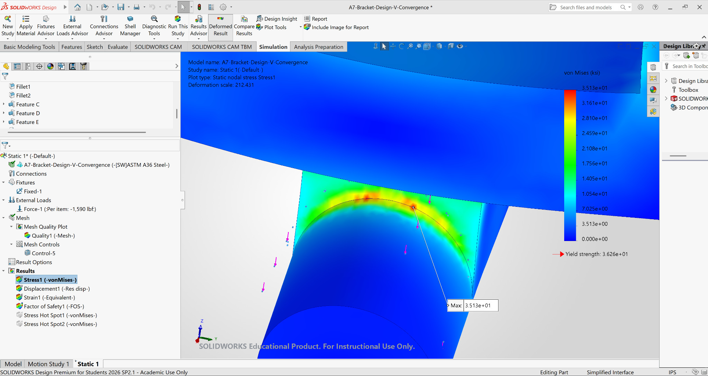

*Figure 20: Maximum nodal von Mises stress for local Refinement 3.*

The maximum resultant displacement was 0.002489 in.

The increase in maximum stress demonstrated that the local peak stresses remained sensitive to mesh refinement.

### Refinement Comparison

| Refinement | Local Element Size (in) | Max Nodal Stress (ksi) | Max Displacement (in) |
|---|---:|---:|---:|
| 1 | 0.10 | 44.67 | 0.002492 |
| 2 | 0.07 | 29.15 | 0.002486 |
| 3 | 0.05 | 35.13 | 0.002489 |

The localized maximum stress did not change monotonically with mesh refinement.

In contrast, maximum resultant displacement varied very little between the three refinements.

This demonstrated that global displacement predictions were considerably less sensitive to local mesh refinement than peak stress predictions.

### Element Stress and Energy Norm Error

Additional result plots were generated for Refinement 3 to investigate the source of the numerical uncertainty.

The first plot displayed unaveraged element von Mises stress.

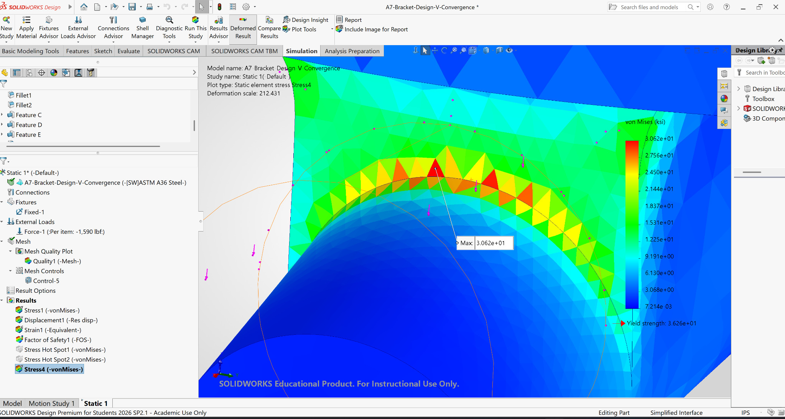

*Figure 21: Refinement 3 element von Mises stress distribution, showing a maximum of 30.62 ksi.*

The maximum element von Mises stress was 30.62 ksi, compared with the maximum nodal von Mises stress of 35.13 ksi.

The difference demonstrated that stress-recovery and averaging methods influenced the reported maximum.

An element energy norm error plot was also generated.

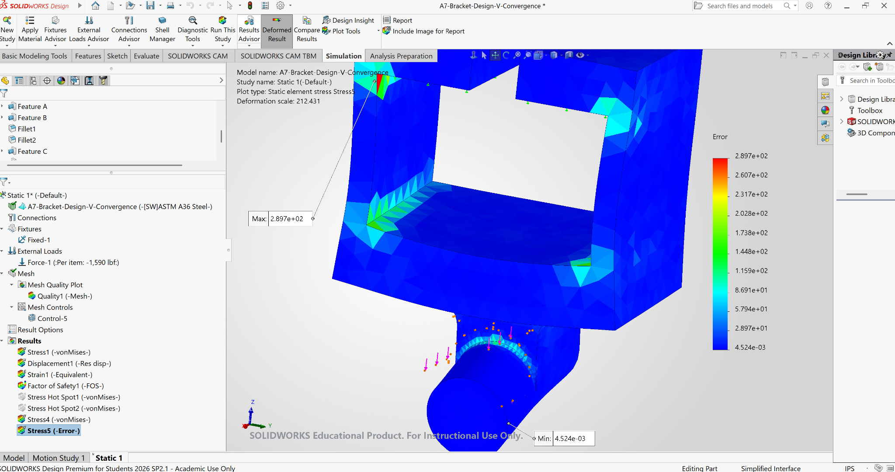

*Figure 22: Refinement 3 element energy norm error distribution highlighting areas of elevated estimated numerical error.*

The energy norm error plot displayed elevated estimated errors near the A-B junction and at several regions of the upper attachment geometry.

The maximum displayed error estimator was approximately 289.7 in the plot's reported scale. This value should not be interpreted as a percentage error in von Mises stress.

The plot indicated that numerical uncertainty remained in multiple locations throughout the bracket.

### Convergence Assessment

The localized maximum von Mises stresses did not meet the required 7% convergence criterion.

The maximum displacement, however, remained approximately 0.00249 in throughout the localized refinement study.

The investigation therefore demonstrated that the model's global displacement response was comparatively stable, while local maximum stress predictions remained uncertain.

Further refinement, stress probing at consistent physical locations, and examination of boundary-condition effects would be necessary to establish a reliable mesh-independent stress estimate.

## Mistakes, Difficulties, and Design Decisions

Several difficulties were encountered during the investigation.

**1. Initial analytical assumptions:** The original analytical approach simplified the structural loading and did not sufficiently account for bending effects in the connecting features. This contributed to the need for substantial design revisions.

**2. Nonconvergent peak stresses:** Mesh refinement repeatedly altered the maximum von Mises stress, demonstrating that a visually smooth stress plot is not sufficient evidence of convergence.

**3. Fillet effectiveness:** Introducing fillets at the B-C junction improved some results, but increasing a fillet radius did not always decrease maximum stress.

**4. Stress relocation:** Reducing stress concentrations in one region caused another junction to become critical. This demonstrated the importance of evaluating the entire load path rather than focusing on only one location.

**5. Local refinement difficulties:** Refinements at the A-B junction produced fluctuating maximum stress values. The energy norm error plot also indicated numerical uncertainty in regions outside the locally refined area.

**6. Simulation limitations:** The fixed-support approximation and distributed cylindrical force do not reproduce every detail of real contact behavior. Mesh convergence alone cannot validate these physical assumptions.

## Lessons Learned

This assignment provided practical experience with finite element modeling, parametric geometry modification, and the interpretation of numerical simulation results.

One important lesson was the distinction between satisfying a numerical stress limit on a particular mesh and demonstrating a reliable, converged solution.

I also learned that geometric changes must be evaluated using the complete stress distribution, displacement, and factor of safety rather than assuming that a larger fillet will necessarily improve the design.

The localized mesh investigation reinforced the difference between global structural response and local stress concentrations.

Although displacement predictions remained relatively stable, the maximum stresses continued to fluctuate.

Finally, the project emphasized the importance of preserving previous design iterations and documenting unsuccessful approaches. Even when an attempted improvement failed, its results provided useful information for subsequent design decisions.

## Current Status and Future Work

As of October 29, 2026, the bracket has undergone six design iterations, multiple global mesh studies, stress singularity investigations, and three localized refinement tests.

The bracket optimization and stress convergence verification are not yet complete.

The remaining work includes:

1. Comparing stresses at consistent physical locations away from the critical A-B edge.
2. Investigating the influence of mesh quality and attachment boundary conditions.
3. Determining whether additional structural geometry changes are necessary.
4. Completing a final verified design comparison and documenting the selected configuration.

This page records the investigation and results completed to date and will be updated if additional analysis is performed.

## Assignment Time

Time spent: **26 hours**

## CAD File Downloads

[Download Design V SOLIDWORKS Part](files/A7-Bracket-Design-V.SLDPRT)

Design V is retained as the primary reference for the ongoing convergence investigation. The previous iterations and supplementary simulation results are documented above.

## References

- SOLIDWORKS Simulation, Dassault Systèmes.
- MEGR 2156 Assignment A7 instructions and appendices.
- ASTM A36 structural steel material properties from the SOLIDWORKS material library.
- The Efficient Engineer, "Understanding the Finite Element Method."
