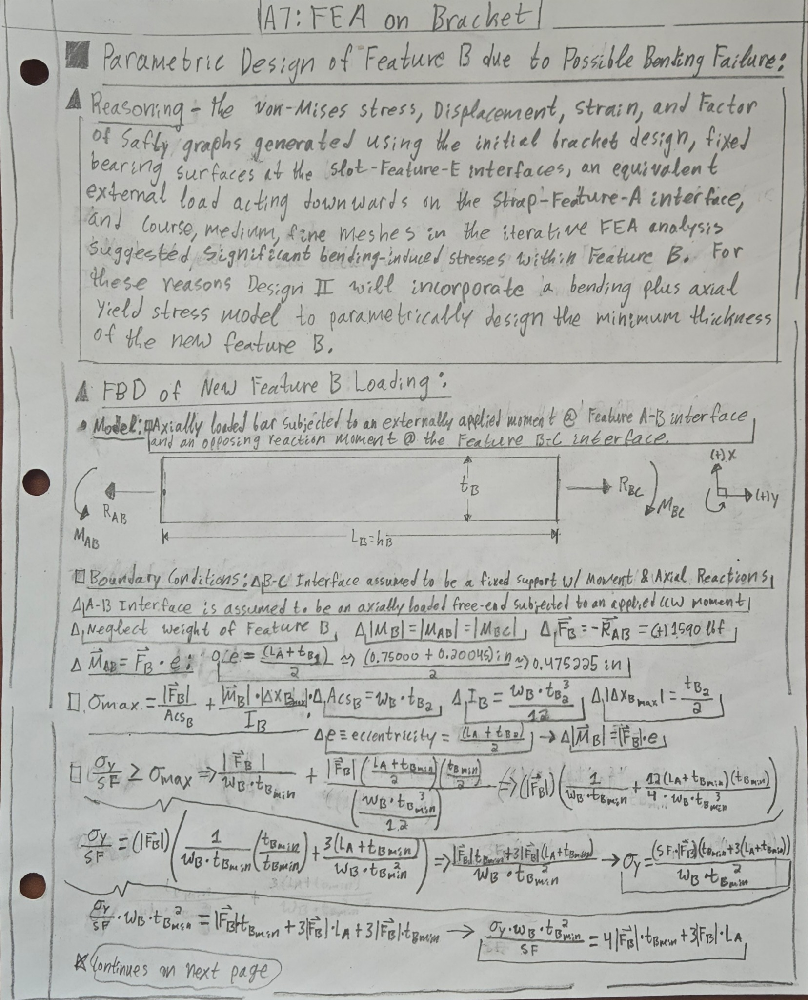
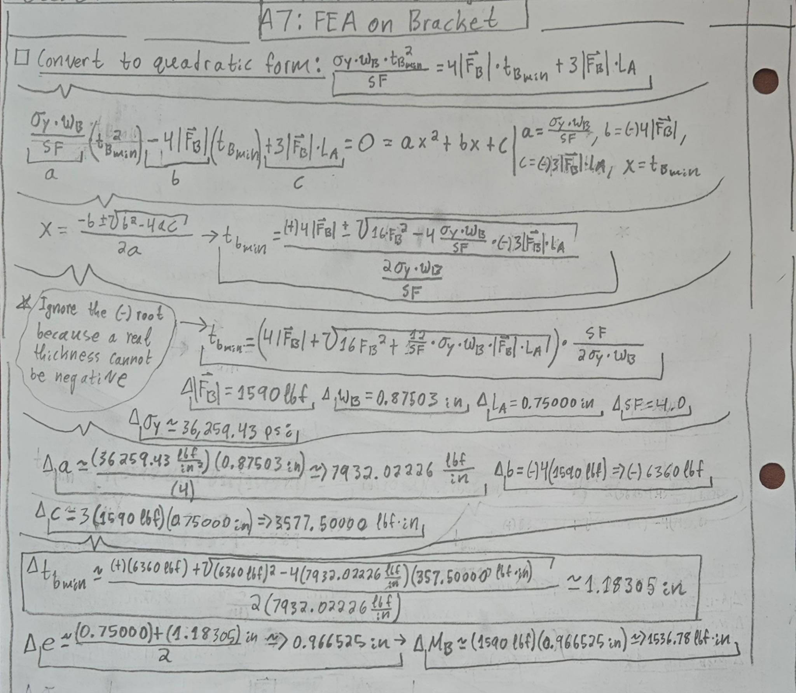

# A7 - Finite Element Analysis and Optimization of a Bracket

## Objective

The objective of Assignment A7 is to use SOLIDWORKS Simulation to evaluate and improve the bracket developed in Assignments A5 and A6. The investigation focuses on maximum von Mises stress, resultant displacement, factor of safety, mesh convergence, and stress concentrations. The bracket material remains ASTM A36 steel.

This page documents the initial model, an analytical redesign of Feature B, six CAD iterations, and the localized convergence investigation completed so far.

## Design Requirements

- **Material:** ASTM A36 steel.
- **Applied load:** 795 lbf from each strap leg, or **1,590 lbf total**.
- **Yield strength:** approximately **36,259.43 psi (36.259 ksi)**.
- **Required factor of safety:** **4.0**, giving a target allowable stress of approximately **9.065 ksi**.
- **A5 deflection criterion:** **0.005 in per analyzed feature**. Overall bracket resultant displacement is reported as a comparison metric, not automatically equivalent to each feature's deflection requirement.
- **Convergence criterion:** a change of no more than **7%** between successive mesh refinements; otherwise, document the lack of convergence.
- **Material constraint:** retain the specified steel while investigating geometric improvements.

## CAD Model and Simulation Setup

The existing A6 parametric bracket was brought into SOLIDWORKS Simulation. The structural model consists of Features A through E and the associated fillets.

The two underside bearing surfaces of **Feature E** were treated as fixed supports, approximating contact with a rigid T-beam. A **1,590 lbf downward directional load** was applied to the curved cylindrical surface of **Feature A** to approximate the combined strap forces.

These are simplified boundary conditions: real bearing contact may permit separation or sliding, and the strap force may not be uniformly distributed across the selected cylindrical face. The same load and support assumptions were maintained for comparisons between geometry iterations.

## Design I - Initial Bracket Evaluation

The initial A6 geometry was analyzed using a high-quality solid mesh.

The coarse mesh produced a maximum von Mises stress of approximately **132.60 ksi**, a maximum resultant displacement of **0.036400 in**, and an estimated minimum factor of safety of **0.27**. Its mesh contained **1,346 elements**.

The medium-mesh maximum stress increased to **149.40 ksi**.

The peak stress was concentrated near the narrow connection between the central bracket and cylindrical strap support, indicating that the earlier axial-only treatment of Feature B omitted important bending effects.

The increase from 132.60 to 149.40 ksi exceeded the 7% convergence criterion.

These elastic stress predictions also exceed the steel's yield strength; they should be understood as warnings about the design and model, not as physically valid post-yield material behavior.

## Analytical Redesign - Feature B Thickness

Before proceeding with additional CAD changes, I revisited the analytical model for **Feature B**.

In Assignment A5, Feature B had been primarily analyzed as an axially loaded connection. The FEA results suggested that the eccentric loading from Feature A also induces a significant bending moment.

I therefore represented Feature B as a rectangular-section member carrying both an axial load and bending moment.

The calculation assumes a fixed connection at the B–C interface, a resultant axial force of **1,590 lbf**, and an eccentricity based on the Feature A length and the unknown Feature B thickness.

The resulting simplified maximum normal-stress relationship was:

**Combined stress:**

σmax = FB/(wBtB) + 6MB/(wBtB2)

where:

MB = FB(LA + tB)/2

Setting this equal to the allowable yield stress, σy/SF, yields the quadratic relationship:

**Thickness equation:**

(σywB/SF)tB,min2 − 4FBtB,min − 3FBLA = 0

Using:

- **FB = 1,590 lbf**
- **wB = 0.87503 in**
- **LA = 0.75000 in**
- **SF = 4.0**
- **σy = 36,259.43 psi**

The positive quadratic solution is:

**tB,min ≈ 1.18305 in.**

The estimated eccentricity at that thickness is **0.966525 in**, corresponding to an applied bending moment of approximately **1,536.78 lbf·in**.

This is a preliminary analytical sizing estimate based on an idealized member and loading model, not proof that the complete bracket meets the FEA requirements.

It illustrates why bending can demand a considerably thicker connection than an axial-only calculation.

## Design II - Parametric Geometry Revision

Design II introduced the revised parametric geometry and was evaluated under the same loading and fixture assumptions.

Its recorded results were:

- Maximum von Mises stress: **28.41 ksi**
- Maximum resultant displacement: **0.002876 in**
- Minimum yield-based factor of safety: **1.28**
- Recorded mass: **2.66 lb**

Although the result was much better than Design I, the stress still exceeded the target allowable stress of 9.065 ksi.

## Stress Hot Spot and Singularity Investigation

Because the highest stresses occurred at abrupt transitions, I used the SOLIDWORKS **Stress Hot Spot** and **Stress Singularity** diagnostic tools.

The investigation identified four leading edges:

- **Edge 1:** Curved A–B transition.
- **Edge 2:** Front B–C transition.
- **Edge 3:** Left B–C transition.
- **Edge 4:** Right B–C transition.

The highest stress concentrations appeared near the corners where Edges 2/3 and 2/4 met.

The diagnostic convergence curves did not level off consistently with increasing mesh refinement.

The results motivated a controlled series of fillet modifications; the diagnostic by itself did not establish a reliable converged peak stress.

## Design III - Initial B–C Junction Fillets

Design III added **0.125 in-radius fillets** along the three identified B–C transition edges.

The preview showed a smoother junction between the bracket and its central support.

The coarse mesh produced:

- Maximum stress: **27.38 ksi**
- Maximum displacement: **0.002698 in**
- Elements: **4,418**

The medium mesh produced:

- Maximum stress: **31.09 ksi**
- Maximum displacement: **0.002736 in**
- Minimum factor of safety: approximately **1.17**

The increase in stress with refinement showed that the design had not demonstrated convergence.

## Design IV - Increased B–C Fillet Radius

Design IV increased the B–C fillet radius to smooth the junction further.

The high-quality medium mesh contained **8,967 elements** and no reported distorted elements.

Results:

- Maximum von Mises stress: **20.15 ksi**
- Maximum displacement: **0.002607 in**
- Minimum factor of safety: **1.80**

This was an improvement in the recorded medium-mesh stress compared with Design III, but the target safety factor was still not met and a mesh-convergence demonstration remained necessary.

## Design V - Stress Redistribution to the A–B Junction

Design V was another B–C junction refinement.

The high-quality medium mesh had **9,165 elements**, with:

- Maximum stress: **23.46 ksi**
- Maximum displacement: **0.002474 in**
- Minimum factor of safety: **1.55**

Although the peak stress rose compared with Design IV, the dominant hot spot shifted to the curved **A–B junction (Edge 1)**.

This indicated that reducing the B–C stress concentration altered which location controlled the maximum reported stress.

## Design VI - Trial Fillet at the A–B Junction

To investigate the newly governing A–B region, Design VI added a local fillet along Edge 1.

The mesh contained **10,106 elements** and no reported distorted elements.

Under the same load:

- Maximum stress: **26.32 ksi**
- Maximum displacement: **0.002502 in**
- Minimum factor of safety: **1.38**

The additional fillet therefore did not improve the reported maximum stress.

I returned to Design V for a more controlled local-mesh investigation rather than assuming that additional filleting would help.

## Simulation Results Comparison

| Design / mesh | Max stress (ksi) | Max displacement (in) | Min. FOS | Elements |
|---|---:|---:|---:|---:|
| I — Coarse | 132.60 | 0.036400 | 0.27 | 1,346 |
| I — Medium | 149.40 | Not recorded | 0.24 | Not recorded |
| II — Refined | 28.41 | 0.002876 | 1.28 | Not recorded |
| III — Coarse | 27.38 | 0.002698 | 1.32 | 4,418 |
| III — Medium | 31.09 | 0.002736 | 1.17 | Not recorded |
| IV — Medium | 20.15 | 0.002607 | 1.80 | 8,967 |
| V — Medium | 23.46 | 0.002474 | 1.55 | 9,165 |
| VI — Medium | 26.32 | 0.002502 | 1.38 | 10,106 |

The values are rounded from SOLIDWORKS result plots and should not be interpreted as converged design certifications.

The mass **2.66 lb** was recorded for Design II; comparable mass values for the other iterations have not yet been recorded.

The largest displacement generally occurs near the free end of Feature A; the controlling stress location changes between the B–C and A–B junctions.

## Localized Mesh Convergence Investigation - Design V

I returned to a saved copy of Design V and established a **local mesh control** near the A–B junction, selecting its curved transition edge and adjacent faces.

Global geometry, material, fixture locations, and applied load were unchanged.

I then progressively decreased the local element size to examine the sensitivity of the stress concentration without uniformly refining the entire part.

The three local control sizes were **0.10 in**, **0.07 in**, and **0.05 in**, each using a mesh-control growth ratio of **1.4**.

The corresponding nodal peak-stress values did not change monotonically:

| Local refinement | Mesh size (in) | Elements | Max nodal stress (ksi) | Max displacement (in) |
|---|---:|---:|---:|---:|
| 1 | 0.10 | 16,042 | 44.67 | 0.002492 |
| 2 | 0.07 | 16,519 | 29.15 | 0.002486 |
| 3 | 0.05 | 25,163 | 35.13 | 0.002489 |

The maximum displacement stabilized near **0.00249 in**, but the peak nodal stress varied substantially between refinements.

Thus, displacement stability must not be mistaken for stress convergence.

I also created plots of **element von Mises stress** and **element energy norm error** for Refinement 3.

The maximum element stress was **30.62 ksi**, different from the maximum nodal stress of **35.13 ksi**.

The energy-norm-error plot highlighted areas needing additional attention, including regions outside the immediate A–B junction.

Neither plot established satisfactory peak-stress convergence.

**Convergence status:** The stress results remain unverified against the 7% criterion.

No iteration should be described as converged solely because its numerical peak happens to be lower, or because three refinements have been attempted.

Further modeling and/or local geometry changes may be necessary.

## Problems Encountered and Engineering Lessons

1. **A simpler analytical model can miss a major load effect.**

   The initial axial-only assumption for Feature B underestimated the importance of eccentric bending. The handwritten combined axial-and-bending analysis provides a more appropriate preliminary sizing model, although it remains idealized.

2. **Mesh quality and mesh convergence are different.**

   Several meshes contained no distorted elements, yet their peak stresses remained sensitive to refinement.

3. **Lower stress in one run does not prove a design improvement.**

   Fillets reduced some local stress concentrations, but changing geometry could relocate the critical hot spot or increase the maximum stress elsewhere.

4. **Local stress singularities complicate use of a global peak.**

   Nodal and element stresses must be interpreted with attention to mesh density, result averaging, local geometry, and the diagnostic plots.

5. **Boundary conditions matter.**

   Fixed bearing faces and a distributed directional strap force are useful simplifications, but convergence alone would not validate those representations of physical contact and loading.

## Current Status and Next Steps

At the time of this portfolio update, six design iterations and three localized mesh refinements have been investigated.

Design IV has the lowest recorded medium-mesh maximum stress of the iterations shown, while Design V provides the baseline for the localized convergence study.

None of the reported designs has yet demonstrated both the specified **factor of safety of 4.0** and the required **7% stress convergence**.

The project is therefore **in progress**, and these results are submitted as an account of the completed investigation rather than as a validated final bracket.

Remaining work includes reviewing the load-path and contact assumptions, improving the stress-convergence approach, reassessing critical geometric dimensions, collecting final mass properties for comparison, and updating this page once a satisfactory design is established.

**Time spent on A7 to date:** [26 hours]

## CAD Download

[Download SOLIDWORKS Design V part](files/A7-Bracket-Design-V.SLDPRT)

*This link requires the named .SLDPRT file to be uploaded to the corresponding GitHub files/ folder. The file is not included in the screenshot ZIP.*

## References

- MEGR 2156 Assignment A7 instructions, grading requirements, and appendices.
- SOLIDWORKS Simulation: stress, displacement, factor of safety, stress hot spot/singularity diagnostics, and mesh controls.
- The Efficient Engineer, *Understanding the Finite Element Method* (assignment-linked reference): https://www.youtube.com/watch?v=GHjopp47vvQ
