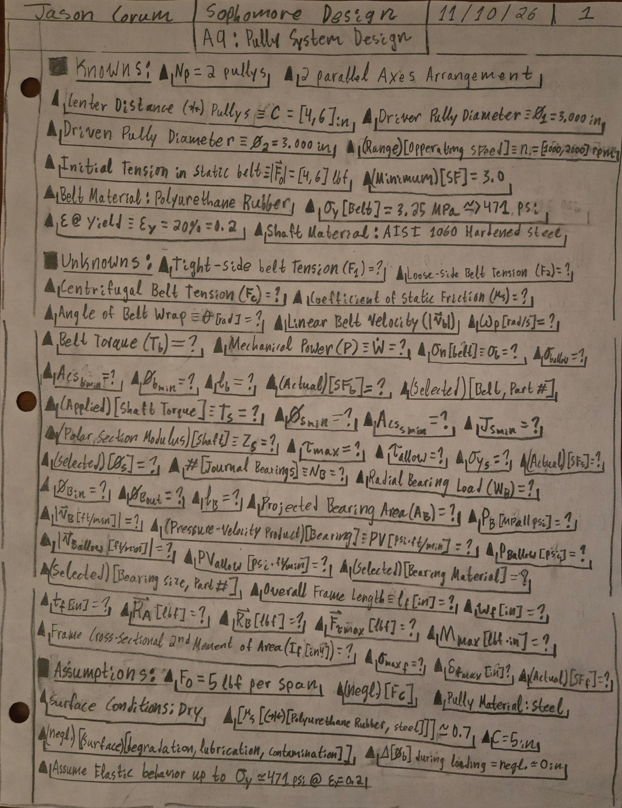
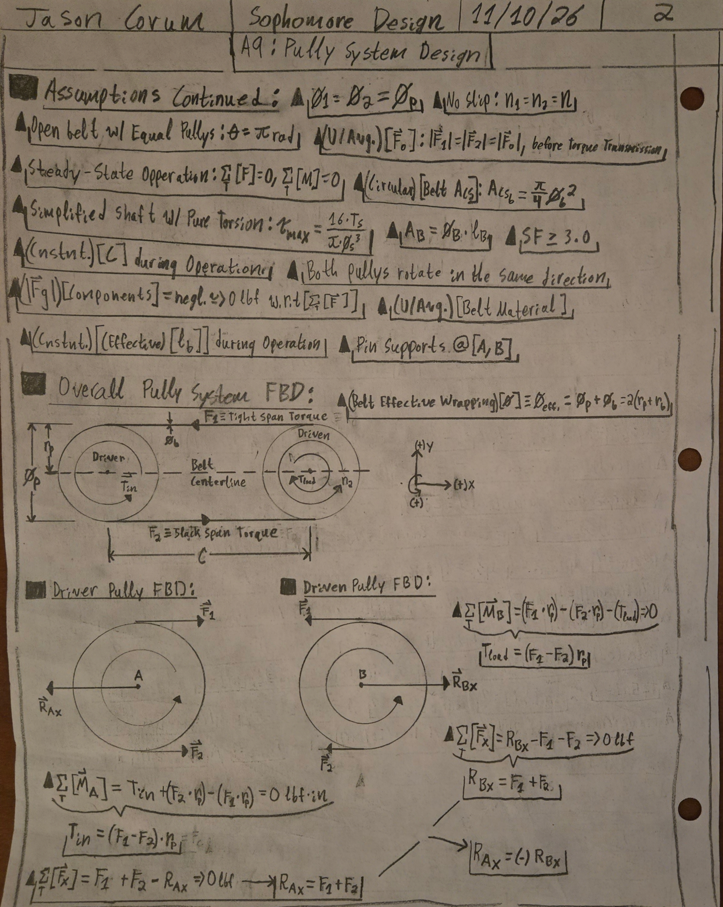
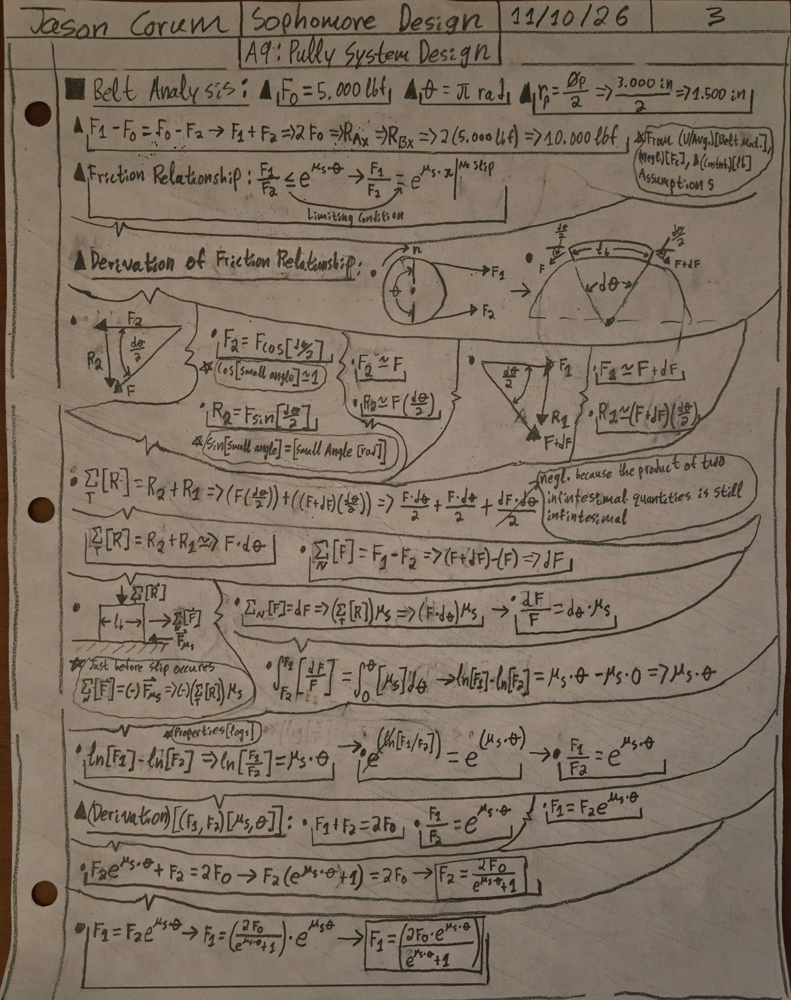
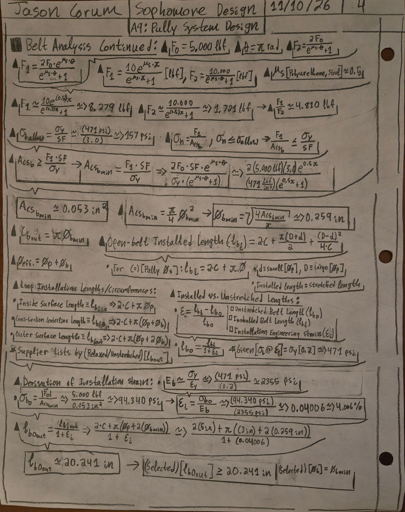
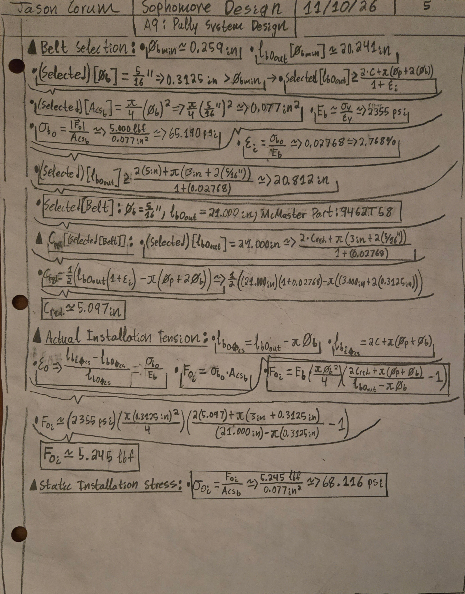
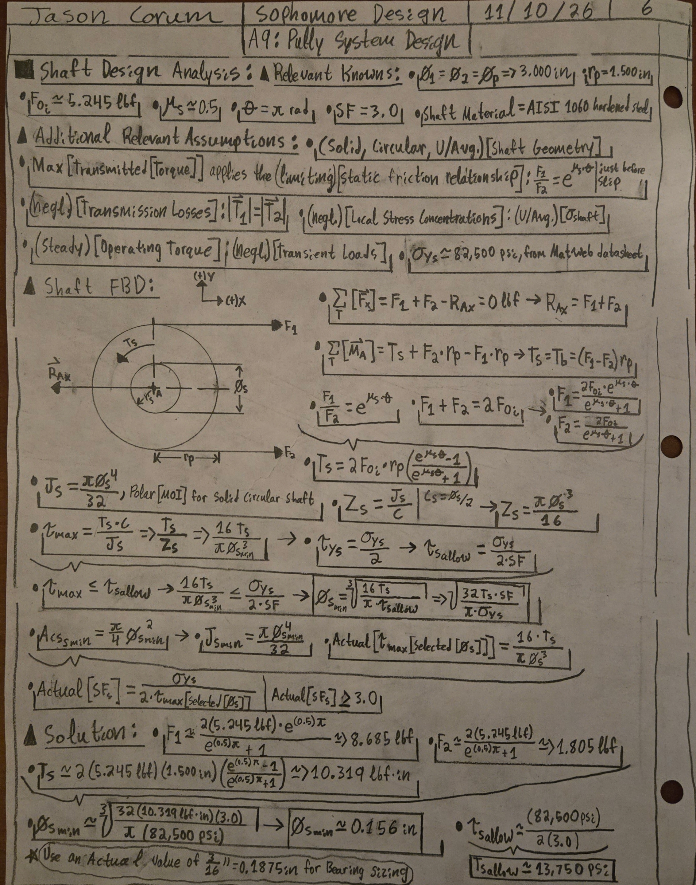
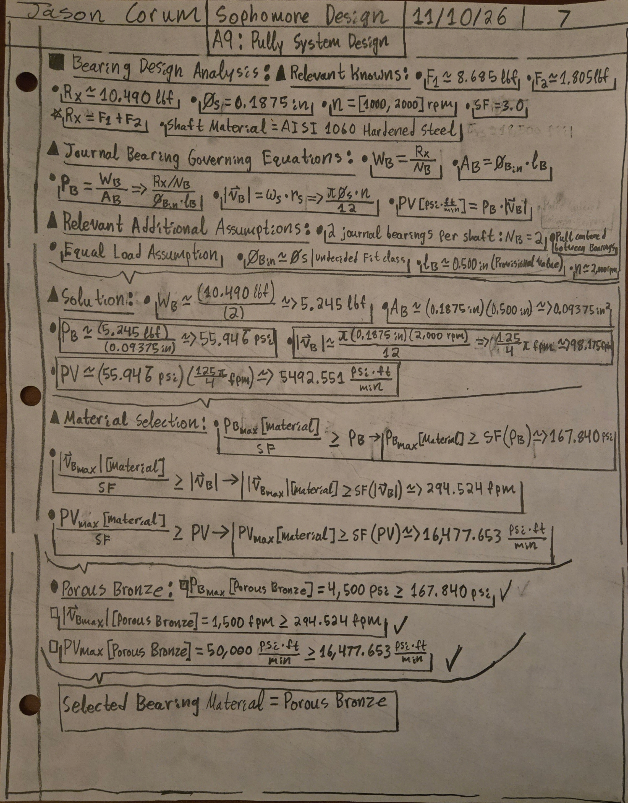
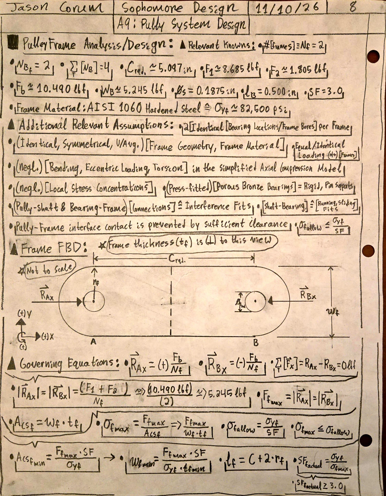
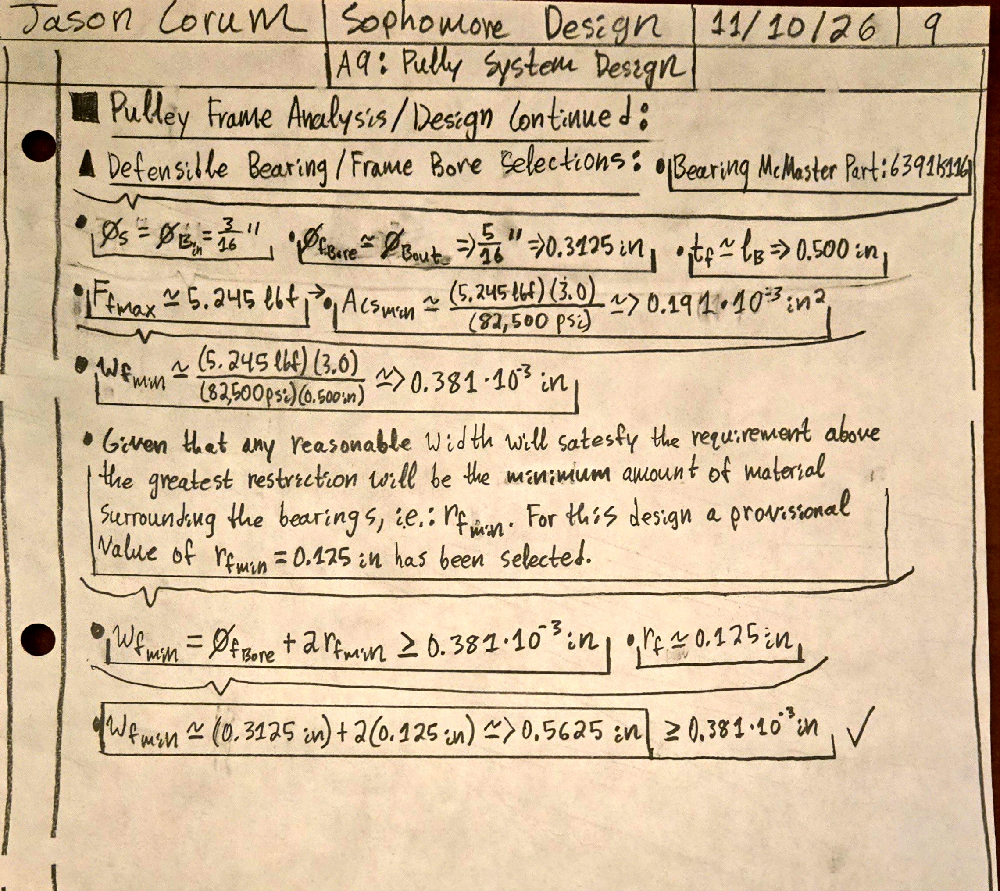

# A9: Pulley System Design

**Course:** MEGR 2156 — Sophomore Design  
**Assignment:** A9 — Pulley System Design  
**Student:** Jason Corum  
**Documentation:** Hand calculations, free-body diagrams, material selection, and preliminary mechanical design  
**Status:** Analytical concept and preliminary frame dimensions documented; detailed manufacturing drawings and full assembly CAD were not completed.

---

## 1. Introduction and Design Objective

The objective of A9 is to design a friction-belt power-transmission system using two parallel-axis pulleys. The work includes belt tension and strength, belt selection and installed length, shaft torsional strength, journal bearing selection, and structural frame sizing.

The design was developed parametrically by first identifying the required inputs and unknowns, then deriving governing equations and completing calculations by hand. The attached scans preserve the original calculations, assumptions, sketches, and nomenclature. Numerical values are rounded to match those handwritten pages.

### 1.1 Assignment Requirements and Initial Givens

| Parameter | Value |
| --- | --- |
| Pulley count, Np | 2 |
| Shaft/pulley arrangement | Two parallel axes; open belt |
| Driver diameter, Ø1 | 3.000 in |
| Driven diameter, Ø2 | 3.000 in |
| Permitted center distance, C | 4–6 in |
| Operating speed, n | 1,000–2,000 rpm |
| Initial belt tension permitted | 4–6 lbf per span |
| Belt material | Polyurethane rubber |
| Assignment belt yield-stress reference, σY,b | Approximately 471 psi |
| Corresponding engineering strain, εY | 0.200 |
| Shaft material | AISI 1060 hardened steel |
| Required minimum safety factor, SF | 3.0 |

### 1.2 Selected Working Assumptions

- Initial nominal belt tension: **F0 = 5.000 lbf per span**.
- Static belt–pulley friction coefficient: **μs = 0.50**, selected provisionally for dry polyurethane against steel.
- Both pulleys have the same nominal diameter and rotate at the same speed in the no-slip model.
- For equal pulleys in an open-belt configuration, the wrap angle is **θ = π rad**.
- Belt material is treated as uniform. A provisional linear secant approximation is derived from the provided stress–strain point.
- Centrifugal belt tension, surface contamination, material degradation, and transient loads are neglected in the preliminary model.
- The shafts are modeled as solid circular members carrying steady torsion; stress concentrations and shaft bending are excluded from the simplified shaft-strength calculation.
- The two-frame, four-bearing configuration is symmetric, so a single representative shaft and frame may be analyzed.

*Figure 1. Page 1 — Initial knowns, finds, selected parameters, and assumptions.*

*Figure 2. Page 2 — Supplemental assumptions, complete belt-drive FBD, and driver/driven pulley equilibrium.*

---

## 2. Belt Force and Friction Analysis

The initial belt tension is equal in both spans before torque transmission. When torque is transmitted, one span becomes the tight side (F1) while the other becomes the loose side (F2).

### 2.1 Force Equilibrium

<strong>F1 + F2 = 2F0</strong>

For the original 5.000 lbf static pretension:

<strong>F1 + F2 = 10.000 lbf</strong>

### 2.2 Limiting Static-Friction Relationship

At the onset of slipping, the belt-friction relationship is:

<strong>F1 / F2 = eμsθ</strong>

Combining this with the span-force sum gives:

<strong>F1 = [2F0eμsθ] / [eμsθ + 1]</strong>

<strong>F2 = 2F0 / [eμsθ + 1]</strong>

With **F0 = 5.000 lbf**, **μs = 0.50**, and **θ = π rad**, the handwritten calculation gives:

| Quantity | Calculated value |
| --- | ---: |
| Tight-side tension, F1 | 8.279 lbf |
| Loose-side tension, F2 | 1.721 lbf |
| Limiting tension ratio, F1/F2 | 4.810 |

The limiting-friction equation was derived from a small differential belt element. The free-body derivation and integration are retained in the original notes.

*Figure 3. Page 3 — Belt element FBDs, force components, equilibrium, integration, and belt-tension formulas.*

---

## 3. Belt Cross-Section and Strength

The minimum belt area was selected from allowable axial tension in the tight span. The required safety factor was applied to the assignment's belt yield-stress reference.

### 3.1 Allowable Belt Stress

<strong>σallow,b = σY,b / SF = 471 / 3 = 157 psi</strong>

### 3.2 Minimum Area and Diameter

<strong>Acs,b,min = F1SF / σY,b</strong>

<strong>Acs,b,min ≈ 0.053 in2</strong>

For a solid round belt:

<strong>Acs,b = πØb2 / 4</strong>

<strong>Øb,min = √(4Acs,b,min/π) ≈ 0.259 in</strong>

The 0.259 in value is the diameter of the **belt's circular cross section**, not the diameter of the entire O-ring.

### 3.3 Installed Belt Length

For a general open-belt drive, the approximate path-length equation from the handbook is:

<strong>L = 2C + (π/2)(D + d) + (D − d)2/(4C)</strong>

For equal pulleys, this simplifies to:

<strong>L = 2C + πD</strong>

Because the belt has a finite round cross section, the nominal installed belt centerline and outer-surface lengths for the idealized ungrooved-pulley geometry are:

<strong>lb,i,cs = 2C + π(Øp + Øb)</strong>

<strong>lb,i,out = 2C + π(Øp + 2Øb)</strong>

The supplier's listed **unstretched outer circumference** is not the same as either installed length; a shortening/strain correction is needed.

*Figure 4. Page 4 — Belt strength sizing, geometry of installed belt paths, and initial strain calculations.*

---

## 4. Commercial Belt Selection and Installation Tension

### 4.1 Material Stiffness Assumption

The assignment provides an approximate yield stress of 471 psi at engineering strain 0.200. With no complete supplier stress–strain curve, the design uses the straight-line **secant approximation**:

<strong>Eb ≈ σY,b/εY = 471/0.200 = 2,355 psi</strong>

This is a provisional engineering approximation, not a verified elastic modulus for the specific commercial belt.

### 4.2 Selected Belt

**Selected product:** [McMaster-Carr 9462T58](https://www.mcmaster.com/9462T58/), a polyurethane round belt specified at the required circumference.

| Selected parameter | Value |
| --- | ---: |
| Belt cross-sectional diameter, Øb | 5/16 in = 0.3125 in |
| Belt cross-sectional area, Acs,b | Approximately 0.077 in² |
| Unstretched outer circumference, lb0,out | 21.000 in |
| Estimated installation strain, εi | 0.02768 = 2.768% |
| Selected/calculated center distance, Crad | Approximately 5.097 in |
| Predicted actual installed pretension, F0i | Approximately 5.245 lbf per span |
| Predicted static installation stress, σ0i | Approximately 68.126 psi |

### 4.3 Installed Pretension Check

Using the belt's unstretched outer circumference, its unstretched centerline length is approximated by:

<strong>lb0,cs = lb0,out − πØb</strong>

The installed centerline length is:

<strong>lb,i,cs = 2Crad + π(Øp + Øb)</strong>

The tension is then modeled as:

<strong>F0i = EbAcs,b[(lb,i,cs/lb0,cs) − 1]</strong>

<strong>F0i ≈ 5.245 lbf</strong>

The 5.245 lbf figure is the calculated **installed tension** used for the subsequent shaft, bearing, and frame work. It supersedes the original nominal design target of 5.000 lbf for those later calculations.

*Figure 5. Page 5 — Selected belt, 21.000 in outer circumference, center-distance selection, and installed pretension model.*

---

## 5. Shaft Design — AISI 1060 Hardened Steel

The two pulley shafts are treated as identical, solid, uniform circular shafts carrying equal torque. For this preliminary strength calculation, shaft bending, local geometric stress concentrations, and transient torque are neglected.

### 5.1 Selected Material Property and Failure Criterion

| Quantity | Value |
| --- | ---: |
| Shaft material | AISI 1060 hardened steel |
| Assumed tensile yield strength, σY,s | 82,500 psi |
| Required SF | 3.0 |
| Failure criterion | Tresca, maximum shear stress |
| Allowable torsional shear, τallow | 13,750 psi |

The material value is a **representative hardened-and-tempered condition** from a [MatWeb AISI 1060 datasheet](https://www.matweb.com/search/DataSheet.aspx?MatGUID=f1b48dfd2168492184364d4627376e06), not a guaranteed minimum for all heat treatments.

<strong>τallow = σY,s/(2SF) = 82,500/(2 × 3) = 13,750 psi</strong>

### 5.2 Torque at the Limiting Belt-Friction Condition

The operating belt tensions are recalculated using **F0i = 5.245 lbf**, not the earlier nominal 5.000 lbf:

<strong>F1 ≈ 8.685 lbf; &nbsp; F2 ≈ 1.805 lbf</strong>

For either 3.000 in pulley, the moment arm is **rp = 1.500 in**.

<strong>Ts = (F1 − F2)rp</strong>

<strong>Ts,max ≈ 10.319 lbf·in</strong>

### 5.3 Shaft Torsion Equations

For a solid circular shaft:

<strong>Js = πØs4/32</strong>

<strong>Zs = Js/(Øs/2) = πØs3/16</strong>

<strong>τmax = Ts/Zs = 16Ts/(πØs3)</strong>

By requiring τmax ≤ τallow:

<strong>Øs,min = [32TsSF/(πσY,s)]1/3</strong>

### 5.4 Shaft Results

| Quantity | Result |
| --- | ---: |
| Required minimum shaft diameter, Øs,min | Approximately 0.156 in |
| Selected shaft diameter, Øs | **3/16 in = 0.1875 in** |
| Selected shaft shear stress, τmax | Approximately 7,973 psi |
| Actual torsional SF (Tresca) | Approximately 5.17 |

The selected 3/16 in shaft exceeds the minimum diameter and meets the required torsional safety factor **under the stated simplified assumptions**.

*Figure 6. Page 6 — Representative shaft FBD, torque equilibrium, Tresca criterion, minimum diameter, and 3/16 in shaft selection.*

---

## 6. Journal Bearing Analysis and Material Selection

Two identical journal bearings are assumed to support each shaft, with the pulley centered between them. Therefore, the complete two-shaft system uses four bearings.

### 6.1 Bearing Loads and Assumptions

<strong>Rx = F1 + F2 ≈ 10.490 lbf</strong>

<strong>WB = Rx/NB = 10.490/2 = 5.245 lbf per bearing</strong>

| Parameter | Value |
| --- | ---: |
| Bearings per shaft, NB | 2 |
| Selected journal/shaft diameter, Øs | 0.1875 in |
| Assumed bearing length, lB | 0.500 in |
| Maximum operating speed, nmax | 2,000 rpm |
| Bearing design SF | 3.0 |

### 6.2 Projected Pressure, Surface Speed, and PV

Projected bearing area:

<strong>AB = ØB,inlB = (0.1875)(0.500) = 0.09375 in2</strong>

Bearing pressure:

<strong>pB = WB/AB ≈ 55.946 psi</strong>

Maximum shaft surface speed (fpm):

<strong>vB,max = πØsnmax/12 ≈ 98.175 fpm</strong>

Pressure–velocity product:

<strong>PVmax = pBvB,max ≈ 5,492.551 psi·ft/min</strong>

### 6.3 Handbook Material Screening

The three operating quantities were multiplied by the assigned safety factor before comparison with *Machinery's Handbook*, Table 4, **Application Limits — Sintered Metal and Nonmetallic Bearings**.

| Screening parameter | 3 × Design value | Porous bronze limit | Result |
| --- | ---: | ---: | --- |
| Bearing pressure | 167.840 psi | 4,500 psi | Pass |
| Surface speed | 294.524 fpm | 1,500 fpm | Pass |
| PV product | 16,477.653 psi·ft/min | 50,000 psi·ft/min | Pass |

**Selected bearing material: porous bronze.** The assignment did not require temperature analysis; no service-temperature claim is made here.

*Figure 7. Page 7 — Bearing loading, projected pressure, velocity, PV, and three safety-factor screening comparisons.*

---

## 7. Frame Configuration and Structural Assumptions

The Appendix A frame concept has two bores aligned along a straight, round-ended member. To preserve the previously analyzed two bearings per shaft, the system uses **two identical, parallel frame members**, one at each end of the shafts. Each frame has two bearing bores.

### 7.1 Relevant Frame Values

| Parameter | Symbol | Value |
| --- | --- | ---: |
| Frame count | Nf | 2 |
| Bearing bores per frame | NB,f | 2 |
| Total bearings | ΣNB | 4 |
| Pulley center distance | Crad | 5.097 in |
| Tight-side tension | F1 | 8.685 lbf |
| Loose-side tension | F2 | 1.805 lbf |
| Total radial pulley load | Fb | 10.490 lbf |
| Load per bearing | WB | 5.245 lbf |
| Shaft diameter | Øs | 0.1875 in |
| Bearing length | lB | 0.500 in |
| Frame material | — | AISI 1060 hardened steel |
| Assumed frame yield strength | σY,f | 82,500 psi |
| Required safety factor | SF | 3.0 |

The bearing count follows the notebook's summation convention:

<strong>ΣNB = NfNB,f = 2 × 2 = 4</strong>

### 7.2 Preliminary Load Model

The belt forces pull the two shaft centers toward each other. Under the idealized symmetric arrangement, each frame member carries concentric **axial compression** rather than the central transverse point load assumed in an earlier sketch.

The analysis neglects bending, torsion, eccentric loading, and localized bore stresses. The bushings are idealized as rigid pin supports for the frame FBD. These simplifications define the scope of the analysis; they do not prove that those failure modes cannot occur in the finished assembly.

| Component interface | Intended relationship |
| --- | --- |
| Pulley–shaft | Press/interference fit; rotate together |
| Bearing–frame bore | Press/interference fit; stationary |
| Shaft–bearing | Running clearance fit; rotation permitted |
| Pulley–frame faces | Axial clearance, avoiding intended face contact |

Numerical manufacturing fit classes and tolerance limits have not been specified for this preliminary paper design.

### 7.3 Single-Frame Equilibrium

The inward end-force magnitude is:

<strong>Ff,max = |RAx| = |RBx| = (F1 + F2)/Nf</strong>

<strong>Ff,max = 10.490/2 = 5.245 lbf</strong>

This is the internal nominal compressive force in a **single** frame member, not the sum of both opposite reactions.

### 7.4 Governing Axial-Strength Equations

For a uniform rectangular section between the bores:

<strong>Acs,f = wftf</strong>

<strong>σmax,f = Ff,max/(wftf)</strong>

<strong>σallow,f = σY,f/SF</strong>

<strong>Acs,f,min = Ff,maxSF/σY,f</strong>

<strong>wf,min = Ff,maxSF/(σY,ftf)</strong>

For the rounded-end frame concept:

<strong>lf = Crad + 2rf</strong>

And the final axial safety-factor definition is:

<strong>SFf,actual = σY,f/σmax,f ≥ 3.0</strong>

*Figure 8. Page 8 — Symmetric frame assumptions, single-frame compression FBD, and parametric design equations.*

---

## 8. Bearing Housing and Preliminary Frame Dimensions

### 8.1 Bearing and Frame-Bore Selection

To avoid an arbitrary frame hole diameter, a commercial bearing was selected to match the shaft diameter and assumed bearing length.

**Candidate/selected bearing:** [McMaster-Carr 6391K116](https://www.mcmaster.com/6391K116/) — oil-embedded 841 bronze sleeve bearing.

| Bearing geometry | Nominal dimension |
| --- | ---: |
| Shaft / bearing inside diameter, ØB,in | 3/16 in = 0.1875 in |
| Required frame housing bore, Øf,bore | 5/16 in = 0.3125 in |
| Bearing length, lB | 1/2 in = 0.500 in |

The frame bore is the nominal housing size; the pressed bearing's manufactured outside-diameter limits are not being specified here.

### 8.2 Minimum Nominal Compression Area

<strong>Acs,f,min = (5.245 × 3.0)/82,500 ≈ 0.191 × 10−3 in2</strong>

Selecting a frame thickness to match the bearing length:

<strong>tf = 0.500 in</strong>

The nominal axial-strength requirement alone gives:

<strong>wf,min,strength = Acs,f,min/tf ≈ 0.381 × 10−3 in</strong>

This extremely small width is only a mathematical result of the simplified strength model. It is not a practical frame dimension.

### 8.3 Bearing Edge Margin Governs Width

The notebook selects a provisional minimum radial margin of **rf,min = 0.125 in** around each bearing bore.

<strong>wf,min,geometry = Øf,bore + 2rf,min</strong>

<strong>wf,min,geometry = 0.3125 + 2(0.125) = 0.5625 in</strong>

Therefore, **the geometry surrounding the bearing bore governs**, rather than nominal axial yielding.

*Figure 9. Page 9 — Matched bronze bushing, 5/16 in frame bore, 0.500 in thickness, and 0.5625 in minimum geometric width.*

### 8.4 Proposed Final Dimensions (Not Yet Entered on Page 9)

The following convenient dimensions were proposed during the design discussion as a continuation of the calculations above; they are **provisional paper-design choices**, not dimensions explicitly finalized on the scanned Page 9.

| Frame property | Proposed value |
| --- | ---: |
| Frame width, wf | 0.6250 in (5/8 in) |
| Frame thickness, tf | 0.5000 in |
| Semicircular end radius, rf = wf/2 | 0.3125 in |
| Center-to-center bore spacing, Crad | 5.097 in |
| Overall length, lf = Crad + 2rf | 5.722 in |
| Proposed section area, Acs,f | 0.31250 in² |
| Nominal axial stress, σmax,f | 16.784 psi |
| Nominal axial-yield SF | Approximately 4,916 |

The very large **nominal axial** safety factor is a consequence of the idealized loading model and must not be interpreted as a validated overall frame safety factor. Buckling, local bore stresses, installation interference, and structural attachment were outside the scope of the submitted hand calculations.

---

## 9. Summary of Preliminary Design Selections

| Component or parameter | Current A9 result |
| --- | --- |
| Belt material | Polyurethane rubber |
| Belt cross-sectional diameter | 5/16 in |
| Belt catalog reference | McMaster 9462T58 |
| Belt unstretched outer circumference | 21.000 in |
| Pulley diameters | 3.000 in each |
| Working center distance | 5.097 in |
| Predicted installed belt tension | 5.245 lbf per span |
| Maximum transmitted torque per shaft | 10.319 lbf·in |
| Shaft material | AISI 1060 hardened steel |
| Shaft diameter | 3/16 in |
| Shaft nominal torsional SF | Approximately 5.17 |
| Bearing material | Oil-impregnated porous bronze |
| Selected bearing reference | McMaster 6391K116 |
| Bearing dimensions | 3/16 in ID × nominal 5/16 in housing bore × 1/2 in length |
| Bearing count | 4 |
| Frame count | 2 |
| Frame material | AISI 1060 hardened steel |
| Frame geometric minimum width | 0.5625 in |
| Proposed frame width | 0.6250 in (provisional) |
| Proposed frame length | 5.722 in (provisional) |

### Scope and Remaining Work

This portfolio documents the **preliminary analytical design** and its associated hand sketches. It does not assert that a complete detailed CAD assembly, fully toleranced manufacturing drawing, physical build, interference check, or independent buckling/local-stress verification was completed.

---

**Time spent on A7 to date:** [20.5 hours]

## 10. Engineering Lessons Learned

1. **Catalog dimensions should be checked early.** An initial center distance of 5.000 in produced a required unstretched belt circumference shorter than the available standard 5/16 in ready-made belts. Reducing C to 4.000 in would shorten the belt path even further. Selecting an available belt circumference and then adjusting the center distance was more effective than repeatedly choosing a center distance first.
2. **Belt cross-sectional diameter is not overall O-ring diameter.** The belt's installed path and the supplier's unstretched outer circumference must be distinguished.
3. **Material-property assumptions should be explicit.** The secant modulus of 2,355 psi comes from the assignment's stated 471 psi at 20% strain and is an approximate model, not a measured stress–strain curve for the selected product.
4. **Design calculations must use updated actual selections.** After predicting a 5.245 lbf installed tension, the shaft analysis recalculated belt tensions and torque rather than carrying forward values based on 5.000 lbf.
5. **Different failure modes require different models.** Belt tension governed initial belt size, shaft torsion governed shaft size, bearing pressure/speed/PV governed the bearing-material screen, and bore geometry governed the frame-width selection.
6. **Not all structural safety factors represent overall safety.** The frame's nominal compressive stress is very low, but simplified axial compression does not assess every possible mode of structural failure.
7. **Time management affected design scope.** Considerable time was spent deriving and checking early belt relationships; later work prioritized consistent hand calculations and a feasible preliminary concept rather than a fully detailed CAD model.

---

## 11. Sources and References

1. MEGR 2156, A9 assignment instructions and Appendix A frame concept.
2. MEGR 2156 Lecture 10 — Friction Belts, course notes.
3. MEGR 2156 Lecture 9 — Gearbox Design, course notes.
4. Oberg et al., *Machinery's Handbook*, 31st and 32nd editions, power-transmission, torsional-strength, bearing PV, and limits-and-fits references consulted during the project.
5. [McMaster-Carr — polyurethane round belt, 9462T58](https://www.mcmaster.com/9462T58/).
6. [McMaster-Carr — oil-embedded bronze sleeve bearing, 6391K116](https://www.mcmaster.com/6391K116/).
7. [MatWeb — AISI 1060 oil-quenched and tempered steel reference](https://www.matweb.com/search/DataSheet.aspx?MatGUID=f1b48dfd2168492184364d4627376e06).

---

## 12. Handwritten Design Record

All nine pages are included above and can also be accessed directly here:

| Page | Content | Image |
| --- | --- | --- |
| 1 | Knowns, unknowns, and initial assumptions | [Page 1](images/A9_01_Knowns_Unknowns_Assumptions.jpg) |
| 2 | Additional assumptions and system/pulley FBDs | [Page 2](images/A9_02_Pulley_System_and_FBDs.jpg) |
| 3 | Derivation of limiting belt friction | [Page 3](images/A9_03_Belt_Friction_Derivation.jpg) |
| 4 | Belt sizing and loop-length equations | [Page 4](images/A9_04_Belt_Sizing_and_Length_Analysis.jpg) |
| 5 | Selected belt and installed pretension | [Page 5](images/A9_05_Belt_Selection_and_Installation_Tension.jpg) |
| 6 | Shaft torsional-strength analysis | [Page 6](images/A9_06_Shaft_Torsion_Analysis.jpg) |
| 7 | Journal bearing pressure, speed, and PV analysis | [Page 7](images/A9_07_Journal_Bearing_Analysis.jpg) |
| 8 | Frame FBD, assumptions, and equations | [Page 8](images/A9_08_Frame_FBD_and_Equations.jpg) |
| 9 | Bronze bushing and geometric frame-width selection | [Page 9](images/A9_09_Frame_Bore_and_Width_Selection.jpg) |
