# A10: Lead Screw Translating System

**Course:** MEGR 2156 — Sophomore Design  
**Assignment:** A10 — Tensile Tester, Part 1  
**Team Members:** Jason Corum, Tai Podvojsky, Gavin Sanchez  
**Documentation:** Team project; individual contributions identified by section  
**CAD package status:** Complete Pack and Go archive received; ZIP integrity checked and assembly opening verified by the student. Final mechanical design verification remains open.

---

## 1. Project Description and Objectives

The objective of this project is to conceptually design a mechanically driven tensile testing machine capable of applying a maximum axial tensile load of **2 kN** while maintaining a controllable crosshead speed of **1–50 mm/min**. The assembly consists of two identical leadscrews, their nuts and flanges, a crosshead, and a supporting frame. The design should provide repeatable loading, suitable structural strength, and limited crosshead deflection.

### Design Requirements

| Parameter | Value |
| --- | --- |
| Maximum tensile load, ΣP | 2,000 N |
| Number of leadscrews, N_s | 2 |
| Assumed axial load per leadscrew, P | 1,000 N |
| Crosshead linear speed | 1–50 mm/min |
| Minimum purchased leadscrew length | 18 in (457.2 mm) |
| Design safety factor, SF | 4.0 |
| Maximum crosshead deflection | 0.1 mm |
| Thread type | Acme; modeled as square threads where directed during lecture |
| Crosshead model | Simply supported beam |
| Operating principle | Mechanical leadscrew-driven crosshead |

### Individual Responsibilities

| Team Member | Primary Contribution |
| --- | --- |
| **Jason Corum** | Leadscrew diameter, material research, buckling, rotational speed, required torque, and screw selection |
| **Tai Podvojsky** | Crosshead beam analysis, deflection analysis, multiview sketch, crosshead CAD, and bill of materials |
| **Gavin Sanchez** | Bronze nut/flange bending analysis, nut selection, and overall CAD assembly |

---

## 2. Leadscrew Diameter — Jason Corum

### 2.1 Initial Knowns, Unknowns, and Assumptions

The preliminary design began with the assignment constraints, possible material properties, and a list of unknown geometric dimensions. The two screws were modeled as identical, synchronously rotating members carrying equal loads. Materials were treated as homogeneous and isotropic. For the preliminary nominal axial-stress calculation, local thread-root stress concentrations, self-weight, misalignment, and inertial loading were neglected.

**Nomenclature:** Ø_maj denotes the major/nominal diameter; Ø_R = Ø_min is the minor/root diameter; Ø_p denotes the pitch diameter. These are distinct dimensions.

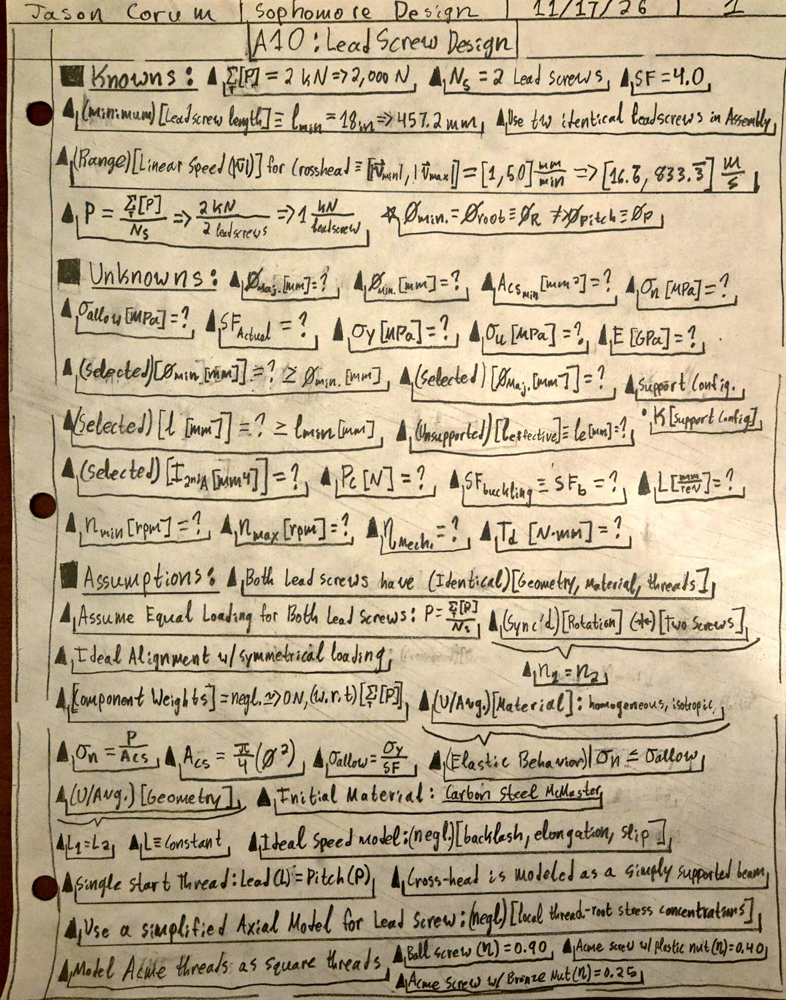

*Figure 1. Initial knowns, unknowns, governing conditions, and assumptions.*

### 2.2 Axial Stress Analysis

The specified load is assumed to divide equally between both leadscrews:

$$
P=\frac{\sum P}{N_s}=\frac{2000\ \mathrm{N}}{2}=1000\ \mathrm{N}
$$

For a nominal solid circular cross section at the root diameter:

$$
\sigma_n=\frac{P}{A_{cs}},\qquad A_{cs}=\frac{\pi\varnothing_{\min}^{2}}{4}
$$

Using the yield-strength-based allowable stress,

$$
\sigma_{\mathrm{allow}}=\frac{\sigma_Y}{SF}
$$

and requiring nominal axial stress to remain below the allowable value gives:

$$
\boxed{\varnothing_{\min}\geq\sqrt{\frac{4P(SF)}{\pi\sigma_Y}}}
$$

### 2.3 Material Research

The McMaster-Carr catalog provides material classifications, tensile strengths, hardnesses, and strength classes, but does not give a certified yield strength for the selected leadscrew. The team therefore compared published properties for related materials. The instructor advised using the lowest defensible strength and verifying the correct steel specification.

| Material classification | Investigated yield strength (provisional) |
| --- | --- |
| Carbon steel | 31,900–57,000 psi |
| Zinc-plated carbon steel | 34,000 psi, assuming a comparable steel substrate |
| Alloy steel | 60,200–105,000 psi |
| 18-8 stainless steel | 30,000–31,200 psi |
| 316 stainless steel | 30,000 psi minimum investigated |

**Important:** The entries above are comparison values from reference materials, not certified yield strengths for individual McMaster parts. A conservative **30,000 psi** assumption was used for general candidate screening.

### 2.4 Numerical Axial Diameter Results

| Assumed yield strength | Minimum calculated root diameter |
| --- | --- |
| 34,000 psi | 4.6611 mm (0.18351 in) |
| 105,000 psi | 2.65235 mm (0.104423 in) |
| 30,000 psi | 4.9621 mm (0.19536 in) |

The most restrictive provisional axial-stress requirement was:

$$
\boxed{\varnothing_{\min,\mathrm{axial}}=0.19536\ \mathrm{in}}
$$

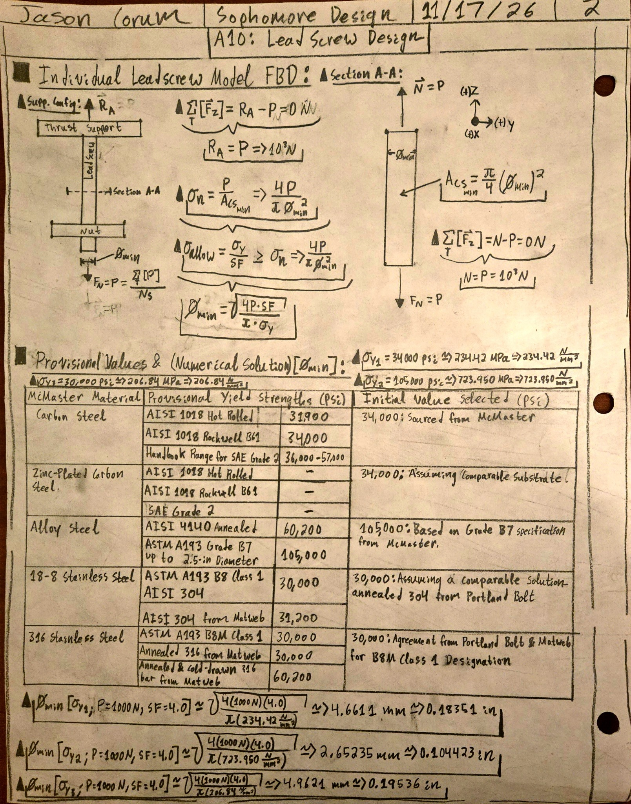

*Figure 2. Individual leadscrew FBD, axial-stress derivation, material research, and numerical sizing calculations.*

---

## 3. Buckling Analysis — Jason Corum

### 3.1 Buckling Model

Because a leadscrew may act as a slender compression member, Euler buckling was investigated as a conservative separate failure mode. The preliminary model uses **pinned–pinned** end restraints and an effective-length factor of **K = 1.0**.

$$
P_{cr}=\frac{\pi^2EI}{(K l_u)^2}
$$

For a solid circular cross section:

$$
I=\frac{\pi\varnothing_{\min}^{4}}{64}
$$

The required critical buckling load satisfies:

$$
P_{cr}\geq P(SF)
$$

Solving for minimum root diameter:

$$
\boxed{\varnothing_{\min,\mathrm{buckling}}\geq
\sqrt[4]{\frac{64P(SF)K^2l_u^2}{\pi^3E}}}
$$

Assumed values: **P = 1,000 N per screw**, **SF = 4**, **E = 29 × 10⁶ psi**, **K = 1.0**.

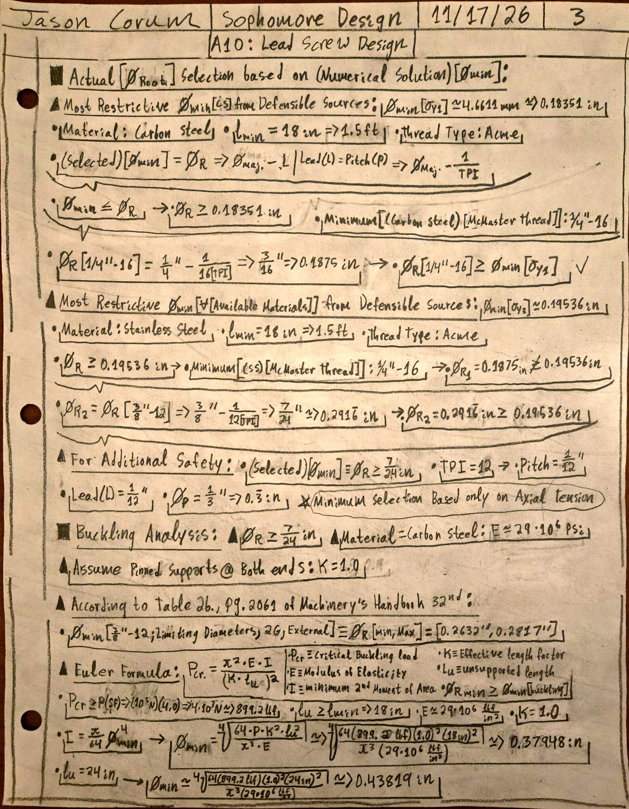

*Figure 3. Preliminary root-diameter screening and parametric Euler buckling derivation.*

### 3.2 Numerical Buckling Results

| Assumed unsupported length, l_u | Required minimum root diameter |
| --- | --- |
| 18 in | 0.37948 in |
| 24 in | 0.43819 in |

The longer unsupported span is more restrictive:

$$
\boxed{\varnothing_{\min,\mathrm{buckling}}=0.43819\ \mathrm{in}\quad(l_u=24\ \mathrm{in})}
$$

### 3.3 Leadscrew Selection Based on Buckling

The *Machinery's Handbook*, 32nd edition, Table 2b, gives a minimum limiting external root diameter of approximately **0.4570 in** for the **5/8"-8 Class 2G Acme** thread.

$$
\varnothing_{R,\min}=0.4570\ \mathrm{in}>0.43819\ \mathrm{in}
$$

The selected thread therefore satisfies the preliminary Euler buckling screening condition under the pinned–pinned, 24-inch unsupported-length assumption. The estimated buckling safety factor is approximately **4.73** for the assumed load of 1,000 N per screw.

**Model limitation:** The real assembly must confirm the actual unsupported length, screw load direction, and support conditions. This is a conservative preliminary compression calculation rather than proof that the final assembly will experience compression.

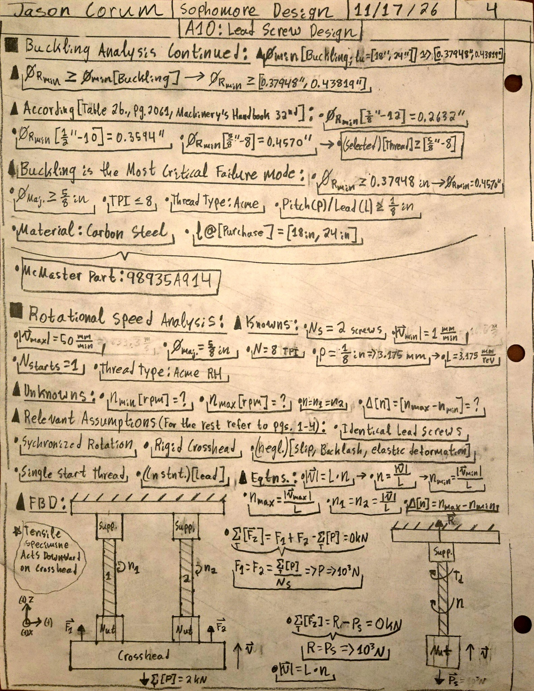

*Figure 4. Buckling results, 5/8"-8 thread selection, catalog part number, and rotational-speed FBDs.*

---

## 4. Selected Leadscrew — Jason Corum

**Selected McMaster-Carr Part: [98935A914](https://www.mcmaster.com/98935A914/)**

| Specification | Selected value |
| --- | --- |
| Supplier | McMaster-Carr |
| Part number | 98935A914 |
| Material | Carbon steel |
| Reported fastener strength class | SAE Grade 2 |
| Thread | 5/8"-8 Acme, Class 2G |
| Direction | Right-hand |
| Nominal major diameter | 5/8 in |
| Threads per inch | 8 |
| Thread starts | 1 |
| Pitch and lead | 0.125 in/rev = 3.175 mm/rev |
| Purchased length | 24 in |
| Minimum limiting root diameter used | 0.4570 in |
| Catalog tensile strength cited | 64,000 psi (not yield strength) |
| Catalog hardness cited | Rockwell B61 |

**CAD download:** [McMaster 98935A914 leadscrew (.SLDPRT)](files/A10_McMaster_98935A914_Carbon_Steel_Acme_Lead_Screw.SLDPRT)

The downloaded supplier model provides geometry for the assembly. The complete packaged assembly and all included component files are linked in Section 10. Final screw-end support conditions, mechanical load path, and clearances still require independent engineering checks.

---

## 5. Rotational Speed Analysis — Jason Corum

The selected leadscrew is single-start, so lead equals pitch:

$$
L=p=\frac{1}{8}\ \mathrm{in/rev}=3.175\ \mathrm{mm/rev}
$$

With synchronized screw rotation and negligible backlash and slip, the kinematic relation is:

$$
|\vec v|=Ln\quad\Rightarrow\quad\boxed{n=\frac{|\vec v|}{L}}
$$

The limiting rotational speeds are:

$$
\boxed{n_{\min}=\frac{1}{3.175}=0.3150\ \mathrm{rpm}}
$$

$$
\boxed{n_{\max}=\frac{50}{3.175}=15.748\ \mathrm{rpm}}
$$

The numerical difference between the limits is:

$$
\Delta n=n_{\max}-n_{\min}=15.433\ \mathrm{rpm}
$$

Each screw must rotate at approximately **0.3150–15.748 rpm** to produce the specified crosshead travel speed.

---

## 6. Maximum Driving Torque Analysis — Jason Corum

The selected leadscrew carries **P = 1,000 N**, has **L = 3.175 mm/rev**, and is modeled with a provisional mechanical efficiency of **η = 0.25**, based on the assumed Acme screw/bronze nut combination. This preliminary torque analysis neglects acceleration, misalignment, and losses elsewhere in the drivetrain.

The required torque for one screw is:

$$
\boxed{T_d=\frac{PL}{2\pi\eta}}
$$

$$
T_d=\frac{(1000\ \mathrm{N})(3.175\ \mathrm{mm/rev})}{2\pi(0.25)}
$$

$$
\boxed{T_{d,\max}=2021.267\ \mathrm{N\,mm}=2.021\ \mathrm{N\,m}}
$$

For both identical leadscrews:

$$
\boxed{\sum T_{d,\max}=\frac{(2000\ \mathrm{N})(3.175\ \mathrm{mm/rev})}{2\pi(0.25)}
=4042.535\ \mathrm{N\,mm}=4.043\ \mathrm{N\,m}}
$$

Two independent drives would each need to deliver the per-screw torque; a common 1:1 drive must transmit the combined screw torque plus any additional drivetrain losses.

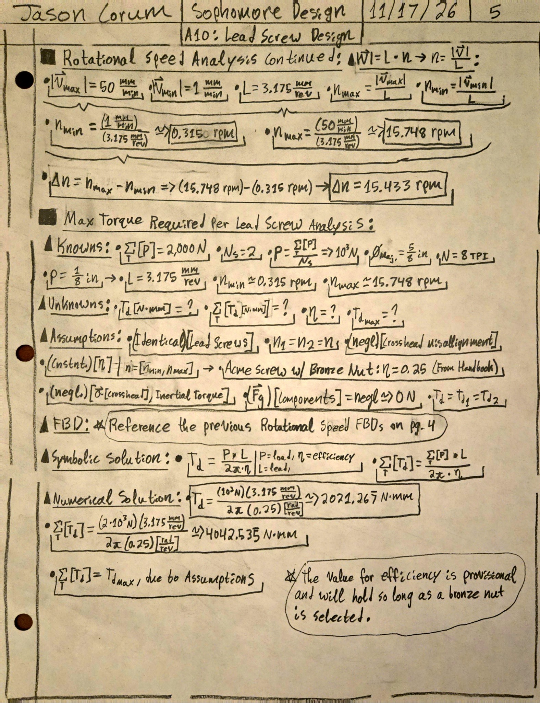

*Figure 5. Rotational-speed and maximum driving-torque calculations.*

---

## 7. Summary of Leadscrew Design Results — Jason Corum

| Parameter | Preliminary design result |
| --- | --- |
| Selected part | McMaster 98935A914 |
| Thread and material | Carbon steel, 5/8"-8 RH Acme |
| Screw length | 24 in |
| Conservative comparison yield strength | 30,000 psi (assumed; not certified for part) |
| Axial-stress minimum root diameter | 0.19536 in |
| Buckling minimum root diameter, 18-in span | 0.37948 in |
| Buckling minimum root diameter, 24-in span | 0.43819 in |
| Selected limiting root diameter | 0.4570 in |
| Estimated buckling SF for 24-in span | 4.73 |
| Rotational-speed range | 0.3150–15.748 rpm |
| Maximum driving torque per screw | 2.021 N·m |
| Combined maximum screw torque | 4.043 N·m |

### Engineering Conclusions

Nominal axial stress alone would permit a substantially smaller leadscrew. The conservative Euler buckling analysis governed the preliminary diameter selection for the selected support and length assumptions. Further checks should confirm the actual steel specification, combined stresses, unsupported length, screw-end constraints, whether the screw experiences compression, and the finished drivetrain efficiency.

---

## 8. Designing the Crosshead — Tai Podvojsky

Tai developed the crosshead as a simply supported beam with a centrally applied specimen load, then used beam bending and deflection relationships to select an initial cross-sectional height. The proposed crosshead material was carbon steel.

### 8.1 Initial Design Values

| Parameter | Value in Tai's work |
| --- | --- |
| Applied load, P | 2,000 N |
| Beam span, L | 0.300 m |
| Crosshead width, b | 0.050 m |
| Elastic modulus, E | 200 GPa |
| Assumed yield strength, σ_Y | 250 MPa |
| Design safety factor, SF | 4 |
| Allowable deflection | 0.0001 m = 0.1 mm |

### 8.2 Beam Strength and Crosshead Height

For a simply supported beam with a central applied force:

$$
R_A=R_B=\frac{P}{2},\qquad M_{\max}=\frac{PL}{4}
$$

For a rectangular cross section of width **b** and height **h**:

$$
I=\frac{bh^3}{12},\qquad c=\frac{h}{2},\qquad \sigma_{\max}=\frac{M_{\max}c}{I}
$$

Combining the relations with the safety factor gives:

$$
\boxed{h\geq\sqrt{\frac{3PL(SF)}{2b\sigma_Y}}}
$$

Using the preliminary values, Tai obtained **h ≈ 0.0170 m (0.669 in)**.

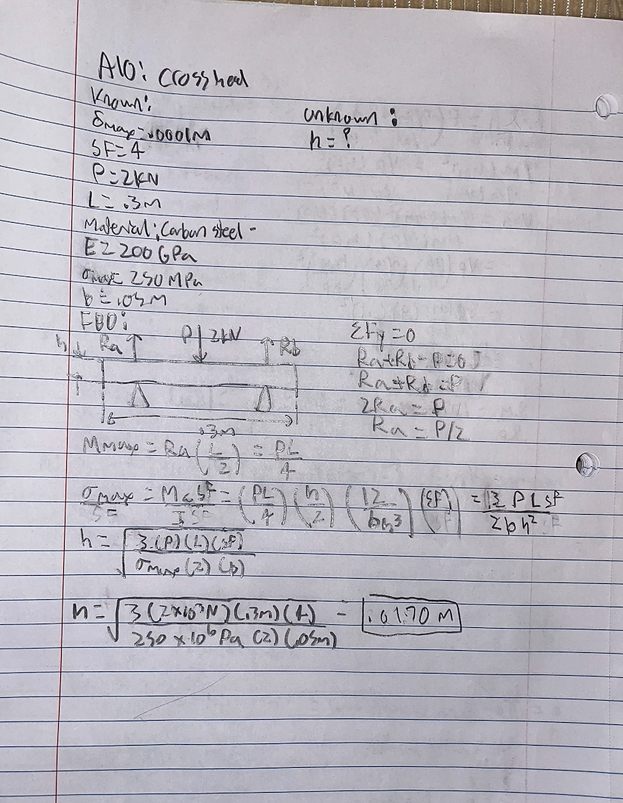

*Figure 6. Tai's initial crosshead knowns, beam FBD, and beam-strength calculation.*

### 8.3 Deflection Analysis and Multiview Sketch

The theoretical central deflection for a simply supported beam with a centered load is:

$$
\delta=\frac{PL^3}{48EI},\qquad I=\frac{bh^3}{12}
$$

Tai's submitted handwritten page reports a deflection of **0.000026 m**. That reported value needs independent verification before asserting that the **0.1 mm** deflection limit is met. With the recorded dimensions, a direct substitution into the beam formula gives approximately **0.275 mm at the 2 kN service load**, or approximately **1.10 mm if the factor of safety is also applied to the deflection load**. Both exceed the stated 0.1 mm limit, so the crosshead thickness and/or structural model requires revision before final design validation.

Tai also produced a preliminary multiview sketch, with approximate overall dimensions of **11.81 in length**, **1.97 in width**, and **0.669 in height**, and mounting features for the nuts/flanges and screws. Hole spacing and fit should be verified from the final CAD model.

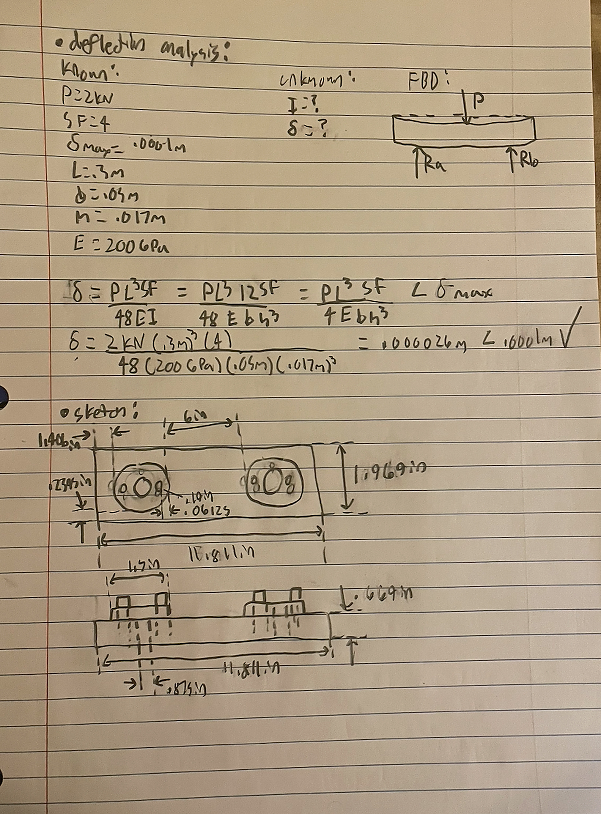

*Figure 7. Tai's deflection work and preliminary multiview crosshead sketch.*

### 8.4 SOLIDWORKS Crosshead Modeling

After creating the sketch, Tai extruded the rectangular crosshead body, added holes and mounting features, and inspected the interfaces needed to fit the selected leadscrew and nut assembly.

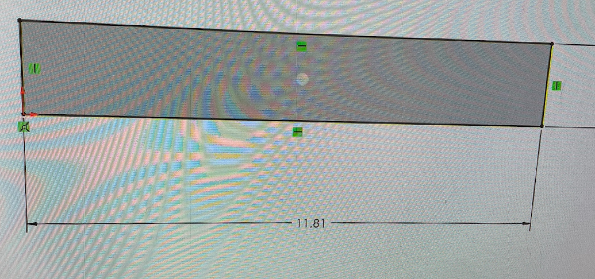

*Figure 8. Initial parametric crosshead body in SOLIDWORKS.*

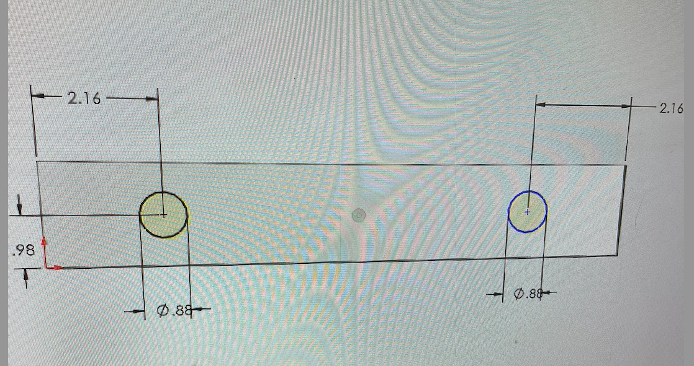

*Figure 9. Crosshead hole layout and mounting geometry.*

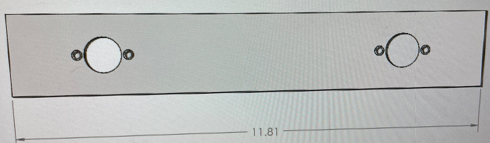

*Figure 10. Front view of the modeled crosshead.*

The final assembly must verify all hole locations, clearance, lead screw alignment, and the actual load path. The screenshots do not independently establish that the complete mechanical assembly meets the deflection requirement.

---

## 9. Bronze Nut and Flange Design — Gavin Sanchez

Gavin evaluated bending stress in the threaded section of the selected bronze flange nut. His analysis drew on the selected **5/8"-8 RH Acme** leadscrew, the assignment's **SF = 4** requirement, and an assumed bearing-bronze yield strength of **20,000 psi**.

### 9.1 Knowns, Unknowns, and Free-Body Diagram

Gavin's handwritten design work lists the thread pitch as **0.125 in**, the modeled thread-root thickness as **0.0625 in**, the flange-nut threaded engagement length as approximately **1.25 in**, and a nominal axial force of approximately **449.62 lbf** corresponding to the full 2 kN test load. His thread-bending analysis uses an assumed number of engaged threads and a simplified beam-section model.

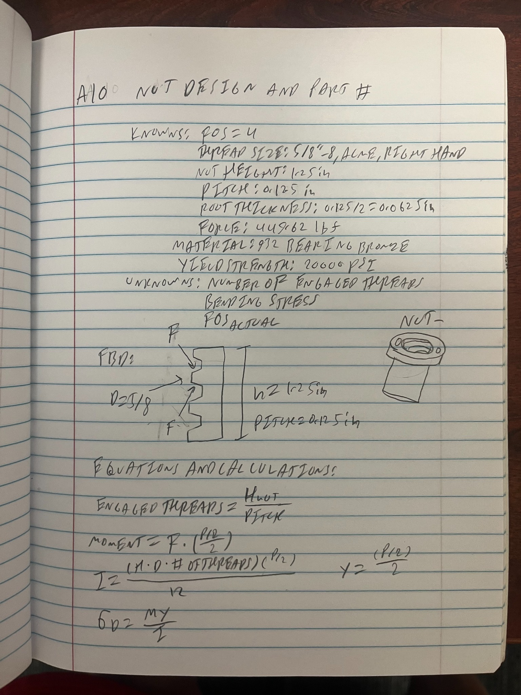

*Figure 11. Gavin's bronze nut knowns, assumptions, thread geometry, and free-body diagram.*

### 9.2 Thread Bending Stress and Factor of Safety

The simplified bending analysis uses the flexure relationship:

$$
\sigma_b=\frac{Mc}{I}
$$

The submitted calculation reports:

$$
\boxed{\sigma_b\approx549.575\ \mathrm{psi}}
$$

Using the selected provisional material yield strength:

$$
SF_{\mathrm{actual}}=\frac{\sigma_Y}{\sigma_b}
=\frac{20{,}000}{549.575}\approx\boxed{36.39}
$$

The submitted estimate exceeds the assigned minimum safety factor of 4. This is a preliminary calculation based on the reported thread-load distribution, number of engaged threads, and material assumption; these details should be checked against the final physical assembly and the actual product specification.

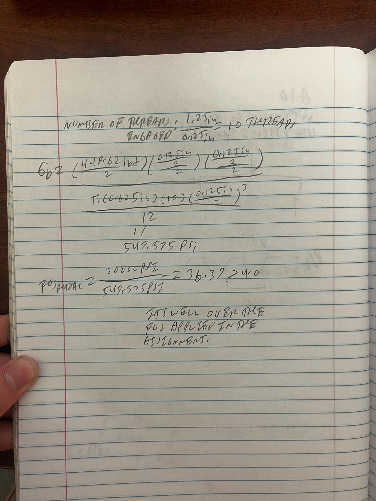

*Figure 12. Gavin's thread-bending stress evaluation and resulting preliminary safety factor.*

### 9.3 Selected Bronze Nut

**Selected McMaster-Carr Part: [95120A119](https://www.mcmaster.com/95120A119/)**

| Specification | Team selection |
| --- | --- |
| Supplier | McMaster-Carr |
| Component | Acme bronze flange nut |
| Part number | 95120A119 |
| Material | 932 bearing bronze |
| Matching screw | 5/8"-8 RH Acme, McMaster 98935A914 |
| Provisional bronze yield strength used | 20,000 psi |
| Reported thread bending stress | 549.575 psi |
| Reported preliminary safety factor | 36.39 |

The nut thread fit, required quantity, flange mounting-hole pattern, and CAD model should be checked against the selected leadscrew and actual crosshead design.

---

## 10. CAD Assembly and Pack and Go Verification — Gavin Sanchez, Tai Podvojsky, and Jason Corum

Gavin developed the overall SOLIDWORKS assembly using the selected commercial parts, while Tai modeled the crosshead. Jason coordinated recovery of the missing components and organized the complete set of CAD files for the portfolio. The model includes two leadscrews, two modified bronze flange nuts, mounting screws, crosshead, and T-slotted framing.

### 10.1 Complete Downloadable SOLIDWORKS Assembly

**[Download the complete A10 SOLIDWORKS assembly package (.zip)](files/A10_Complete_Assembly.zip)**

This archive is the **preferred download** for anyone wishing to inspect or open the full assembly. It contains one `.SLDASM` file and the six unique `.SLDPRT` files required by the package. The filename of the assembly inside the ZIP is `Real_A10_Assembly.SLDASM`.

### 10.2 Packaged CAD Component Inventory

The following filenames are **exactly as packaged** in the verified ZIP; the quantities describe component occurrences shown in the earlier SOLIDWORKS assembly tree, not additional copies of each part file.

| Component | Instances in assembly tree | Actual filename inside ZIP |
| --- | ---: | --- |
| Crosshead (team-designed) | 1 | `Cross Head.SLDPRT` |
| Carbon-steel RH Acme leadscrew, 98935A914 | 2 | `A10_McMaster_98935A914_Carbon_Steel_Acme_Lead_Screw.SLDPRT` |
| Modified 932 bronze Acme flange nut, 95120A119 | 2 | `95120A119_932 Bearing Bronze Acme Flange Nut (1).SLDPRT` |
| 316 stainless-steel socket-head screw, 90666A013 | 4 | `90666A013_Super-Corrosion-Resistant 316 Stainless Steel Socket Head Screw (1).SLDPRT` |
| T-slotted framing rail, 4658N33 | 2 | `4658N33_T-Slotted Framing Rail.SLDPRT` |
| T-slotted framing component, 47065T023 | 4 | `47065T023_T-Slotted Framing.SLDPRT` |

The six unique part files together with the assembly are included in **one ZIP**. Each component is stored once; SOLIDWORKS creates multiple component instances in the assembly as required.

### 10.3 Recovering Missing References and Modified Components

The initial assembly was difficult to reopen because some native components were missing or did not match the component revisions used to construct the assembly. After recovering the initial part files, multiple concentric and coincident mates remained unresolved. During manual inspection, the team identified that the originally supplied bronze flange-nut part did not contain the mounting holes required by the socket-head screws. Gavin supplied the **modified part models**, allowing the correct component revisions to be used.

A new copy was assembled using those revisions and then packaged through **SOLIDWORKS File > Pack and Go > Save to Zip File**. The student extracted the ZIP and confirmed that the packaged assembly could be opened successfully.

**Important modeling distinction:** The flange-nut CAD in this archive has been **modified for this team's assembly** and should not be treated as an unmodified, manufacturer-certified McMaster part. The bolt-hole locations, fastener sizes, and manufacturing feasibility of these modifications should be documented and checked before fabrication.

### 10.4 Verification Results and Remaining Checks

| Verification item | Result |
| --- | --- |
| ZIP archive integrity | **Passed:** no damaged ZIP entries detected |
| Assembly model file present | **Yes:** `Real_A10_Assembly.SLDASM` |
| Six unique native part files present | **Yes** |
| Required component categories from prior Find References list | **All six represented by filenames** |
| New files compared with previously incomplete package | **Updated assembly and component versions detected** |
| Assembly reopening after extraction | **Confirmed by student in SOLIDWORKS** |
| Mate rebuild and no-error status | **Student-side verification required**; not independently testable here |
| Interference, clearance, and motion studies | **Not yet independently verified** |
| Crosshead stress/deflection compliance | **Not established** by the assembly file |

**Verification limitation:** File-integrity testing can establish that the archive is readable and the expected files are included, but does not inspect the parametric geometry or validate mate relationships. A SOLIDWORKS rebuild, interference detection, dimensional inspection, and an engineering review of the complete load path remain necessary before calling the design fully validated.

For an overview of the crosshead geometry used in the assembly, see Figures 8–10 in Section 8. A final overall assembly screenshot may be added as additional documentation after the assembly is reopened in SOLIDWORKS.

---

## 11. Tabulating Costs — Tai Podvojsky

The following bill of materials reproduces the **quantities and prices reported in the submitted team PDF**. Prices are a record of the submitted estimate, not current verified supplier quotes.

| Item | Quantity | Name | Cost / Item | Reported Cost | Purchase Link |
| --- | ---: | --- | ---: | ---: | --- |
| 1 | 1 | 932 bearing-bronze Acme flange nut | $138.20 | $138.20 | [95120A119](https://www.mcmaster.com/95120A119/) |
| 2 | 2 | Carbon-steel Acme leadscrews | $10.29 | $20.58 | [98935A914](https://www.mcmaster.com/98935A914/) |
| 3 | 4 | 316 stainless-steel socket-head screws | $0.63 | $6.32 (pack of 10) | [90666A013](https://www.mcmaster.com/90666A013/) |
| 4 | 2 | T-slotted framing rails, 2 ft | $38.12 | $76.42 | [4658N31](https://www.mcmaster.com/products/4658n31/) |
| 5 | 4 | T-slotted framing rails, 1.5 ft | $29.08 | $116.32 | [4658N31](https://www.mcmaster.com/products/4658n31/) |
| 6 | 1 | Crosshead (fabricated / estimated) | $30.00 | $30.00 | Designed component |
| | | **Reported total** | | **$387.84** | |

**Bill-of-materials verification:** The submitted PDF lists **one** bronze flange nut, whereas the packaged assembly contains **two nut instances**. The ZIP also identifies the actual framing part models as **4658N33** and **47065T023**, which differ from the **4658N31** part number cited in the original bill of materials; therefore, the earlier rail prices cannot be assumed to describe the modeled parts. The listed 2-ft framing subtotal is **$76.42**, although 2 × $38.12 = **$76.24**. The screw cost reflects a pack purchase rather than four individual items. The reported **$387.84** estimate is retained as a record of the submitted PDF, **not a verified final procurement total**. Quantities, supplier part numbers, modified-part costs, and subtotals must be reconciled before purchasing.

---

## 12. Engineering Lessons Learned

### Jason Corum — Leadscrew Design

The material investigation demonstrated why tensile strength and yield strength must be distinguished. Because the selected part's listing did not supply a certified yield strength, additional materials references and conservative provisional assumptions were necessary.

The axial analysis demonstrated that satisfying nominal strength does not guarantee stability under compression. Buckling depends strongly on unsupported length and end conditions, and using limiting external Acme-thread dimensions is more defensible than using an overly simplified root-diameter estimate. The rotational-speed and torque analyses also illustrated the separate roles of screw lead, applied load, and efficiency.

### Tai Podvojsky — Crosshead Design and CAD

Tai reported spending approximately **3 hours** on his assigned portions. He gained experience creating threaded holes and using appropriate reference planes and mating relationships while assembling screw and nut components in SOLIDWORKS. The crosshead deflection calculation is flagged for verification before the design is considered complete.

### Gavin Sanchez — Bronze Nut and Assembly

Gavin reported spending approximately **3 hours** on the assignment. His main difficulty was developing an appropriate bending-stress model for a threaded flange nut rather than treating it as a conventional flat beam. The final simplified expression included pitch and an assumed number of engaged threads, which made it possible to estimate thread bending stress and a preliminary safety factor.

### Team — Component Reference Recovery

When the original assembly references and mates failed, troubleshooting the geometry revealed a mismatch between the socket-head mounting screws and the original flange-nut CAD model. Recovering the modified nut and fastener models, then rebuilding and packaging the assembly with Pack and Go, demonstrated why native CAD files must be collected as a coherent set rather than individually renamed or copied without verifying their references.

### Time Spent

| Team member | Reported or recorded time |
| --- | --- |
| Jason Corum | 13 hours previously documented in the A10 portfolio |
| Tai Podvojsky | Approximately 3 hours |
| Gavin Sanchez | Approximately 3 hours |
| **Total of reported times** | **Approximately 19 hours** |

---

## 13. References and Supplier Files

1. [McMaster-Carr — Carbon Steel Acme Lead Screw, 98935A914](https://www.mcmaster.com/98935A914/).
2. [McMaster-Carr — 932 Bearing Bronze Acme Flange Nut, 95120A119](https://www.mcmaster.com/95120A119/).
3. [McMaster-Carr — Stainless Socket-Head Screws, 90666A013](https://www.mcmaster.com/90666A013/).
4. McMaster-Carr — T-slotted framing component IDs appearing in the packaged assembly: [4658N33](https://www.mcmaster.com/4658N33/) and [47065T023](https://www.mcmaster.com/47065T023/). Supplier listings and prices should be rechecked.
5. Oberg et al., *Machinery's Handbook*, 31st edition, Industrial Press, 2020, assigned leadscrew reference material.
6. Oberg et al., *Machinery's Handbook*, 32nd edition, Table 2b, p. 2061 (as consulted for Acme thread limiting dimensions).
7. [MechaniCalc — Column Buckling](https://mechanicalc.com/reference/column-buckling).
8. MEGR 2156 lecture material and instructor clarifications (Acme-to-square-thread model, simply supported crosshead, and conservative material selection).
9. [Team's A10 GitHub source page](https://github.com/TaiPodUNCC/megr2157-portfolio/blob/main/docs/assignments/A10/index.md).

---

## 14. Final Documentation and Verification Checklist

- [x] Leadscrew nominal axial-stress analysis.
- [x] Preliminary Euler buckling analysis and leadscrew selection.
- [x] Leadscrew speed and required driving torque calculations.
- [x] Bronze flange-nut stress calculation and part selection documented.
- [x] Crosshead preliminary bending analysis, sketch, and CAD images included.
- [x] Team's reported bill of materials and supplier links included.
- [x] Direct leadscrew CAD link and complete packaged assembly ZIP download link supplied.
- [ ] Verify crosshead deflection and redesign if necessary.
- [ ] Check actual lead screw support conditions, screw loading, and combined stresses.
- [ ] Reconcile bronze nut quantity (two modeled), frame part numbers (4658N33 and 47065T023), framing subtotals, and purchased component costs.
- [x] Confirm all six expected distinct part files are present in the uploaded Pack and Go ZIP.
- [x] Reopen extracted packaged assembly in SOLIDWORKS (student verified).
- [ ] Confirm mate errors are fully cleared after rebuild and capture an overview screenshot.
- [ ] Verify modified bronze flange-nut mounting holes, fastener fit, and complete an interference/alignment check.
- [ ] Confirm identical team documentation and final Canvas submission requirements.
