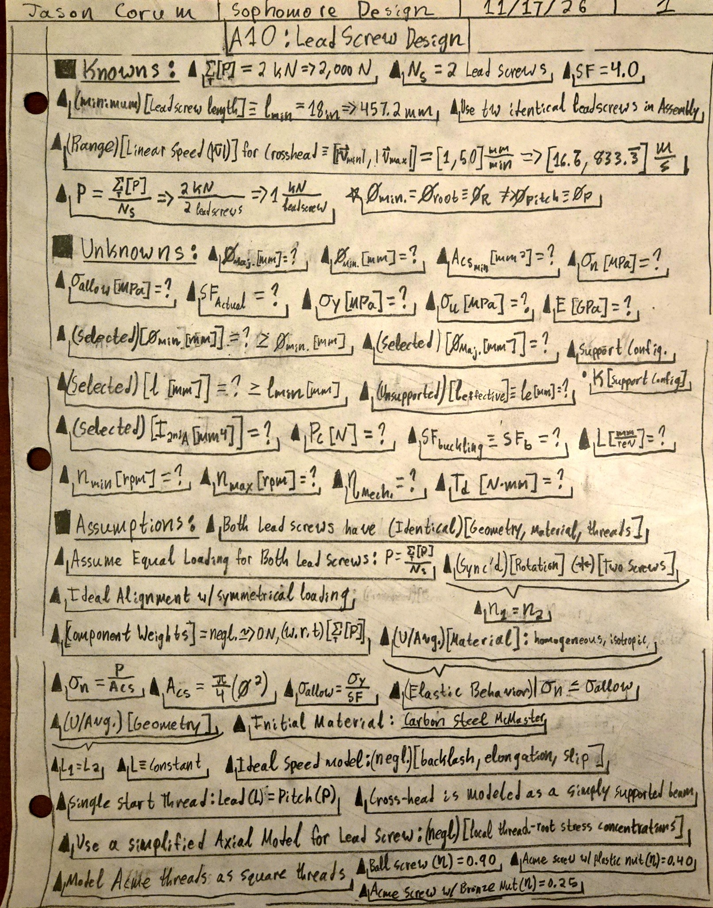
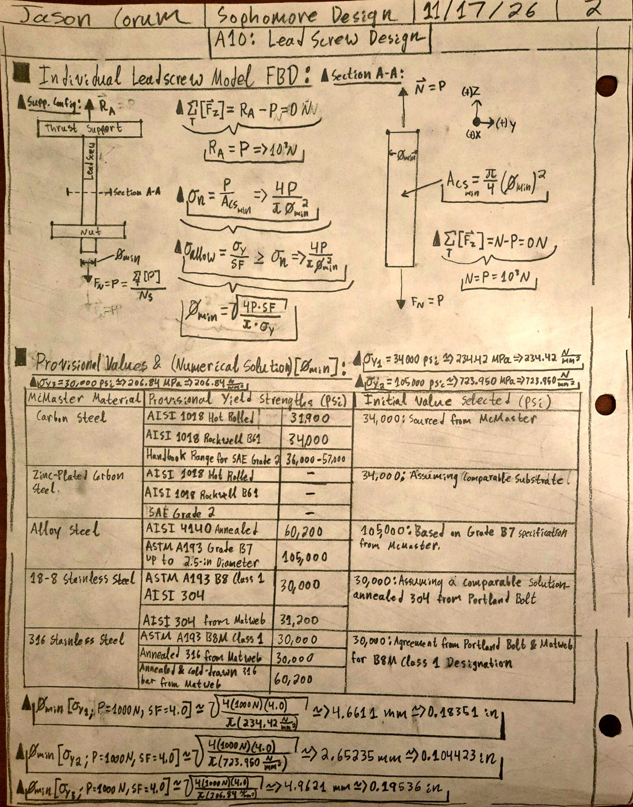
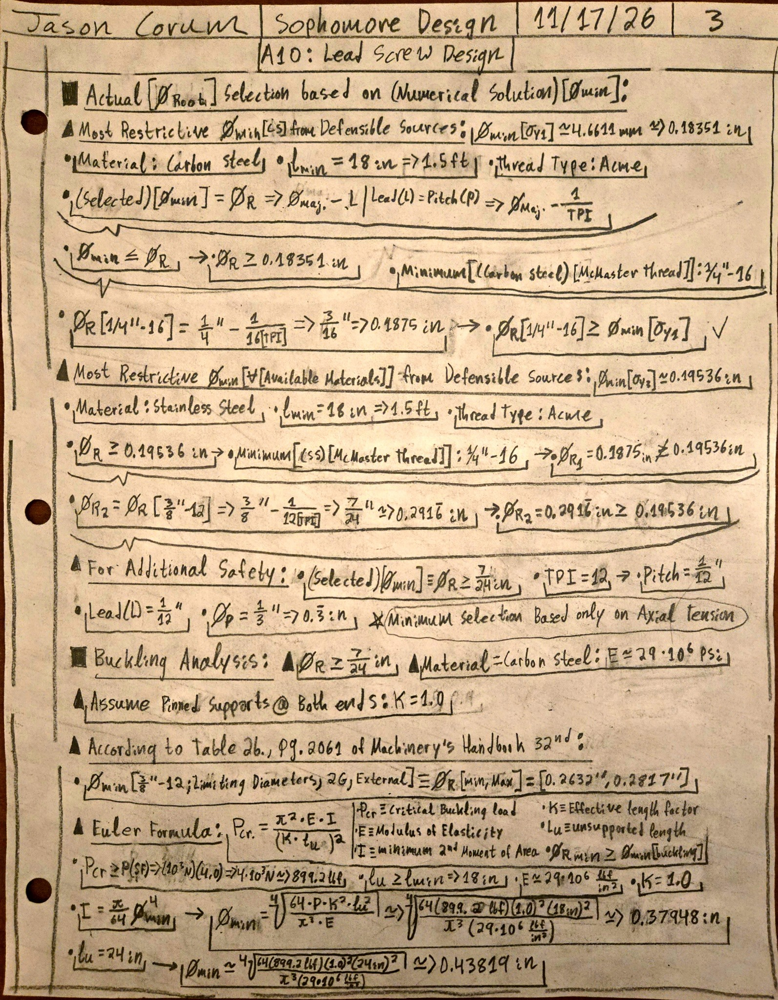
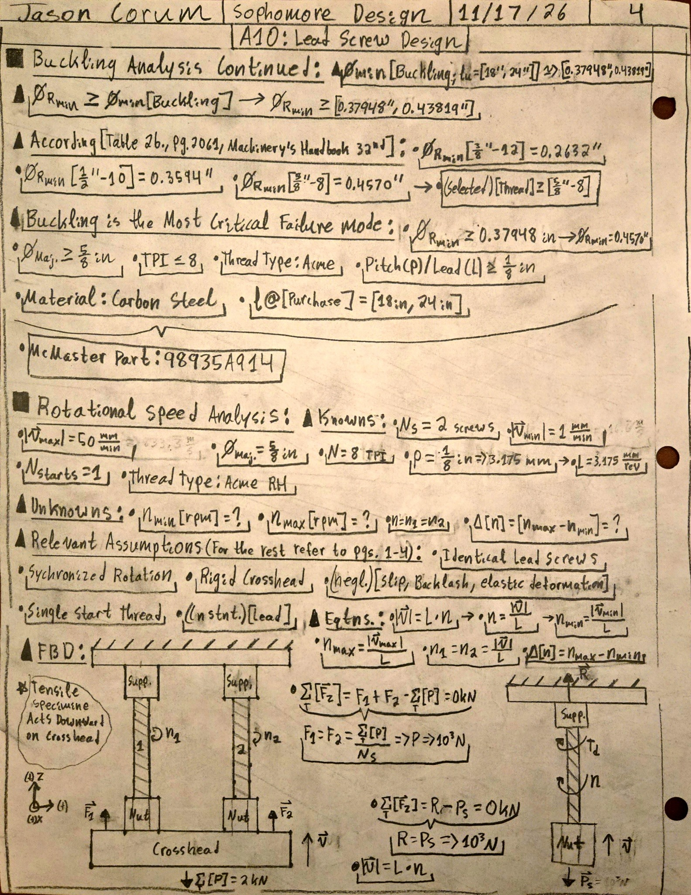
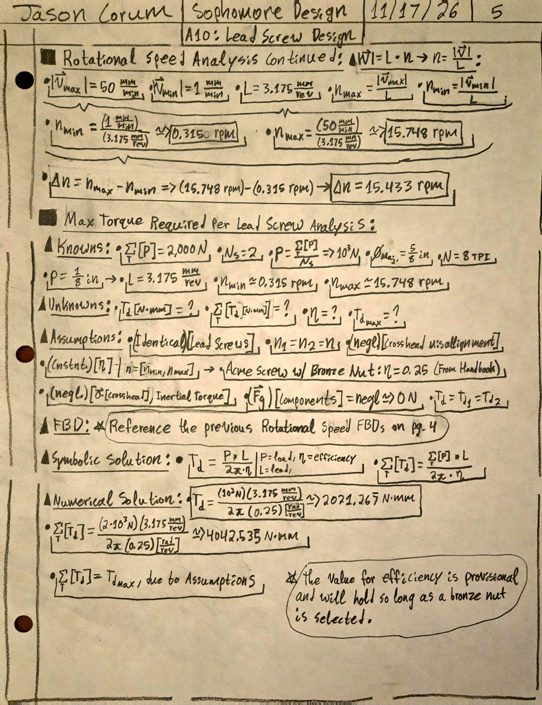

# A10: Leadscrew-Driven Tensile Tester

**Course:** MEGR 2156 — Sophomore Design

**Team Members:** Jason Corum, [Teammate 2], [Teammate 3]

**Assignment:** A10 — Tensile Tester, Part 1

**Project Status:** Leadscrew analysis completed. Remaining group contributions in progress.

---

## 1. Project Description and Objectives

The objective of this project is to conceptually design a mechanically driven tensile testing machine capable of applying a maximum axial tensile load of 2 kN while maintaining a controllable crosshead speed between 1 and 50 mm/min.

The design incorporates two identical leadscrews, compatible nuts and flanges, a crosshead, and a supporting frame. The system must provide accurate, repeatable loading while maintaining structural strength and minimizing crosshead deflection.

### Design Requirements

| Parameter | Value |
|---|---|
| Maximum tensile load | 2,000 N |
| Number of leadscrews | 2 |
| Load per leadscrew | 1,000 N |
| Crosshead linear speed | 1–50 mm/min |
| Minimum leadscrew length | 18 in |
| Design safety factor | 4 |
| Maximum crosshead deflection | 0.1 mm |
| Thread type | Acme, modeled as square threads where appropriate |
| Crosshead model | Simply supported beam |

### Individual Responsibilities

| Component | Contributor | Status |
|---|---|---|
| Leadscrew diameter, speed, torque, and selection | Jason Corum | Analysis completed |
| Bronze nut/flange selection and thread analysis | [Teammate 2] | Pending |
| Crosshead strength, deflection, and design | [Teammate 3] | Pending |
| Cost analysis and CAD assembly | [Assigned members] | In progress |

---

## 2. Leadscrew Diameter — Jason Corum

### 2.1 Initial Knowns, Unknowns, and Assumptions

The leadscrew design began by identifying the given operating requirements, unknown design parameters, and assumptions needed for the preliminary engineering analysis.

The two leadscrews are assumed to have identical geometry and material properties, carry equal axial loads, and rotate synchronously.

The material is modeled as homogeneous and isotropic. Local thread-root stress concentrations, component weights, misalignment, and inertial effects are neglected for preliminary calculations.

*Figure 1. Initial knowns, unknowns, governing conditions, and assumptions.*

### 2.2 Axial Stress Analysis

The maximum applied load is distributed equally between the two leadscrews:

$$
P=\frac{\sum P}{N_s}
$$

$$
P=\frac{2000}{2}=1000\ \mathrm{N}
$$

The individual leadscrew free-body diagram establishes the axial load and the corresponding support reaction.

The governing nominal axial stress is:

$$
\sigma_n=\frac{P}{A_{cs}}
$$

For a circular cross section:

$$
A_{cs}=\frac{\pi}{4}\varnothing_{\min}^{2}
$$

The allowable stress is:

$$
\sigma_{\mathrm{allow}}=\frac{\sigma_Y}{SF}
$$

Combining these equations and solving for the minimum root diameter:

$$
\boxed{
\varnothing_{\min}\geq
\sqrt{\frac{4P(SF)}{\pi\sigma_Y}}
}
$$

### 2.3 Material Research

The McMaster-Carr catalog lists material classifications, tensile strengths, hardnesses, and fastener strength grades, but does not explicitly provide a guaranteed yield strength for the selected leadscrew.

Additional research was performed using the Machinery's Handbook and published material-property references.

The professor recommended selecting the least defensible strength value and verifying the actual steel classification.

The investigated provisional values included:

| Material | Investigated Yield Strength |
|---|---|
| Carbon steel | 31,900–57,000 psi |
| Zinc-plated carbon steel | 34,000 psi assumed from comparable substrate |
| Alloy steel | 60,200–105,000 psi |
| 18-8 stainless steel | 30,000–31,200 psi |
| 316 stainless steel | 30,000 psi minimum investigated |

These values are preliminary comparisons and are not certified material properties for the selected McMaster component.

A conservative assumed yield strength of 30,000 psi was used for the overall candidate screening.

### 2.4 Numerical Axial Diameter Results

| Yield Strength | Calculated Minimum Root Diameter |
|---|---|
| 34,000 psi | 4.6611 mm (0.18351 in) |
| 105,000 psi | 2.65235 mm (0.104423 in) |
| 30,000 psi | 4.9621 mm (0.19536 in) |

The most restrictive axial-stress result was:

$$
\boxed{\varnothing_{\min}=0.19536\ \mathrm{in}}
$$

This result alone suggested that several relatively small Acme leadscrews could satisfy the nominal axial stress requirement.

*Figure 2. Leadscrew FBD, symbolic axial-stress derivation, provisional material-property research, and numerical minimum-diameter calculations.*

---

## 3. Buckling Analysis — Jason Corum

### 3.1 Buckling Model

A supplementary buckling investigation was performed to determine whether a relatively long leadscrew could withstand a conservative axial compression load without elastic instability.

For the preliminary analysis, the leadscrew was modeled as a solid circular column with pinned supports at both ends.

The effective length factor was:

$$
K=1
$$

The Euler critical buckling load is:

$$
P_{cr}=\frac{\pi^2EI}{(Kl_u)^2}
$$

For a solid circular cross section:

$$
I=\frac{\pi\varnothing_{\min}^{4}}{64}
$$

Requiring a safety factor of 4 against Euler buckling:

$$
P_{cr}\geq P(SF)
$$

Solving for the minimum root diameter:

$$
\boxed{
\varnothing_{\min}\geq
\sqrt[4]{
\frac{64P(SF)K^2l_u^2}{\pi^3E}
}
}
$$

### 3.2 Numerical Results

Using:

- Axial load: 1,000 N per screw
- Elastic modulus: 29 × 10^6 psi
- Effective length factor: 1
- Safety factor: 4

The following results were obtained:

| Unsupported Length | Minimum Root Diameter |
|---|---|
| 18 in | 0.37948 in |
| 24 in | 0.43819 in |

The more restrictive result corresponds to the assumed 24-inch unsupported length:

$$
\boxed{\varnothing_{\min}=0.43819\ \mathrm{in}}
$$

*Figure 3. Preliminary Acme thread screening and the parametric Euler buckling analysis.*

### 3.3 Leadscrew Selection Based on Buckling

According to Table 2b in the Machinery's Handbook, 32nd edition, the minimum limiting external minor diameter for the 5/8"-8 Class 2G Acme thread is approximately:

$$
\varnothing_{R,\min}=0.4570\ \mathrm{in}
$$

Comparing this to the conservative buckling requirement:

$$
0.4570>0.43819\ \mathrm{in}
$$

Therefore, the selected thread satisfies the preliminary Euler buckling requirement.

For a 24-inch unsupported length, the estimated Euler critical load is approximately 1,064 lbf, giving a buckling safety factor of approximately 4.73 for the assumed 1,000 N load per screw.

**Engineering limitation:** This is a conservative compressive-load screening calculation. The final assembly must establish whether each leadscrew experiences compression or tension during operation and determine the actual unsupported length and end restraints.

*Figure 4. Buckling results, selected 5/8"-8 Acme thread, catalog part number, and rotational-speed free-body diagrams.*

---

## 4. Selected Leadscrew — Jason Corum

Following the axial-stress analysis, buckling analysis, and catalog screening, the selected leadscrew is:

**McMaster-Carr Part Number: 98935A914**

[View Selected Leadscrew on McMaster-Carr](https://www.mcmaster.com/98935A914/)

### Selected Specifications

| Specification | Value |
|---|---|
| Manufacturer/Supplier | McMaster-Carr |
| Part Number | 98935A914 |
| Material | Carbon Steel |
| Fastener Strength Class | SAE Grade 2 |
| Thread Type | Acme, Class 2G |
| Thread Direction | Right-Hand |
| Nominal Major Diameter | 5/8 in |
| Thread Count | 8 TPI |
| Number of Starts | 1 |
| Lead | 0.125 in/rev |
| Purchased Length | 24 in |
| Minimum Limiting Root Diameter | 0.4570 in |
| Catalog Tensile Strength | 64,000 psi |
| Catalog Hardness | Rockwell B61 |

### Downloadable SOLIDWORKS CAD File

[Download McMaster 98935A914 Leadscrew (.SLDPRT)](files/A10_McMaster_98935A914_Carbon_Steel_Acme_Lead_Screw.SLDPRT)

The downloaded supplier model will be used in the group CAD assembly. Compatibility with the final nut, flange, and support arrangement must be confirmed during assembly design.

---

## 5. Rotational Speed Analysis — Jason Corum

### 5.1 Knowns and Assumptions

The required crosshead linear speed varies between:

$$
|\vec v_{\min}|=1\ \mathrm{mm/min}
$$

$$
|\vec v_{\max}|=50\ \mathrm{mm/min}
$$

The selected leadscrew has a single-start 5/8"-8 Acme thread.

Consequently:

$$
L=p=\frac{1}{8}\ \mathrm{in/rev}
$$

$$
L=3.175\ \mathrm{mm/rev}
$$

The leadscrews are assumed to rotate synchronously, with negligible backlash and slip.

### 5.2 Symbolic Derivation

The relationship between linear speed and rotational speed is:

$$
|\vec v|=Ln
$$

Solving for rotational speed:

$$
\boxed{n=\frac{|\vec v|}{L}}
$$

Therefore:

$$
n_{\min}=\frac{|\vec v_{\min}|}{L}
$$

$$
n_{\max}=\frac{|\vec v_{\max}|}{L}
$$

### 5.3 Numerical Results

Minimum rotational speed:

$$
n_{\min}=\frac{1}{3.175}
$$

$$
\boxed{n_{\min}=0.3150\ \mathrm{rpm}}
$$

Maximum rotational speed:

$$
n_{\max}=\frac{50}{3.175}
$$

$$
\boxed{n_{\max}=15.748\ \mathrm{rpm}}
$$

Rotational speed range difference:

$$
\Delta n=n_{\max}-n_{\min}
$$

$$
\boxed{\Delta n=15.433\ \mathrm{rpm}}
$$

Thus, each synchronized leadscrew must operate between approximately 0.3150 and 15.748 rpm.

---

## 6. Maximum Driving Torque Analysis — Jason Corum

### 6.1 Known Values and Assumptions

The maximum required driving torque was calculated using the same force relationships established in the rotational-speed FBD.

Relevant values:

| Parameter | Value |
|---|---|
| Total applied load | 2,000 N |
| Load per leadscrew | 1,000 N |
| Lead | 3.175 mm/rev |
| Assumed mechanical efficiency | 0.25 |
| Number of leadscrews | 2 |

A mechanical efficiency of 25% was provisionally assumed for an Acme leadscrew operating with a bronze nut.

The preliminary analysis neglects inertial torque, drivetrain friction beyond the assumed screw efficiency, and crosshead misalignment.

### 6.2 Symbolic Solution

The required driving torque for one leadscrew is:

$$
\boxed{T_d=\frac{PL}{2\pi\eta}}
$$

The combined torque for both identical leadscrews is:

$$
\boxed{\sum T_d=\frac{\sum P\,L}{2\pi\eta}}
$$

### 6.3 Numerical Solution

Per leadscrew:

$$
T_d=\frac{(1000)(3.175)}{2\pi(0.25)}
$$

$$
\boxed{T_{d,\max}=2021.267\ \mathrm{N\,mm}}
$$

Or:

$$
\boxed{T_{d,\max}=2.021\ \mathrm{N\,m}}
$$

Combined torque:

$$
\sum T_d=\frac{(2000)(3.175)}{2\pi(0.25)}
$$

$$
\boxed{\sum T_{d,\max}=4042.535\ \mathrm{N\,mm}}
$$

Or:

$$
\boxed{\sum T_{d,\max}=4.043\ \mathrm{N\,m}}
$$

If the leadscrews are driven independently, each drive must provide the required per-screw torque. A shared 1:1 drive must transmit the combined screw torque, plus any additional drivetrain losses.

The assumed efficiency remains provisional pending the final nut and drivetrain selection.

*Figure 5. Rotational-speed calculations, required driving torque, numerical results, and efficiency assumptions.*

---

## 7. Summary of Leadscrew Design Results

| Parameter | Final Preliminary Result |
|---|---|
| Selected Part | McMaster 98935A914 |
| Material | Carbon Steel |
| Thread | 5/8"-8 Acme, Right-Hand |
| Screw Length | 24 in |
| Assumed Yield Strength for Conservative Screening | 30,000 psi |
| Minimum Root Diameter from Axial Stress | 0.19536 in |
| Minimum Root Diameter from Buckling, 18 in | 0.37948 in |
| Minimum Root Diameter from Buckling, 24 in | 0.43819 in |
| Selected Minimum Limiting Root Diameter | 0.4570 in |
| Estimated Buckling SF, 24 in | 4.73 |
| Minimum Rotational Speed | 0.3150 rpm |
| Maximum Rotational Speed | 15.748 rpm |
| Maximum Torque Per Leadscrew | 2.021 N·m |
| Combined Maximum Screw Torque | 4.043 N·m |

### Engineering Conclusions

The investigation demonstrated that the minimum leadscrew diameter depends on more than the nominal axial load alone.

Although the axial-stress calculation permitted a smaller diameter, the conservative Euler buckling analysis resulted in a substantially larger minimum root diameter.

The selected 5/8"-8 carbon steel Acme leadscrew satisfies the preliminary axial-strength and assumed compression-buckling screening calculations.

The required rotational speed is relatively low because of the selected lead. The calculated torque is based on the specified load and assumed 25% mechanical efficiency.

Further verification will be necessary to establish actual material properties, confirm the final leadscrew support conditions, evaluate combined axial and torsional stresses, and determine the final nut and drivetrain efficiency.

---

## 8. Bronze Nut and Flange Selection — [Teammate 2]

### 8.1 Known Values and Unknowns

[Insert the relevant knowns and unknowns.]

### 8.2 Free-Body Diagram

[Insert a detailed FBD illustrating the loading on the nut threads.]

### 8.3 Thread Bending Stress Analysis

[Insert the symbolic equations and derivation.]

### 8.4 Numerical Analysis

[Insert numerical calculations using the selected material and thread geometry.]

### 8.5 Component Selection

[Insert selected bronze nut/flange specifications, manufacturer, part number, and purchase link.]

### 8.6 Downloadable CAD

[Insert the downloadable nut/flange CAD model and relevant screenshots.]

---

## 9. Crosshead Design — [Teammate 3]

### 9.1 Known Values and Unknowns

[Insert the crosshead design parameters, support spacing, selected material, and unknown dimensions.]

### 9.2 Crosshead Free-Body Diagram

[Insert FBD modeling the crosshead as a simply supported beam.]

### 9.3 Beam Strength Analysis

[Insert symbolic equations, calculations, allowable stresses, and resulting dimensions.]

### 9.4 Beam Deflection Analysis

The crosshead must satisfy:

$$
\delta_{\max}\leq0.1\ \mathrm{mm}
$$

[Insert symbolic derivation and numerical verification.]

### 9.5 Material and Dimensions

[Insert the final selected crosshead material, cross-sectional dimensions, and support spacing.]

### 9.6 Multiview Paper Sketch

[Insert front, top, and side views with overall dimensions, mounting interfaces, nut/flange attachment details, and material designation.]

---

## 10. Cost Analysis — [Assigned Team Member]

The following table will be completed using current supplier prices and functional purchase links.

| Item | Quantity | Component | Cost/Item | Total Cost | Purchase Link |
|---|---|---|---|---|---|
| 1 | 2 | McMaster 98935A914 Leadscrew | TBD | TBD | [McMaster](https://www.mcmaster.com/98935A914/) |
| 2 | 2 | Bronze Acme Nut/Flange | TBD | TBD | TBD |
| 3 | TBD | Frame Components | TBD | TBD | TBD |
| 4 | TBD | Additional Purchased Components | TBD | TBD | TBD |
| | | **Total Estimated Cost** | | **TBD** | |

The completed cost table will be maintained as a Markdown table, not an uploaded screenshot.

---

## 11. Parametric CAD Modeling and Assembly — [Assigned Team Members]

### 11.1 Leadscrew CAD

The selected McMaster leadscrew model has been downloaded.

[Download Leadscrew CAD](files/A10_McMaster_98935A914_Carbon_Steel_Acme_Lead_Screw.SLDPRT)

### 11.2 Bronze Nut and Flange CAD

[Insert downloadable CAD files and images.]

### 11.3 Crosshead CAD

[Insert parametrically modeled crosshead part and screenshots.]

### 11.4 Frame Components

[Insert frame component specifications and downloaded CAD files.]

### 11.5 Final Assembly

[Insert final SOLIDWORKS assembly file and images showing the assembled components.]

### 11.6 Design Verification

[Document component compatibility, alignment, interference checks, and any required modifications.]

---

## 12. Engineering Lessons Learned

### 12.1 Leadscrew Analysis — Jason Corum

The material-selection investigation demonstrated the importance of distinguishing tensile strength from yield strength. The available product specifications did not provide an explicit yield-strength value, so additional reference research and conservative material-property assumptions were necessary.

The axial-stress analysis also demonstrated that a design satisfying nominal material strength requirements may not satisfy stability requirements under an assumed compression load.

The buckling investigation showed how the effective length factor and unsupported screw length influence the required diameter. It also demonstrated the importance of using actual limiting thread dimensions instead of relying exclusively on idealized thread geometry.

Finally, the rotational-speed and torque analyses demonstrated the different roles of screw lead, axial load, and mechanical efficiency in determining the operating requirements.

### 12.2 Nut and Flange Design — [Teammate 2]

[Insert specific engineering lessons learned.]

### 12.3 Crosshead and CAD Design — [Teammate 3]

[Insert specific engineering lessons learned.]

### 12.4 Time Spent

| Contributor | Work Performed | Time |
|---|---|---|
| Jason Corum | Leadscrew research, calculations, and selection | 13 Hours |
| [Teammate 2] | Nut and flange analysis | TBD |
| [Teammate 3] | Crosshead design | TBD |
| **Total** | | **TBD** |

---

## 13. References

1. [McMaster-Carr — Selected Leadscrew, Part 98935A914](https://www.mcmaster.com/98935A914/)

2. [McMaster-Carr — 5/8"-8 Lead Screw Catalog](https://www.mcmaster.com/products/shafts/thread-size~5-8-8/)

3. *Machinery's Handbook*, 32nd Edition. Table 2b, page 2061, Acme thread limiting dimensions.

4. *Machinery's Handbook*, 31st Edition. Course-assigned screw and leadscrew reference material.

5. [MechaniCalc — Column Buckling](https://mechanicalc.com/reference/column-buckling)

6. MEGR 2156 lecture presentations and instructor clarification on Acme thread modeling, beam assumptions, and material selection.

7. [Additional sources to be added by teammates.]

---

## 14. Final Submission Checklist

- [x] Leadscrew axial-stress calculations
- [x] Leadscrew buckling calculations
- [x] Leadscrew rotational-speed calculations
- [x] Leadscrew required torque calculations
- [x] Preliminary leadscrew selection
- [x] Downloaded leadscrew CAD model
- [ ] Bronze nut/flange strength verification
- [ ] Bronze nut/flange selection
- [ ] Crosshead strength and deflection
- [ ] Crosshead multiview sketch
- [ ] Complete cost table
- [ ] Complete CAD assembly
- [ ] All CAD files uploaded with download links
- [ ] All teammates' contributions documented
- [ ] Actual time spent recorded
- [ ] Final portfolio reviewed by all team members
- [ ] Identical portfolio pages uploaded
- [ ] Portfolio PDF submitted through Canvas
