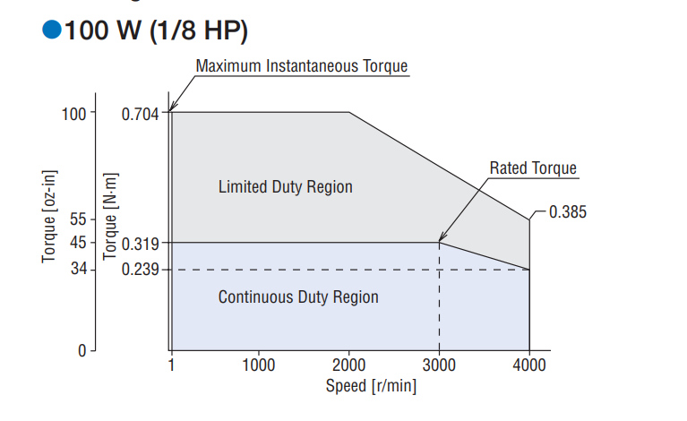
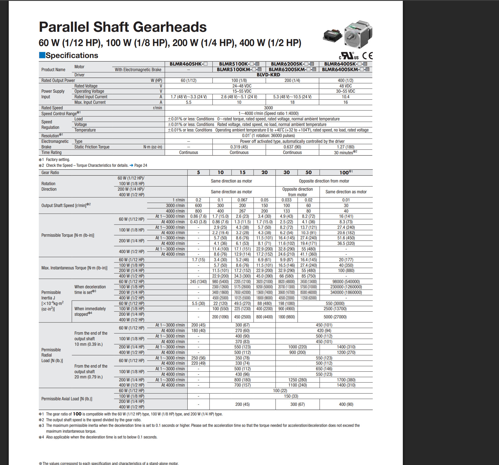
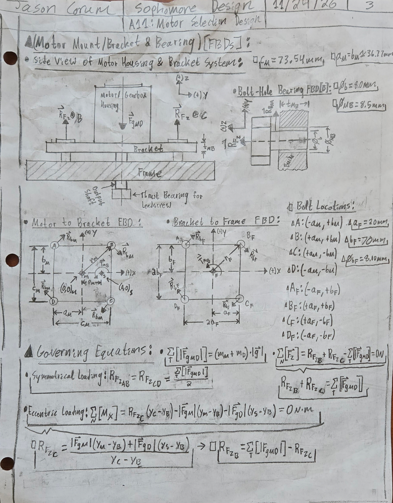
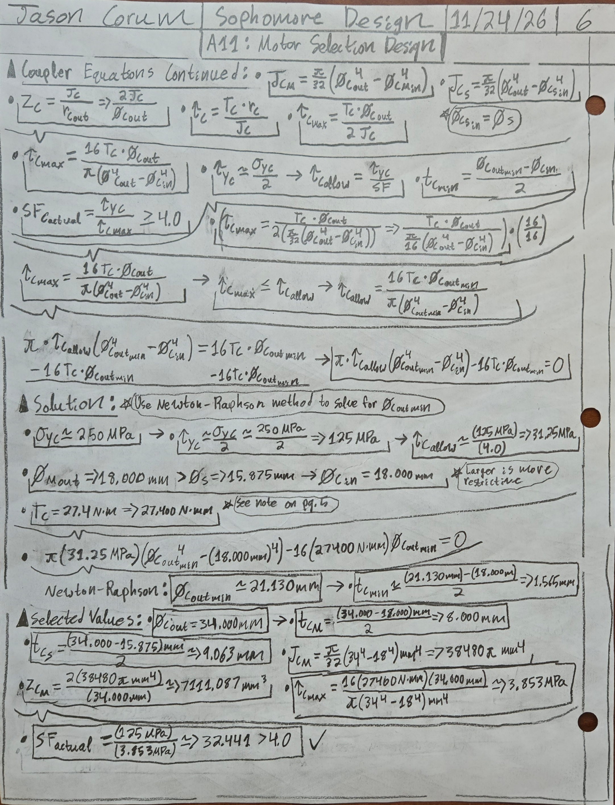

# A11: Motor Selection Design

**Course:** MEGR 2156 — Sophomore Design  
**Assignment:** A11 — Tensile Tester, Part 2  
**Team Members:** Jason Corum, Tai Podvojsky, Gavin Sanchez  
**Documentation:** Team project; individual contributions identified by section  
**Status:** Jason's motor selection, preliminary bracket and coupler analyses, CAD development, and individual bill of materials are complete. Remaining team contributions are identified by section.

---

## 1. Project Description and Objectives

The objective of A11 is to continue the development of the dual-leadscrew tensile testing machine designed in A10. The machine must apply a maximum axial tensile load of **2,000 N** while maintaining a controllable crosshead speed of **1–50 mm/min**.

A10 established the leadscrew selection, preliminary driving torque, required rotational speed, crosshead concept, bronze flange nuts, and initial supporting frame.

A11 builds on those results by selecting the drive motors, designing motor mounting brackets and shaft couplers, developing the supporting frame and floating bearing mounts, and integrating the components into the complete machine.

The proposed design uses two identical motor-driven leadscrews. Each motor drives one leadscrew, and the screws must rotate synchronously to maintain crosshead alignment.

### 1.1 Design Requirements

| Parameter | Value |
| --- | --- |
| Maximum tensile load, ΣP | 2,000.000 N |
| Number of leadscrews, Ns | 2 |
| Number of motors, NM | 2 |
| Assumed load per leadscrew, Ps | 1,000.000 N |
| Crosshead speed | 1.000–50.000 mm/min |
| Minimum leadscrew length | 18.000 in |
| Selected leadscrew length | 24.000 in |
| Required safety factor, SF | 4.000 |
| Motor selection categories | DC, stepper, or gearmotor |
| Motor mounting arrangement | Four mounting holes |
| Motor alignment | Coaxial with leadscrew |
| Frame construction | T-slotted aluminum framing |
| Engineering labor rate | $35.00/hour |
| Assignment design restriction | No electronics or software; purely mechanical |

**Assignment interpretation:** The selected brushless DC motor requires an external electronic driver. The instructor was contacted about this restriction, but clarification was not received. The motor selection is documented with this unresolved compliance limitation; instructor approval is not assumed.

### 1.2 Individual Responsibilities

| Team Member | Primary Contribution |
| --- | --- |
| **Jason Corum** | Motor selection, required speed and torque verification, motor mounting bracket, bracket bearing-stress analysis, shaft coupler, motor assembly CAD, and bill of materials |
| **Tai Podvojsky** | [TODO: Insert Tai's confirmed A11 responsibilities and completed work] |
| **Gavin Sanchez** | [TODO: Insert Gavin's confirmed A11 responsibilities and completed work, including frame connections and assembly integration] |

The remaining team sections provide space for the frame analysis, finite element results, clamp design, floating bearing support, and final assembly verification.

### 1.3 Relationship to A10

The selected A10 leadscrew is:

**[McMaster-Carr 98935A914 — Carbon Steel 5/8"-8 RH Acme Leadscrew](https://www.mcmaster.com/98935A914/)**

| Specification | Selected value |
| --- | --- |
| Material | Carbon steel |
| Nominal major diameter | 15.875 mm |
| Thread | 5/8"-8 RH Acme |
| Thread starts | 1 |
| Pitch | 3.175 mm |
| Lead, Ls | 3.175 mm/rev |
| Purchased length | 609.600 mm |
| Axial load per screw | 1,000.000 N |
| Assumed efficiency, ηs | 0.250 |

The screw selection, nominal axial-stress analysis, preliminary buckling analysis, and required torque calculations are documented in the [A10 Lead Screw Translating System portfolio](../A10/index.md).

---

## 2. Motor Selection — Jason Corum

### 2.1 Initial Knowns, Unknowns, and Assumptions

The motor selection began by determining the torque and rotational speed required by the A10 leadscrew system.

Candidate motors were investigated based on output speed, continuous torque capability, gearbox reduction, manufacturer documentation, mounting geometry, and available CAD models.

The preliminary analysis assumes:

- Two identical motors drive two identical leadscrews.
- The applied tensile load is shared equally between the leadscrews.
- Both leadscrews rotate synchronously.
- The selected Acme screw and nut combination has an assumed mechanical efficiency of 0.250.
- The initial torque calculation represents steady-state operation.
- Acceleration, misalignment, and additional transmission losses are neglected in the preliminary screw torque equation.
- Axial thrust is carried through the appropriate leadscrew bearings and frame supports, rather than directly by the motor output shafts.
- Manufacturer-rated gearbox torque is used for the motor selection rather than maximum instantaneous torque.

*Figure 1. Jason's initial motor-selection knowns, unknowns, assumptions, and selected component specifications.*

### 2.2 Required Leadscrew Rotational Speed

For the selected single-start Acme leadscrew, the lead equals the pitch:

<strong>Ls = 3.175 mm/rev</strong>

The relationship between linear crosshead speed and leadscrew rotational speed is:

ns = |vCH| / Ls

At the minimum required crosshead speed:

ns,min = 1.000 / 3.175

<strong>ns,min = 0.315 rpm</strong>

At the maximum required crosshead speed:

ns,max = 50.000 / 3.175

<strong>ns,max = 15.748 rpm</strong>

Therefore, each leadscrew must operate over approximately:

<strong>0.315 ≤ ns ≤ 15.748 rpm</strong>

### 2.3 Required Leadscrew Driving Torque

The preliminary maximum driving torque for one leadscrew is:

Ts = PsLs / (2πηs)

Using the selected load, lead, and assumed efficiency:

Ts = (1,000.000 × 3.175) / (2π × 0.250)

<strong>Ts,max = 2,021.267 N·mm = 2.021 N·m</strong>

The specified design safety factor is:

<strong>SF = 4.000</strong>

The target motor output torque is:

TM,target = SF × Ts,max

TM,target = 4.000 × 2.021267...

<strong>TM,target = 8.085 N·m</strong>

Each motor must provide at least the required nominal driving torque with the specified safety-factor margin.

### 2.4 Motor Candidate Investigation

Several manufacturers and motor systems were evaluated before selecting the final configuration.

The primary difficulties were achieving the unusually low required output speed, maintaining adequate continuous torque, and obtaining documentation for the exact motor and gearbox configuration.

| Manufacturer or Candidate | Investigation Result |
| --- | --- |
| Bodine Electric | Investigated gearmotor combinations; minimum output speed was unsuitable for the selected candidate |
| Crouzet DCmind | Investigated low-speed DC gearmotors; selected candidate could not achieve the required minimum speed |
| Novanta MDrive | Investigated motor and gear-reduction options; not selected |
| Applied Motion Products | Investigated integrated motor candidates; documentation and configuration issues remained |
| Parvalux Electric Motors | Investigated DC gearmotor combinations; verification remained incomplete |
| Dunkermotoren | Investigated motor and planetary gearbox combinations |
| Neugart | Investigated reduction gearboxes and mechanical adapters |
| Oriental Motor | Selected motor, gearhead, and driver configuration with applicable manufacturer specifications and CAD |

The investigation demonstrated that sufficient nominal torque alone was not enough to establish suitability. The motor also had to operate at approximately 0.315 rpm at the gearbox output.

### 2.5 Selected Motor, Gearhead, and Driver

**Manufacturer:** Oriental Motor

**Selected configuration:** BLMR5100K-GFV-B / GFV5G100 / BLVD-KRD

[Official Oriental Motor Product Page](https://catalog.orientalmotor.com/en-us/item/100-120w-brushless-dc-motor-speed-control-systems/100w-blv-r-series-brushless-dc-motors/blmr5100k-gfv-b-gfv5g100-blvd-krd)

| Specification | Selected value |
| --- | --- |
| Motor model | BLMR5100K-GFV-B |
| Gearhead model | GFV5G100 |
| Driver model | BLVD-KRD |
| Motor type | Brushless DC |
| Rated motor power | 100.000 W |
| Gear reduction ratio, iG | 100:1 |
| Published gearbox output-speed range | 0.010–40.000 rpm |
| Rated motor speed | 3,000.000 rpm |
| Permissible continuous gearbox torque | 27.400 N·m |
| Maximum instantaneous gearbox torque | 40.000 N·m |
| Selected nominal supply voltage | 48.000 VDC |
| Rated current at 48 VDC | 2.600 A |
| Maximum recorded input current | 10.000 A |
| Motor and gearhead mass | 2.400 kg |
| Separate driver mass | 0.120 kg |
| Gearbox output shaft | Ø18.000 mm, keyed |
| Motor mounting-hole diameter | Ø8.500 mm |
| Motor mounting-hole pattern | 73.540 × 73.540 mm |

The selected driver is external to the motor and gearhead assembly. Its final structural mounting location is separate from the motor mounting bracket.

The nominal electrical specifications are recorded for motor selection and documentation purposes. The external power supply and optional control accessories are outside the current assignment BOM scope.

### 2.6 Gearbox Speed Verification

The selected reduction ratio is:

<strong>iG = 100.000</strong>

The corresponding motor rotor speed is:

nMr = iGns

For the minimum leadscrew speed:

nMr,min = 100.000 × (1.000 / 3.175)

<strong>nMr,min = 31.496 rpm</strong>

For the maximum leadscrew speed:

nMr,max = 100.000 × (50.000 / 3.175)

<strong>nMr,max = 1,574.803 rpm</strong>

The required gearbox output-speed range is within the manufacturer's published output-speed capability.

### 2.7 Motor Torque Verification

The manufacturer's permissible continuous torque for the selected 100 W, 100:1 configuration is:

<strong>TM,rated = 27.400 N·m</strong>

The nominal torque ratio is:

SFTM = TM,rated / Ts,max

Substituting:

SFTM = 27.400 / 2.021267...

<strong>SFTM = 13.556 ≥ 4.000</strong>

The rated gearbox output torque exceeds the preliminary leadscrew torque requirement by more than the specified factor of safety.

The manufacturer's maximum instantaneous torque is **40.000 N·m** for the selected configuration. This higher value is not substituted for the continuous torque rating.

*Figure 2. Motor rotational-speed requirements, driving-torque calculations, and preliminary motor selection results.*

### 2.8 Manufacturer Speed–Torque Characteristics

The manufacturer's speed–torque graph identifies the continuous-duty and limited-duty regions for the 100 W BLV Series R Type motor.

*Figure 3. Manufacturer speed–torque characteristics for the 100 W BLV Series R Type motor, including its continuous-duty region. Source: Oriental Motor, BLV Series R Type catalog, p. 24.*

At motor speeds up to approximately 3,000 rpm, the graph identifies a continuous motor-shaft torque rating of approximately 0.319 N·m.

The required rotor-speed interval is:

<strong>31.496 ≤ nMr ≤ 1,574.803 rpm</strong>

This interval lies within the graph's continuous-duty speed region.

The manufacturer's corresponding gearbox specifications confirm the permissible torque after the selected 100:1 reduction.

*Figure 4. Manufacturer parallel-shaft gearhead specifications showing 27.400 N·m permissible continuous torque and 40.000 N·m maximum instantaneous torque for the 100 W motor with 100:1 gear reduction. Source: Oriental Motor, BLV Series R Type catalog.*

The manufacturer lists a permissible continuous gearbox torque of 27.400 N·m for motor speeds from 1–3,000 rpm.

Therefore, the selected motor and gearhead satisfy the preliminary speed and rated-torque requirements.

**Verification limitations:** The comparison uses the manufacturer's rated motor and gearbox performance. It does not independently verify thermal operation under the final machine duty cycle, drive synchronization, or controller configuration. A manufacturer-certified efficiency value for the complete gearhead combination was not established.

---

## 3. Motor Mounting Bracket Design — Jason Corum

### 3.1 Material Selection and Design Requirements

The motor mounting bracket connects the selected gearmotor to the supporting structural frame while maintaining the alignment of the motor output shaft and leadscrew.

The bracket must accommodate four motor mounting holes, frame attachment hardware, the gearbox locating boss, and sufficient space for installation and maintenance.

**Selected material:** ASTM A36 steel

The preliminary analysis uses an assumed material yield strength of:

<strong>σYMB = 250.000 MPa</strong>

### 3.2 Final Preliminary Bracket Geometry

| Feature | Selected value |
| --- | --- |
| Material | ASTM A36 steel |
| Width, WMB | 120.000 mm |
| Length, LMB | 180.000 mm |
| Thickness, tMB | 6.350 mm |
| Motor mounting holes | 4 × Ø8.500 mm |
| Motor mounting pattern | 73.540 × 73.540 mm |
| Frame mounting holes | 4 × Ø9.000 mm |
| Frame mounting pattern | 40.000 × 140.000 mm |
| Gearbox clearance hole | Ø40.000 mm |
| Gearbox locating-boss diameter | Ø39.000 mm |
| Nominal radial boss clearance | 0.500 mm |

The motor mounting-hole pattern is positioned relative to the center of the manufacturer's gearbox mounting interface.

### 3.3 Motor Mounting-Hole Locations

Using the center of the motor mounting-hole pattern as the coordinate origin:

| Hole | X (mm) | Y (mm) |
| --- | ---: | ---: |
| AM | -36.770 | +36.770 |
| BM | +36.770 | +36.770 |
| CM | +36.770 | -36.770 |
| DM | -36.770 | -36.770 |

The nominal half-spacings are:

<strong>aM = bM = 36.770 mm</strong>

The mounting bolt-group radius is:

rM = √(aM2 + bM2)

<strong>rM = 52.001 mm</strong>

### 3.4 Frame Mounting-Hole Locations

The frame mounting pattern uses four holes positioned around the bracket's central reference.

| Hole | X (mm) | Y (mm) |
| --- | ---: | ---: |
| AF | -20.000 | +70.000 |
| BF | +20.000 | +70.000 |
| CF | +20.000 | -70.000 |
| DF | -20.000 | -70.000 |

The half-spacings are:

<strong>aF = 20.000 mm</strong>

<strong>bF = 70.000 mm</strong>

The corresponding frame bolt-group radius is:

rF = √(aF2 + bF2)

<strong>rF = 72.801 mm</strong>

### 3.5 Free-Body Diagrams and Applied Torque

The bracket was analyzed using a simplified four-bolt moment-reaction model.

The motor and gearhead apply a reaction torque to their mounting bolts. This torque is then transferred through the bracket-to-frame connection.

The selected design torque is the manufacturer's rated gearbox output torque:

<strong>TMB = 27.400 N·m = 27,400.000 N·mm</strong>

*Figure 5. Motor-to-bracket and bracket-to-frame free-body diagrams, bolt-hole coordinates, applied reactions, and bearing-stress model.*

### 3.6 Bolt-Group Reaction Equations

For four symmetrically positioned bolts transmitting a torque about the bolt-group centroid, the simplified tangential reaction magnitude per bolt is:

|R⃗b| = TMB / (4r)

The Cartesian components can be expressed as:

Rb,ix = TMByi / (4r2)

Rb,iy = −TMBxi / (4r2)

The signs depend on the applied torque direction and coordinate convention.

For the motor mounting bolts:

|R⃗bM| = TMB / (4rM)

For the frame mounting bolts:

|R⃗bF| = TMB / (4rF)

### 3.7 Motor-to-Bracket Reactions

The magnitude of the nominal tangential reaction at each motor mounting bolt is:

|R⃗bM| = 27,400.000 / (4 × 52.000633...)

<strong>|R⃗bM| = 131.729 N</strong>

Because the motor bolt pattern is square, the corresponding Cartesian component magnitudes are equal:

<strong>|RbM,ix| = |RbM,iy| = 93.147 N</strong>

### 3.8 Bracket-to-Frame Reactions

The nominal reaction magnitude at each frame mounting bolt is:

|R⃗bF| = 27,400.000 / (4 × 72.801099...)

<strong>|R⃗bF| = 94.092 N</strong>

The corresponding component magnitudes are:

<strong>|RbF,ix| = 90.472 N</strong>

<strong>|RbF,iy| = 25.849 N</strong>

### 3.9 Nominal Bolt-Hole Bearing Stress

For the simplified bearing model, the projected contact area is:

Ab = ØbtMB

Using the nominal M8 bolt diameter:

Ab = 8.000 × 6.350

<strong>Ab = 50.800 mm2</strong>

The nominal bearing stress is:

σMB = |R⃗b| / Ab

For the motor mounting holes:

σMB,M = 131.729 / 50.800

<strong>σMB,M = 2.593 MPa</strong>

For the frame mounting holes:

σMB,F = 94.092 / 50.800

<strong>σMB,F = 1.852 MPa</strong>

The motor mounting-hole bearing stress governs the simplified analysis:

<strong>σMB,max = 2.593 MPa</strong>

*Figure 6. Parametric bolt reactions, projected bearing-area relationships, and minimum-thickness equations.*

### 3.10 Minimum Bracket Thickness

The allowable nominal bearing stress is:

σMB,allow = σYMB / SF

σMB,allow = 250.000 / 4.000

<strong>σMB,allow = 62.500 MPa</strong>

Rearranging the nominal bearing-stress equation:

tMB,min = |R⃗b|SF / (ØbσYMB)

For the motor mounting holes:

<strong>tMB,Mmin = 0.263 mm</strong>

For the frame mounting holes:

<strong>tMB,Fmin = 0.188 mm</strong>

The governing theoretical value is:

tMB,min = max[0.263, 0.188]

<strong>tMB,min = 0.263 mm</strong>

The practical selected plate thickness is:

<strong>tMB = 6.350 mm</strong>

### 3.11 Nominal Bearing-Stress Safety Factor

The nominal bearing safety factor is:

SFMB,actual = σYMB / σMB,max

Using unrounded intermediate results:

<strong>SFMB,actual = 96.410 ≥ 4.000</strong>

The selected plate therefore exceeds the required safety-factor margin under the simplified bearing-stress model.

**Model limitation:** This calculation evaluates nominal bolt-hole bearing stress caused by the applied torque reaction. It does not independently establish the safety factors against plate bending, deflection, bolt shear and tension, edge tearing, thread failure, fatigue, or local stress concentrations.

*Figure 7. Final bracket bearing-stress results, minimum required thickness, nominal bearing safety factor, and initial coupler analysis.*

### 3.12 Bracket Design Revision

The original bracket had the following dimensions:

| Parameter | Initial value |
| --- | --- |
| Width | 120.000 mm |
| Length | 160.000 mm |
| Thickness | 6.350 mm |
| Frame hole pattern | 40.000 × 120.000 mm |

During CAD assembly, the preliminary frame uprights interfered with the motor mounting-bolt service envelope.

The frame mounting-hole half-length was increased:

bF: 60.000 mm → 70.000 mm

The bracket length was increased:

LMB: 160.000 mm → 180.000 mm

The updated mounting arrangement provides approximately **6.730 mm nominal clearance** between the motor mounting-bolt head envelope and the nearest support-member envelope.

This revision improved service access without changing the manufacturer's motor mounting pattern.

### 3.13 Bracket CAD Development

The final preliminary bracket model includes:

- 120.000 × 180.000 × 6.350 mm steel plate.
- Four Ø8.500 mm motor mounting holes.
- Four Ø9.000 mm frame mounting holes.
- A Ø40.000 mm through-hole for the gearbox locating boss.
- The revised 40.000 × 140.000 mm frame mounting pattern.

The gearbox locating boss, mounting bolts, principal clearances, and support alignment were checked during assembly development.

The completed bracket is included in the native SOLIDWORKS assembly package described in Section 5.

---

## 4. Shaft Coupler Design — Jason Corum

### 4.1 Design Requirements and Material Selection

The shaft coupler transmits torque from the motor gearbox output shaft to the selected Acme leadscrew.

The selected motor output shaft has a nominal diameter of 18.000 mm, while the leadscrew has a nominal major diameter of 15.875 mm.

A custom stepped-bore hollow cylindrical coupler was designed.

**Selected material:** ASTM A36 steel

| Parameter | Selected value |
| --- | --- |
| Assumed material yield strength | 250.000 MPa |
| Design torque, TC | 27.400 N·m |
| Safety factor, SF | 4.000 |
| Motor-side bore | Ø18.000 mm |
| Leadscrew-side bore | Ø15.875 mm |
| Selected outside diameter | Ø34.000 mm |
| Overall length | 60.000 mm |
| Motor-side engagement | 25.000 mm |
| Leadscrew-side engagement | 25.000 mm |
| Nominal shaft-tip separation | 10.000 mm |

The coupler was sized for the manufacturer's rated gearbox output torque rather than the smaller nominal leadscrew driving torque.

### 4.2 Simplified Coupler Free-Body Diagram

The preliminary coupler model considers the applied motor torque and the opposing leadscrew resistance.

For static torque equilibrium:

ΣN[Mz] = TM − Ts = 0

Therefore:

<strong>TM = Ts = TC</strong>

The stress calculation treats the coupler as a hollow circular shaft in pure torsion and neglects local effects from keyways, set screws, and other attachment features.

### 4.3 Polar Second Moment of Area

For a hollow circular section:

JC = π(ØC,out4 − ØC,in4) / 32

The polar section modulus is:

ZC = JC / rC,out

The maximum nominal torsional shear stress is:

τC,max = TCrC,out / JC

Equivalently:

<strong>τC,max = 16TCØC,out / [π(ØC,out4 − ØC,in4)]</strong>

### 4.4 Allowable Shear Stress

The preliminary calculation uses the simplified shear-yield approximation:

τYC ≈ σYC / 2

Using the assumed yield strength:

τYC = 250.000 / 2

<strong>τYC = 125.000 MPa</strong>

Applying the required safety factor:

τC,allow = τYC / SF

τC,allow = 125.000 / 4.000

<strong>τC,allow = 31.250 MPa</strong>

### 4.5 Minimum Outside Diameter

The motor-side Ø18.000 mm bore is the larger internal diameter and governs the preliminary sizing.

The outside diameter must satisfy:

16TCØC,out / [π(ØC,out4 − ØC,in4)] ≤ τC,allow

At the limiting condition:

π τC,allow(ØC,out,min4 − ØC,in4) − 16TCØC,out,min = 0

The resulting nonlinear fourth-degree equation was solved numerically using the Newton–Raphson method.

<strong>ØC,out,min = 21.130 mm</strong>

The selected outside diameter is:

<strong>ØC,out = 34.000 mm</strong>

### 4.6 Coupler Wall Thickness

For the motor-side bore:

tCM = (ØC,out − ØCM,in) / 2

tCM = (34.000 − 18.000) / 2

<strong>tCM = 8.000 mm</strong>

For the leadscrew-side bore:

tCS = (ØC,out − ØCS,in) / 2

tCS = (34.000 − 15.875) / 2

<strong>tCS = 9.063 mm</strong>

The thinner motor-side section governs the nominal torsional shear analysis.

### 4.7 Coupler Torsional Stress

For the motor-side section:

JCM = π(34.0004 − 18.0004) / 32

The polar section modulus is:

ZCM = 2JCM / ØC,out

<strong>ZCM = 7,111.087 mm3</strong>

The maximum nominal torsional shear stress is:

τC,max = 27,400.000 / 7,111.087...

<strong>τC,max = 3.853 MPa</strong>

### 4.8 Coupler Safety Factor

The nominal pure-torsion safety factor is:

SFC,actual = τYC / τC,max

Using unrounded intermediate values:

<strong>SFC,actual = 32.441 ≥ 4.000</strong>

The selected coupler satisfies the assigned preliminary pure-torsion requirement.

*Figure 8. Coupler governing equations, allowable shear stress, minimum outside diameter, selected dimensions, and nominal torsional safety factor.*

### 4.9 Coupler SOLIDWORKS Development

The coupler was modeled with:

- Ø34.000 mm cylindrical outer body.
- Two stepped internal bores.
- Motor-side keyway.
- Motor-side set-screw hole.
- Appropriate shaft insertion depths.

The CAD assembly includes a motor-side parallel key and an M5 × 0.800 × 6.000 mm set screw.

The coupler and leadscrew were positioned concentrically during assembly development.

**Scope limitation:** The individual A11 coupler assignment requires a coupling selection or design supported by torsional shear-stress analysis. That calculation and the preliminary coupling model are complete.

A fabrication-ready leadscrew-side torque-transfer and retention connection is a separate system-level implementation detail. The floating and thrust bearings support the shaft but do not independently provide a torque-transmitting connection.

---

## 5. Motor Mounting Assembly and Frame Integration — Jason Corum and Gavin Sanchez

### 5.1 SOLIDWORKS Assembly Development

The motor mounting assembly was developed progressively using the manufacturer's motor geometry, the selected Acme leadscrew, and the custom bracket and coupler.

The main development sequence was:

1. Import the manufacturer motor and gearhead CAD.
2. Model the custom stepped-bore coupler.
3. Mate the coupler to the gearbox output shaft.
4. Add the motor-side key and set screw.
5. Insert and align the selected leadscrew.
6. Model the motor mounting bracket.
7. Add the four-hole motor mounting pattern.
8. Add the frame mounting-hole pattern.
9. Create the gearbox locating-boss clearance opening.
10. Insert trial 40-4080 frame members.
11. Revise the bracket to improve fastener accessibility.
12. Add motor and frame mounting screws.
13. Evaluate nominal washer and nut clearances.
14. Replace the trial supports with the final 80 mm tapped support arrangement.
15. Integrate the motor support arrangement with the overall upper frame.

### 5.2 Permanent Motor Support Configuration

During initial CAD verification, two 200 mm extrusion sections were used to test the bracket-to-frame interface.

Following further work by Jason and Gavin, these temporary members were replaced with final **80 mm** sections and incorporated into the permanent motor mounting assembly.

Each motor mounting bracket attaches to two 40-4080 extrusion sections.

The complete two-motor system therefore uses four support members.

| Parameter | Final value |
| --- | --- |
| Manufacturer | 80/20 |
| Profile | 40-4080 |
| Profile cross section | 40.000 × 80.000 mm |
| Member length | 80.000 mm |
| Members per motor bracket | 2 |
| Total quantity | 4 |
| End machining | Two M8 × 1.250 tapped holes |
| Selected tap depth | 31.750 mm |
| Mounting location | Motor bracket to upper structural frame |

These members are now permanent components, not temporary interface-verification parts.

[80/20 — 40-4080 Profile](https://8020.net/40-4080.html)

### 5.3 Motor Mounting Fasteners

The motor mounting assembly uses the following principal fasteners.

| Connection | Quantity per motor | Fastener |
| --- | ---: | --- |
| Motor/gearhead to bracket | 4 | M8 × 1.250 × 90.000 mm socket-head cap screws |
| Bracket to tapped extrusion ends | 4 | M8 × 1.250 × 25.000 mm button-head screws |
| Motor-side coupler retention | 1 | M5 × 0.800 × 6.000 mm flat-point set screw |

The 90 mm motor mounting screws were selected based on the measured axial grip length.

Lgrip = 58.000 + 10.000 + 6.350

<strong>Lgrip = 74.350 mm</strong>

The nominal screw projection below the bracket is:

Lprojection = 90.000 − 74.350

<strong>Lprojection = 15.650 mm</strong>

The proposed nut and washer stack was checked using simplified dimensional envelopes.

The final installation details, fastener tolerances, and manufacturer's assembly instructions remain applicable for any physical construction.

### 5.4 Frame Mounting Screw Engagement

Each bracket connects to the two tapped 40-4080 support members using four M8 × 25.000 mm fasteners.

With a bracket thickness of 6.350 mm, the nominal engagement beyond the bracket is:

Le = Lb − tMB

Le = 25.000 − 6.350

<strong>Le = 18.650 mm</strong>

The selected 31.750 mm tapped depth provides sufficient nominal thread depth for this engagement length.

The detailed thread-strength calculation is not included in the simplified bracket bearing-stress analysis.

### 5.5 Assembly Geometry Verification

The original motor mounting assembly was checked for nominal alignment and geometric interference.

| Verification Item | Result |
| --- | --- |
| Gearbox output and coupler concentricity | Checked |
| Leadscrew nominal concentricity | Checked |
| Motor-side key position | Checked |
| Motor-side set-screw position | Checked |
| Motor mounting-hole alignment | Checked |
| Bracket-to-frame hole alignment | Checked |
| Gearbox locating-boss clearance | Checked |
| Revised bracket service clearance | Checked |
| Principal motor mounting fasteners | Checked |
| Principal frame mounting fasteners | Checked |
| Nut and washer envelopes | Checked virtually |
| Final 80 mm support integration | Updated jointly by Jason and Gavin |
| Complete tensile tester structural verification | Team responsibility |

The earlier geometric inspection established nominal component fit. The subsequently revised 80 mm support assembly was updated in SOLIDWORKS and uploaded to GitHub by the student.

The latest uploaded native package has not been independently subjected to a new complete-machine stress, motion, or interference verification in this portfolio.

### 5.6 Native SOLIDWORKS Assembly

**[Download the updated Complete Motor Mount Assembly (.zip)](files/Complete_Motor_Mount_Assembly.zip)**

The updated native assembly ZIP was uploaded to the team GitHub repository after the final 80 mm support revision.

The ZIP should be used in preference to the previous preliminary assembly containing the temporary 200 mm supports.

This package is intended to preserve the SOLIDWORKS assembly and its dependent components, including the selected motor, bracket, coupler, leadscrew, permanent support members, and mounting hardware.

The completed overall tensile tester assembly will be documented by the team after the remaining frame and bearing-support work is integrated.

---

## 6. Bill of Materials and Engineering Costs — Jason Corum

The following bill of materials documents the costs associated with Jason's selected motors, mounting brackets, couplers, permanent support members, and mounting hardware.

The quantities cover two identical motor stations.

Published supplier prices and fabrication estimates are identified separately. Prices represent the investigated listings and order screenshots rather than guaranteed future purchase quotes.

The external DC power supply, optional communication equipment, and additional electronic control accessories are excluded from the present assignment BOM scope. The required driver power cables remain included.

### 6.1 Motors, Gearheads, Drivers, and Power Cables

The selected Oriental Motor configuration is sold as a complete motor, gearhead, and driver package at $1,032.00 per station.

The individual component prices are listed separately for the bill of materials.

| Item | Component | Qty. | Unit Cost | Total |
| --- | --- | ---: | ---: | ---: |
| 1 | Oriental Motor BLMR5100K-GFV-B | 2 | $337.00 | $674.00 |
| 2 | Oriental Motor GFV5G100 | 2 | $196.00 | $392.00 |
| 3 | Oriental Motor BLVD-KRD driver | 2 | $499.00 | $998.00 |
| 4 | Oriental Motor LC03D06A power cable | 2 | $34.00 | $68.00 |
| | **Motor System Subtotal** | | | **$2,132.00** |

The power cables connect the external DC supply to each driver.

The manufacturer's motor connection cable is included with the motor package and is not counted as an additional purchase.

**Source:** [Oriental Motor — Selected Motor Configuration](https://catalog.orientalmotor.com/en-us/item/100-120w-brushless-dc-motor-speed-control-systems/100w-blv-r-series-brushless-dc-motors/blmr5100k-gfv-b-gfv5g100-blvd-krd).

### 6.2 Motor Mounting Bracket Material and Fabrication

Two identical ASTM A36 motor mounting brackets are required.

Each bracket has finished dimensions of 120.000 × 180.000 × 6.350 mm.

A 6 × 8 × 0.250 in steel plate provides sufficient stock for each bracket.

The preliminary fabrication estimate assumes:

- 1.500 machining hours per bracket.
- An estimated machine-shop rate of $75.00/hour.
- Cutting, drilling/machining the holes, and deburring.

The fabrication cost per bracket is:

CMB,fab = tfabRshop

CMB,fab = 1.500 × 75.00

<strong>CMB,fab = $112.50</strong>

| Item | Component | Qty. | Unit Cost | Total |
| --- | --- | ---: | ---: | ---: |
| 5 | ASTM A36 plate, 6 × 8 × ¼ in | 2 | $18.64 | $37.28 |
| 6 | Estimated bracket fabrication | 2 | $112.50 | $225.00 |
| | **Bracket Subtotal** | | | **$262.28** |

**Fabrication limitation:** The $225.00 machining allowance is a planning estimate, not an obtained machine-shop quotation.

**Material source:** [A36 Steel Plate, 6 × 8 × ¼ in](https://business.walmart.com/ip/1-4-25-Hot-Rolled-Steel-Sheet-Plate-6-X-8-Flat-Bar-A36/844893475).

### 6.3 Shaft Coupler Material and Fabrication

Two custom ASTM A36 couplers are required.

Each coupler has a selected outside diameter of 34.000 mm and an overall length of 60.000 mm.

The selected raw material is one 1.500-inch-diameter, 12-inch-long ASTM A36 steel round bar.

Its nominal stock dimensions are:

<strong>Østock = 38.100 mm</strong>

<strong>Lstock = 304.800 mm</strong>

The stock is large enough to fabricate both couplers with cutting and machining allowances.

The estimated machining process includes:

- Cutting the bar into two blanks.
- Turning the outside diameters.
- Machining the stepped internal bores.
- Cutting the motor-side keyways.
- Drilling and tapping the set-screw holes.
- Finishing and deburring.

The preliminary machining estimate assumes 2.000 hours per coupler at $75.00/hour.

CC,fab = 2.000 × 75.00

<strong>CC,fab = $150.00 per coupler</strong>

| Item | Component | Qty. | Unit Cost | Total |
| --- | --- | ---: | ---: | ---: |
| 7 | ASTM A36 round bar, Ø38.100 × 304.800 mm | 1 | $18.70 | $18.70 |
| 8 | Estimated custom coupler machining | 2 | $150.00 | $300.00 |
| | **Coupler Subtotal** | | | **$318.70** |

The material cost is based on the supplier listing. The machining allowance is an estimate and not a formal supplier quotation.

**Source:** [Online Metals — 1.5-inch A36 Hot-Rolled Round Bar](https://www.onlinemetals.com/en/buy/carbon-steel/1-5-carbon-steel-round-bar-a36-hot-rolled/pid/10250).

### 6.4 Permanent 40-4080 Motor Support Members

The final motor mounting arrangement uses four 80/20 40-4080 aluminum extrusion sections.

Each member measures:

<strong>40.000 × 80.000 × 80.000 mm</strong>

The 80/20 order includes two M8 × 1.250 tapped holes at the selected end of each extrusion.

The supplied order confirms:

| Specification | Value |
| --- | --- |
| Manufacturer | 80/20 |
| Profile | 40-4080 |
| Member length | 80.000 mm |
| Quantity | 4 |
| End machining | Two M8 × 1.250 tapped holes |
| Tap depth | 31.750 mm |
| Quoted unit price | $17.53 |
| Quoted total | $70.12 |

| Item | Component | Qty. | Unit Cost | Total |
| --- | --- | ---: | ---: | ---: |
| 9 | 80/20 40-4080, 80 mm, end-tapped | 4 | $17.53 | $70.12 |
| | **Motor Support Subtotal** | | | **$70.12** |

*Figure 9. 80/20 purchasing configuration for four 80 mm 40-4080 motor supports with the selected M8 end-tapping operation. Quoted total: $70.12.*

**Source:** [80/20 — 40-4080 Profile](https://8020.net/40-4080.html).

### 6.5 Motor Mounting Hardware

The mounting hardware quantities cover two complete motor stations.

The prices below represent the identified supplier listings and purchased-pack quantities where applicable.

| Item | Component | Qty. Needed | Pricing Basis | Total |
| --- | --- | ---: | --- | ---: |
| 10 | M8 × 90 mm socket-head cap screws | 8 | $1.18 each | $9.44 |
| 11 | M8 × 25 mm button-head screws | 8 | One 8-pack | $6.68 |
| 12 | M8 small-OD flat washers | 8 | One 50-pack | $20.04 |
| 13 | M8 DIN 127 split lock washers | 8 | $0.06 each | $0.48 |
| 14 | M8 standard flat washers | 8 | $0.13 each | $1.04 |
| 15 | M8 × 1.250 hex nuts | 8 | $0.10 each | $0.80 |
| 16 | 6 × 6 × 25 mm parallel keys | 2 | $1.42 each | $2.84 |
| 17 | M5 × 0.800 × 6 mm flat-point set screws | 2 | One 20-pack | $3.00 |
| | **Hardware Subtotal** | | | **$44.32** |

The complete purchased pack cost is included when a seller does not offer the exact required quantity.

The hardware pricing also includes a standard DIN 934 M8 hex nut as a cost reference. The preliminary CAD envelope check used an ISO 4032 nut with a nominal 6.800 mm height; therefore, the final physical purchase must remain compatible with the actual clearances.

The listed parallel keys are candidate purchased components. Their use assumes compatibility with the motor's supplied keyway and that they are not already included with the motor package.

**Hardware sources:**

1. [Bolt Depot — M8 × 90 mm Socket-Head Cap Screw](https://boltdepot.com/Product-Details?product=6574).
2. [Home Depot — M8 × 25 mm Button-Head Screws](https://www.homedepot.com/p/204786396).
3. [M8 Small-OD Washer Pack](https://www.walmart.com/ip/371996582).
4. [Bolt Depot — M8 DIN 127 Split Lock Washers](https://boltdepot.com/Product-Details?product=4827).
5. [Bolt Depot — M8 Flat Washers](https://boltdepot.com/Product-Details?product=7742).
6. [Bolt Depot — M8 Hex Nuts](https://boltdepot.com/Product-Details?product=6884).
7. [Maedler — Parallel Keys](https://maedlernorthamerica.com/height/6/).
8. [Gavan Tools — M5 Flat-Point Set Screws](https://gavantools.com/products/20-pcs-m5-x-0-8-x-6mm-flat-point-socket-set-grub-screws-steel).

### 6.6 Overall Structural Frame Connectors — Gavin Sanchez

Gavin selected McMaster-Carr part **47065T799**, an anodized aluminum open-gusset corner bracket.

These connectors are intended to attach the side members of the overall tensile tester frame to the top and bottom members.

They are **not used to mount Jason's motor brackets**.

The motor brackets use the four separate 40 × 80 × 80 mm supports described in Sections 5.2 and 6.4.

| Specification | Value |
| --- | --- |
| Supplier | McMaster-Carr |
| Part number | 47065T799 |
| Connector type | Open-gusset corner bracket |
| Material | Anodized aluminum |
| Listed rail profile | Double/quad |
| Listed rail height | 2.000 in |
| Included fasteners | 4 per connector |
| Included thread | ¼"-20 |
| Unit cost | $15.10 |
| Required quantity | [TODO: Gavin to confirm] |

| Component | Qty. | Unit Cost | Total |
| --- | ---: | ---: | ---: |
| McMaster 47065T799 corner connector | [TODO] | $15.10 | [TODO] |

*Figure 10. Gavin's proposed overall-frame corner connector, manufacturer specifications, included hardware, and listed $15.10 unit price.*

The connector quantity and compatibility with the final overall framing geometry remain part of the team's frame integration work.

**Source:** [McMaster-Carr — 47065T799](https://www.mcmaster.com/47065T799/).

### 6.7 Engineering Labor Cost

The assignment specifies an entry-level mechanical engineering labor rate of:

<strong>RL = $35.00/hour</strong>

Jason's recorded A11 engineering time is:

<strong>tJason = 28.000 hours</strong>

Engineering labor cost is:

CL,Jason = RLtJason

CL,Jason = 35.00 × 28.000

<strong>CL,Jason = $980.00</strong>

| Team Member | A11 Hours | Labor Cost |
| --- | ---: | ---: |
| Jason Corum | 28.000 | $980.00 |
| Tai Podvojsky | [TODO] | [TODO] |
| Gavin Sanchez | [TODO] | [TODO] |
| **Team Total** | **[TODO]** | **[TODO]** |

Engineering design labor is recorded separately from estimated fabrication-shop labor to avoid counting the same work twice.

### 6.8 Individual Cost Summary — Jason Corum

| Cost Group | Total |
| --- | ---: |
| Two motors, gearheads, drivers, and required cables | $2,132.00 |
| Two bracket plates and estimated fabrication | $262.28 |
| Two custom couplers and estimated machining | $318.70 |
| Four permanent tapped 80 mm motor supports | $70.12 |
| Motor mounting hardware | $44.32 |
| Jason's engineering labor | $980.00 |
| **Jason's Quantified Planning Total** | **$3,807.42** |

The quantified subtotal includes:

- Published or recorded supplier material and hardware prices.
- The four 80 mm supports at their supplied order price.
- Estimated bracket fabrication labor.
- Estimated coupler fabrication labor.
- Jason's 28.000 hours of engineering work.

It excludes:

- Taxes and shipping.
- Teammates' structural-frame and bearing-support components.
- Gavin's frame connector quantity and extended cost.
- Teammates' engineering labor.
- External electrical equipment outside the stated BOM scope.

The **$3,807.42** value is the completed preliminary cost estimate for Jason's contribution, not the full team's final procurement total.

The complete team cost will be calculated after the remaining structural and mechanical components and individual labor hours are added.

---

## 7. Remaining Team Design Sections

The following sections are reserved for Tai and Gavin's assigned portions of A11.

### 7.1 Structural Frame Design and Load Analysis

**Responsible team member:** [TODO]

[TODO: Insert initial frame knowns, unknowns, material selection, loads, constraints, free-body diagrams, and governing stress and deflection equations.]

The frame analysis must consider the applied specimen load, leadscrew support reactions, motor assembly loads, and resulting forces transmitted through the top and vertical members.

### 7.2 Frame Finite Element Analysis

**Responsible team member:** [TODO]

[TODO: Insert frame FEA screenshots and numerical results.]

The final documentation should identify:

- Assigned materials and material properties.
- Applied forces and boundary conditions.
- Mesh settings and any local refinements.
- Maximum von Mises stress and its location.
- Maximum displacement and its location.
- Applicable factor of safety.
- Mesh convergence or sensitivity findings.
- Comparison with analytical expectations.
- Design conclusions and remaining limitations.

### 7.3 Clamp Analysis and Design

**Responsible team member:** [TODO]

[TODO: Insert selected clamp design, material, FBD, stress analysis, sizing equations, CAD model, and final selected dimensions.]

### 7.4 Floating Leadscrew Bearing Mount

**Responsible team member:** [TODO]

[TODO: Insert the selected bearing, fit and mounting requirements, support geometry, calculations, CAD model, and results.]

The bearing arrangement must support the rotating leadscrew while providing the intended axial freedom or restraint specified by the complete shaft-support design.

### 7.5 Complete Tensile Tester Assembly

**Responsible team member:** [TODO]

[TODO: Insert the complete two-motor assembly, selected frame connectors, crosshead integration, clamp, bearing mounts, interference checks, and final system-level conclusions.]

The assembled machine should establish the correct mechanical load path and maintain the relative alignment of the two rotating leadscrews.

The motor support arrangement from Jason and Gavin's work is incorporated into this complete machine.

---

## 8. Summary of Jason's Engineering Results

| Parameter | Selected or Calculated Result |
| --- | --- |
| Motor | Oriental Motor BLMR5100K-GFV-B |
| Gearhead | GFV5G100 |
| Driver | BLVD-KRD |
| Rated power | 100.000 W |
| Gear ratio | 100:1 |
| Required leadscrew speed | 0.315–15.748 rpm |
| Required rotor-speed range | 31.496–1,574.803 rpm |
| Required leadscrew torque | 2.021 N·m per motor |
| Torque target with SF = 4 | 8.085 N·m per motor |
| Permissible continuous gearbox torque | 27.400 N·m |
| Maximum instantaneous gearbox torque | 40.000 N·m |
| Nominal motor torque safety-factor ratio | 13.556 |
| Bracket material | ASTM A36 steel |
| Bracket dimensions | 120.000 × 180.000 × 6.350 mm |
| Motor hole pattern | 73.540 × 73.540 mm |
| Frame hole pattern | 40.000 × 140.000 mm |
| Minimum bracket thickness, bearing-only | 0.263 mm |
| Governing nominal bracket bearing stress | 2.593 MPa |
| Nominal bracket bearing safety factor | 96.410 |
| Coupler material | ASTM A36 steel |
| Coupler outside diameter | 34.000 mm |
| Coupler overall length | 60.000 mm |
| Motor-side bore | 18.000 mm |
| Leadscrew-side bore | 15.875 mm |
| Minimum theoretical coupler outside diameter | 21.130 mm |
| Nominal coupler torsional shear stress | 3.853 MPa |
| Nominal coupler torsional safety factor | 32.441 |
| Permanent motor support profile | 80/20 40-4080 |
| Final support dimensions | 40.000 × 80.000 × 80.000 mm |
| Number of support members | 4 |
| Jason's engineering time | 28.000 hours |
| Jason's engineering labor cost | $980.00 |
| Jason's quantified planning cost | $3,807.42 |

---

## 9. Engineering Lessons Learned

### 9.1 Jason Corum — Motor Selection

Selecting the appropriate motor required examining much more than the maximum torque rating.

The unusually low required leadscrew speed eliminated several otherwise promising motor and gearbox candidates.

Manufacturer documentation was essential because a general motor specification could not establish whether the complete motor and gearbox assembly would operate across the required speed range.

The final Oriental Motor selection demonstrated the importance of distinguishing motor-shaft torque, gearbox output torque, continuous permissible torque, and maximum instantaneous torque.

### 9.2 Jason Corum — Motor Mounting Bracket

The simplified bearing-stress analysis produced a theoretical minimum plate thickness much smaller than the selected practical thickness.

This demonstrated the difference between a preliminary calculation based on one failure mode and the practical dimensions needed for structural stiffness, manufacturability, installation, and service access.

The first bracket assembly also revealed insufficient clearance for motor mounting hardware.

Increasing the bracket length and changing the frame mounting-hole spacing resolved the nominal geometric interference and improved accessibility.

### 9.3 Jason Corum — Shaft Coupler

The coupler analysis demonstrated how the polar second moment of area governs torsional stress in a hollow circular shaft.

The minimum outside diameter required solving a nonlinear equation rather than a simple linear relationship.

The final 34.000 mm outside diameter provided a substantial nominal pure-torsion safety-factor margin.

The CAD assembly also illustrated the difference between dimensional alignment, analytical strength, and a fabrication-ready shaft connection.

### 9.4 Jason Corum and Gavin Sanchez — Assembly Integration

Initially, the 40-4080 extrusion sections were used only to verify the motor bracket interface.

Later assembly work incorporated the extrusion members as permanent supports connecting the motor mounting brackets to the upper structural frame.

The support lengths were revised from the preliminary 200 mm sections to the final 80 mm tapped members.

This demonstrated how component dimensions and purchasing requirements must be updated when preliminary CAD verification geometry becomes part of the actual design.

### 9.5 Jason Corum — Bill of Materials

Completing the bill of materials required distinguishing purchased components from custom-fabricated parts.

The costs of raw material, machining operations, standard fasteners, and engineering labor were separated to avoid double-counting.

The process also demonstrated why standard hardware purchased in packs must be priced using the actual purchase quantity rather than only the number of pieces installed in the assembly.

### 9.6 Tai Podvojsky

[TODO: Insert Tai's engineering lessons learned and individual time spent.]

### 9.7 Gavin Sanchez

[TODO: Insert Gavin's engineering lessons learned and individual time spent.]

---

## 10. Engineering Conclusions

### 10.1 Motor Selection

The selected Oriental Motor BLMR5100K-GFV-B, GFV5G100, and BLVD-KRD combination satisfies the preliminary numerical motor torque and speed requirements.

Its permissible continuous gearbox output torque of 27.400 N·m exceeds the required nominal 2.021 N·m leadscrew driving torque by a factor of approximately 13.556.

The selected output-speed capability includes the required 0.315–15.748 rpm interval.

The manufacturer speed–torque curve and gearhead permissible-torque table are included as supporting evidence.

The external electronic driver remains a documented deviation from the assignment's stated no-electronics constraint because instructor clarification was not received.

### 10.2 Motor Mounting Bracket

The final preliminary bracket dimensions are:

<strong>120.000 × 180.000 × 6.350 mm</strong>

The simplified bolt-hole bearing-stress calculation gives:

<strong>σMB,max = 2.593 MPa</strong>

<strong>SFMB,actual = 96.410</strong>

The nominal bearing-stress requirement is satisfied.

The revised bracket geometry provides the required motor mounting-hole locations and improved access to the mounting hardware.

The bearing-only analysis does not independently verify every structural failure mode or the final bracket stiffness.

### 10.3 Shaft Coupler

The selected custom coupler has an outside diameter of 34.000 mm and an overall length of 60.000 mm.

Its nominal torsional shear stress is:

<strong>τC,max = 3.853 MPa</strong>

The corresponding simplified torsional safety factor is:

<strong>SFC,actual = 32.441</strong>

The assigned preliminary coupler design and torsional analysis are complete.

### 10.4 Motor Support Integration

The completed preliminary motor mounting arrangement uses four permanent 80/20 40-4080 supports, each 80 mm long with the selected M8 end tapping.

The revised motor assembly was uploaded to the team GitHub repository.

The structural behavior of the complete machine remains part of the team's frame and integration work.

### 10.5 Individual Cost Estimate

The completed quantified planning estimate for Jason's contribution is:

<strong>CJason,total = $3,807.42</strong>

This includes the selected motor systems, brackets, couplers, permanent supports, mounting hardware, and 28.000 hours of engineering labor.

The final complete-machine cost will incorporate the additional team components and labor.

---

## 11. References and Supplier Files

1. [Oriental Motor — Selected BLMR5100K-GFV-B / GFV5G100 / BLVD-KRD Configuration](https://catalog.orientalmotor.com/en-us/item/100-120w-brushless-dc-motor-speed-control-systems/100w-blv-r-series-brushless-dc-motors/blmr5100k-gfv-b-gfv5g100-blvd-krd).
2. [Oriental Motor — BLV Series R Type Operating Manual](https://www.orientalmotor.com/products/pdfs/opmanuals/HP-5140-8E.pdf).
3. [Oriental Motor — BLV Series R Type Brochure, Speed–Torque Curves and Gearhead Specifications](https://www.orientalmotor.com/products/pdfs/2018-2019/569%20BLV-R%20Brochure.pdf).
4. [Oriental Motor — LC03D06A Power Cable](https://catalog.orientalmotor.com/item/all-categories-accessories-peripherals/ac-motor-accessories/lc03d06a).
5. [McMaster-Carr — Carbon Steel 5/8"-8 RH Acme Leadscrew, 98935A914](https://www.mcmaster.com/98935A914/).
6. [80/20 — 40-4080 Heavy-Duty T-Slotted Profile](https://8020.net/40-4080.html).
7. [McMaster-Carr — 47065T799 Gusset Corner Connector](https://www.mcmaster.com/47065T799/).
8. [A36 Steel Plate, 6 × 8 × ¼ in — Supplier Listing](https://business.walmart.com/ip/1-4-25-Hot-Rolled-Steel-Sheet-Plate-6-X-8-Flat-Bar-A36/844893475).
9. [Online Metals — A36 Round Bar, 1.5-inch Diameter](https://www.onlinemetals.com/en/buy/carbon-steel/1-5-carbon-steel-round-bar-a36-hot-rolled/pid/10250).
10. [Bolt Depot — M8 × 90 mm Socket-Head Cap Screws](https://boltdepot.com/Product-Details?product=6574).
11. [Home Depot — M8 × 25 mm Button-Head Screws](https://www.homedepot.com/p/204786396).
12. [M8 Small-OD Flat Washer Pack](https://www.walmart.com/ip/371996582).
13. [Bolt Depot — M8 Split Lock Washers](https://boltdepot.com/Product-Details?product=4827).
14. [Bolt Depot — M8 Flat Washers](https://boltdepot.com/Product-Details?product=7742).
15. [Bolt Depot — M8 Hex Nuts](https://boltdepot.com/Product-Details?product=6884).
16. [Maedler — Parallel Keys](https://maedlernorthamerica.com/height/6/).
17. [Gavan Tools — M5 Flat-Point Set Screws](https://gavantools.com/products/20-pcs-m5-x-0-8-x-6mm-flat-point-socket-set-grub-screws-steel).
18. Oberg et al., *Machinery's Handbook*, 31st edition, Industrial Press, 2020.
19. Oberg et al., *Machinery's Handbook*, 32nd edition.
20. MEGR 2156 course lectures, assignment instructions, and instructor clarifications.
21. [A10 Lead Screw Translating System — Team Portfolio](../A10/index.md).
22. [TODO: Add Tai's frame and FEA references].
23. [TODO: Add Gavin's frame connection, bearing support, and other references].

---

## 12. Final Documentation and Verification Checklist

### Jason Corum — Motor Selection

- [x] Determine required torque and rotational speed.
- [x] Research candidate motors and gearheads.
- [x] Select the motor, gearhead, and driver.
- [x] Document rated power, torque, speed, electrical specifications, and mounting interface.
- [x] Verify nominal gearbox output-speed coverage.
- [x] Verify nominal torque safety-factor margin.
- [x] Obtain the manufacturer's speed–torque curve.
- [x] Obtain the manufacturer's permissible gearhead torque table.
- [x] Document the unresolved electronics restriction.

### Jason Corum — Motor Mounting Bracket

- [x] Select bracket material and nominal yield strength.
- [x] Develop motor-to-bracket and bracket-to-frame FBDs.
- [x] Derive the nominal bolt-group reaction equations.
- [x] Calculate mounting-bolt reaction forces.
- [x] Determine nominal bearing stresses.
- [x] Calculate the theoretical minimum plate thickness.
- [x] Select a practical plate thickness.
- [x] Create the bracket SOLIDWORKS model.
- [x] Revise the mounting-hole pattern for bolt accessibility.
- [x] Check principal CAD dimensions and clearances.

### Jason Corum — Shaft Coupler

- [x] Identify motor and leadscrew shaft dimensions.
- [x] Select coupler material.
- [x] Develop the simplified torsional FBD.
- [x] Derive the torsional stress equations.
- [x] Calculate minimum outside diameter.
- [x] Select final preliminary coupler dimensions.
- [x] Calculate nominal torsional shear stress.
- [x] Verify nominal torsional safety factor.
- [x] Model the stepped-bore coupler in SOLIDWORKS.
- [x] Include the motor-side key and set screw.
- [x] Check nominal CAD alignment.

### Jason Corum and Gavin Sanchez — Motor Assembly

- [x] Develop the preliminary motor mounting assembly.
- [x] Check the bracket-to-frame interface.
- [x] Revise the bracket for fastener accessibility.
- [x] Select the final 80 mm 40-4080 supports.
- [x] Specify two M8 tapped holes per support.
- [x] Establish the total quantity of four supports.
- [x] Incorporate the permanent supports into the motor assembly.
- [x] Upload the updated native SOLIDWORKS archive to GitHub.

### Jason Corum — Bill of Materials

- [x] Price the selected motor systems.
- [x] Include the required driver power cables.
- [x] Estimate bracket material and fabrication costs.
- [x] Estimate coupler material and fabrication costs.
- [x] Price the four permanent 80 mm motor supports.
- [x] Price the motor mounting fasteners and hardware.
- [x] Record Gavin's selected overall-frame connector and unit cost.
- [x] Calculate 28.000 hours of engineering labor.
- [x] Calculate Jason's quantified individual planning total.
- [x] Document pricing assumptions and estimated fabrication allowances.

### Remaining Team Contributions

- [ ] Add Tai's assigned calculations, CAD, and lessons learned.
- [ ] Add Gavin's assigned calculations, CAD, and lessons learned.
- [ ] Add overall frame strength and FEA results.
- [ ] Add the clamp analysis and design.
- [ ] Add floating bearing-support design and verification.
- [ ] Confirm the quantity and compatibility of overall frame connectors.
- [ ] Complete the full machine assembly and system-level verification.
- [ ] Add the remaining structural and bearing-support costs.
- [ ] Add Tai's and Gavin's engineering labor hours.
- [ ] Calculate the final complete-project cost.
- [ ] Confirm final GitHub file links and Canvas submission requirements.

---

**Final Individual Status:** Jason's assigned motor-selection calculations, preliminary motor mounting bracket analysis, shaft coupler torsion analysis, main CAD development, and quantified individual BOM are documented. Remaining team-level design, verification, and cost contributions are reserved for the responsible teammates. The selected electronic driver and fabrication-level joint details remain documented limitations rather than claims of completed physical validation.
