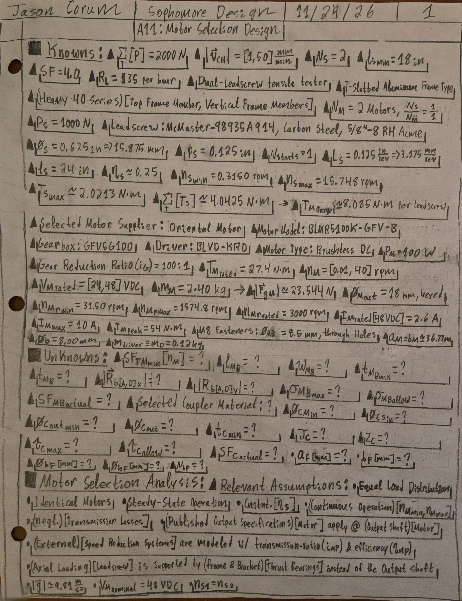
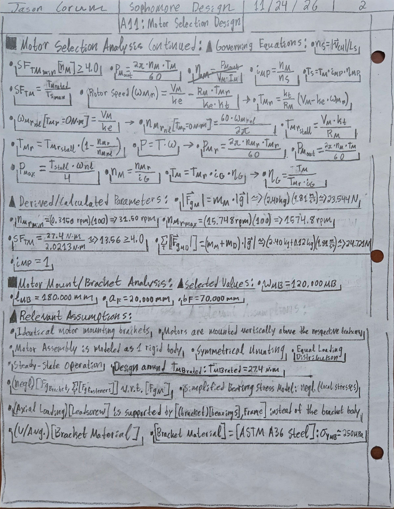
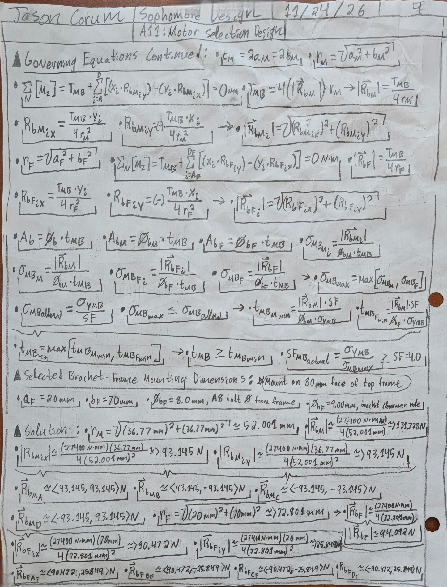
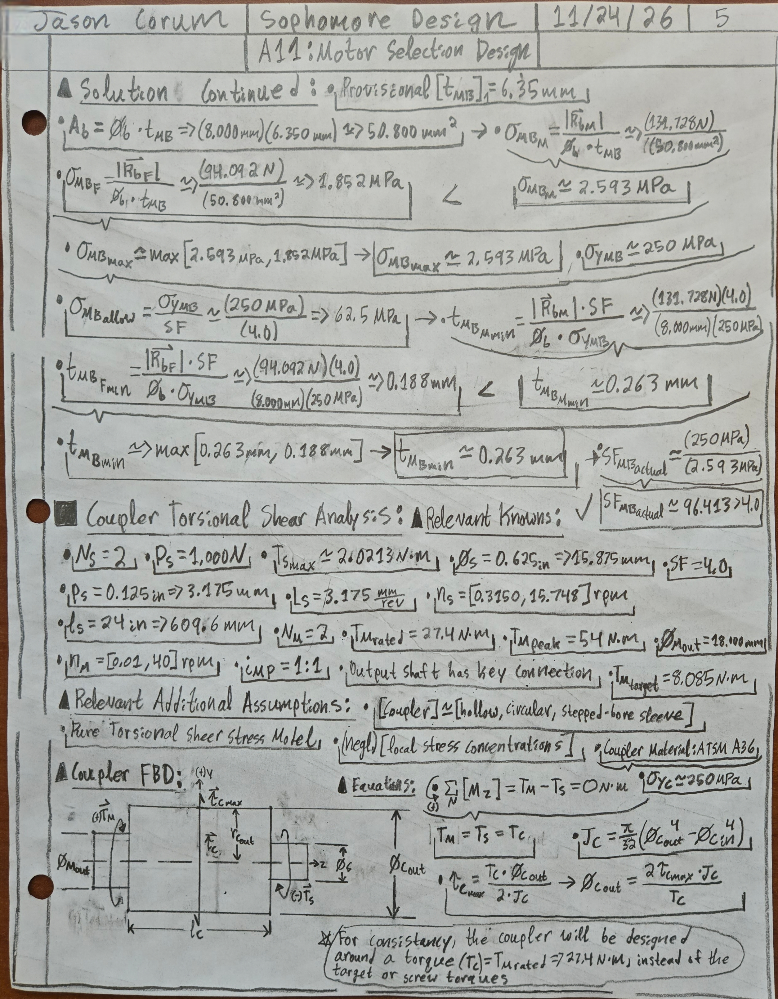

# A11: Motor Selection Design

**Course:** MEGR 2156 — Sophomore Design  
**Assignment:** A11 — Tensile Tester, Part 2  
**Team Members:** Jason Corum, Tai Podvojsky, Gavin Sanchez  
**Documentation:** Team project; individual contributions identified by section  
**CAD Status:** Motor, bracket, and coupler assembly completed and geometrically checked. Full team integration and remaining design verifications are pending.

---

## 1. Project Description and Objectives

The objective of this project is to continue the design of the dual-leadscrew tensile testing machine developed in A10. The machine must apply a maximum axial tensile load of **2,000.000 N** while maintaining a controllable crosshead speed of **1.000–50.000 mm/min**.

A10 established the leadscrew selection, preliminary required torque and rotational speed, crosshead concept, bronze flange nuts, and initial supporting frame. A11 focuses on selecting the motor system, designing its mounting bracket and shaft coupler, analyzing the supporting frame, and developing the remaining mechanical support components.

The proposed machine uses two identical motor-driven leadscrews. Each motor drives one leadscrew, and the two screws must rotate synchronously to maintain the crosshead's alignment during operation.

### 1.1 Design Requirements

| Parameter | Value |
| --- | --- |
| Maximum tensile load | 2,000.000 N |
| Number of leadscrews | 2 |
| Number of motors | 2 |
| Axial load per leadscrew | 1,000.000 N |
| Crosshead linear speed | 1.000–50.000 mm/min |
| Minimum leadscrew length | 18.000 in |
| Selected leadscrew length | 24.000 in |
| Required safety factor | 4.000 |
| Leadscrew thread | 5/8"-8 RH Acme |
| Frame construction | T-slotted aluminum extrusion |
| Motor selection | DC motor, stepper motor, or gearmotor |
| Motor mount | Four-hole mounting arrangement |
| Motor mount alignment | Coaxial with leadscrew |
| Service accessibility | Allow assembly and maintenance |
| Reaction resistance | Resist operational torque and reaction forces |
| Engineering labor rate | $35.000/hour |

The original assignment also specifies a purely mechanical design without electronics or software. The selected motor system uses an external electronic driver. This is a documented design-interpretation deviation that requires instructor approval or clarification before claiming complete compliance with that requirement.

### 1.2 Individual Responsibilities

| Team Member | Primary Contribution |
| --- | --- |
| **Jason Corum** | Motor selection, torque/speed verification, motor mounting bracket, bracket bearing-stress analysis, shaft coupler, and motor assembly CAD |
| **Tai Podvojsky** | [TODO: Insert assigned A11 responsibilities and completed work] |
| **Gavin Sanchez** | [TODO: Insert assigned A11 responsibilities and completed work] |

The remaining group sections include the frame design, frame FEA, floating bearing support, final assembly integration, and bill of materials. Their exact individual ownership should be confirmed before final submission.

### 1.3 Relationship to A10

The selected A10 leadscrew is **McMaster-Carr 98935A914**, a carbon-steel 5/8"-8 right-hand Acme screw with a purchased length of 24.000 in.

The leadscrew selection, initial strength calculations, and preliminary torque analysis are documented in the [A10 project portfolio](../A10/index.md).

A11 uses the A10 torque and speed requirements as the foundation for motor selection.

---

## 2. Motor Selection — Jason Corum

### 2.1 Initial Knowns, Unknowns, and Assumptions

The motor selection began by identifying the required rotational speed, torque, available mounting space, electrical characteristics, and manufacturer's documentation requirements.

The preliminary model assumes:

- Two identical motors drive two identical leadscrews.
- Both leadscrews share the specimen load equally.
- The motors operate in steady state during the nominal loading analysis.
- The leadscrews rotate synchronously.
- The leadscrew efficiency remains constant over the preliminary operating range.
- Transmission losses outside the leadscrew are initially neglected.
- The axial leadscrew loads are supported by separate thrust bearings and the frame, rather than by the motor output shafts.
- The manufacturer's published gearhead output ratings apply to the selected motor and gearhead combination.

The selected leadscrew parameters are:

| Parameter | Value |
| --- | --- |
| Supplier | McMaster-Carr |
| Leadscrew part number | 98935A914 |
| Material | Carbon steel |
| Thread | 5/8"-8 RH Acme |
| Number of starts | 1 |
| Major diameter | 15.875 mm |
| Pitch | 3.175 mm |
| Lead, Ls | 3.175 mm/rev |
| Selected leadscrew length | 609.600 mm |
| Axial load per leadscrew, Ps | 1,000.000 N |
| Assumed leadscrew efficiency, ηs | 0.250 |

*Figure 1. Motor selection knowns, unknowns, selected components, and general design assumptions.*

### 2.2 Required Leadscrew Rotational Speed

For a single-start leadscrew, the lead equals the pitch.

The relationship between crosshead linear speed and leadscrew rotational speed is:

ns = |vCH| / Ls

At the minimum required crosshead speed:

ns,min = 1.000 / 3.175

<strong>ns,min ≈ 0.315 rpm</strong>

At the maximum required crosshead speed:

ns,max = 50.000 / 3.175

<strong>ns,max ≈ 15.748 rpm</strong>

Therefore, each leadscrew must operate over approximately:

<strong>ns = [0.315, 15.748] rpm</strong>

The selected motor and transmission must accommodate the complete speed range.

### 2.3 Required Leadscrew Torque

The preliminary torque requirement was established in A10 using the selected lead, axial load, and assumed leadscrew efficiency.

Ts = (Ps · Ls) / (2π · ηs)

Substituting:

Ts = (1000.000 · 3.175) / (2π · 0.250)

<strong>Ts,max ≈ 2.021 N·m</strong>

The specified design safety factor is:

<strong>SF = 4.000</strong>

The target motor output torque becomes:

TM,target = SF · Ts,max

TM,target = 4.000 · Ts,max

Using the unrounded A10 torque result:

<strong>TM,target ≈ 8.085 N·m</strong>

This target applies to each motor because each motor drives one leadscrew.

### 2.4 Motor Candidate Investigation

Several motor and gearhead combinations were investigated before the final selection.

The main selection difficulties were achieving the required low rotational speed, maintaining sufficient torque throughout the working range, finding compatible gearheads, and obtaining manufacturer documentation and CAD models.

| Candidate or Manufacturer | Investigation Outcome |
| --- | --- |
| Bodine Electric gearmotor | Rejected because the documented minimum output speed exceeded the required minimum |
| Crouzet DCmind gearmotor | Rejected because its minimum achievable output speed exceeded the required minimum |
| Novanta MDrive | Rejected after investigating available gear reduction and operating requirements |
| Applied Motion Products | Considered as a fallback, but exact configuration verification and assembly documentation remained insufficient |
| Parvalux Electric Motors | Investigated multiple candidates; documentation and low-speed verification remained unresolved |
| Dunkermotoren | Investigated motor and planetary gearbox combinations; interface and configuration issues remained |
| Neugart | Investigated planetary gearboxes; adapter and configuration availability complicated verification |
| Oriental Motor | Selected motor, gearhead, and driver combination with usable manufacturer documentation and CAD |

The investigation demonstrated that a nominally sufficient motor torque rating does not necessarily mean the motor can operate at the required minimum speed.

### 2.5 Selected Motor, Gearhead, and Driver

**Selected manufacturer: [Oriental Motor](https://www.orientalmotor.com/)**

**Selected configuration: BLMR5100K-GFV-B / GFV5G100 / BLVD-KRD**

[Official Oriental Motor Product Page](https://catalog.orientalmotor.com/en-us/item/100-120w-brushless-dc-motor-speed-control-systems/100w-blv-r-series-brushless-dc-motors/blmr5100k-gfv-b-gfv5g100-blvd-krd)

| Specification | Selected value |
| --- | --- |
| Motor model | BLMR5100K-GFV-B |
| Gearhead model | GFV5G100 |
| Driver model | BLVD-KRD |
| Motor type | Brushless DC |
| Rated power | 100.000 W |
| Gear reduction ratio | 100:1 |
| Published output speed range | 0.010–40.000 rpm |
| Rated motor rotational speed | 3,000.000 rpm |
| Rated output torque | 27.400 N·m |
| Published peak torque | 54.000 N·m |
| Nominal supply options | 24.000 / 48.000 VDC |
| Selected nominal supply | 48.000 VDC |
| Rated current at 48 VDC | 2.600 A |
| Recorded maximum current | 10.000 A |
| Motor and gearhead mass | 2.400 kg |
| External driver mass | 0.120 kg |
| Output shaft diameter | 18.000 mm |
| Output shaft connection | Keyed |
| Mounting-hole diameter | 8.500 mm |
| Mounting-hole spacing | 73.540 × 73.540 mm |

The BLVD-KRD is an **external driver**, not an integrated motor controller. Its mounting location will be determined during the complete system integration.

The motor's published ratings were used for the preliminary selection. Continuous torque delivery, acceleration characteristics, controller configuration, and synchronized operation across the complete working range remain integration considerations.

### 2.6 Motor Speed Verification

The selected gear reduction is:

<strong>iG = 100.000</strong>

The rotor speed is related to the gearbox output speed by:

nMr = iG · nM

At the minimum required leadscrew speed:

nMr,min = 100.000 · ns,min

<strong>nMr,min ≈ 31.496 rpm</strong>

At the maximum required leadscrew speed:

nMr,max = 100.000 · ns,max

Using the unrounded leadscrew speeds:

<strong>nMr,max ≈ 1574.803 rpm</strong>

The required output-speed interval lies within the manufacturer's stated speed range.

### 2.7 Motor Torque Verification

The selected gearhead has a published rated output torque of:

<strong>TM,rated = 27.400 N·m</strong>

The nominal ratio of rated motor output torque to the calculated leadscrew driving torque is:

SFTM = TM,rated / Ts,max

SFTM = 27.400 / Ts,max

Using the unrounded leadscrew torque:

<strong>SFTM ≈ 13.556 ≥ 4.000</strong>

The published rated torque exceeds the nominal driving torque by more than the required safety-factor margin.

**Verification limitation:** This comparison uses the published rated gearbox torque. It is not a substitute for confirming continuous torque capability at every operating speed under the final controller settings and thermal conditions.

The published peak torque of 54.000 N·m is recorded separately and is not substituted for the continuous rated torque.

*Figure 2. Motor selection equations, required operating speeds, torque comparison, and preliminary bracket assumptions.*

### 2.8 Selected Driver and Electrical Interface

The selected BLVD-KRD driver provides the external electronic interface for the brushless DC gearmotor.

| Driver parameter | Value |
| --- | --- |
| Model | BLVD-KRD |
| Driver mass | 0.120 kg |
| CAD envelope | 65.000 × 80.160 × 31.300 mm |
| Preliminary mounting pattern | Approximately 55.000 × 65.000 mm |
| Selected motor supply | 48.000 VDC |
| Final driver mounting position | To be determined |
| Synchronized dual-drive control | To be determined during integration |

The driver has not been added to the individual motor mounting bracket assembly. Its final position should allow ventilation, wiring access, maintenance, and integration with the remaining frame structure.

Because the assignment's purely mechanical restriction was intentionally relaxed during candidate selection, this control architecture must be documented as a design deviation requiring instructor clarification.

---

## 3. Motor Mounting Bracket Design — Jason Corum

### 3.1 Design Requirements and Material Selection

The motor mounting bracket must connect the selected gearmotor to the supporting frame while maintaining alignment between the gearbox output shaft and the leadscrew.

It must also provide adequate service access and resist the operating torque reaction.

The selected bracket material is **ASTM A36 steel**, modeled with an approximate yield strength of:

<strong>σYMB ≈ 250.000 MPa</strong>

A practical plate thickness of 6.350 mm was selected for the preliminary design.

### 3.2 Final Bracket Geometry

| Feature | Final selected dimension |
| --- | --- |
| Material | ASTM A36 steel |
| Width, WMB | 120.000 mm |
| Length, LMB | 180.000 mm |
| Thickness, tMB | 6.350 mm |
| Motor mounting holes | 4 × Ø8.500 mm |
| Motor mounting pattern | 73.540 × 73.540 mm |
| Frame mounting holes | 4 × Ø9.000 mm |
| Frame mounting pattern | 40.000 × 140.000 mm |
| Gearbox locating-boss clearance | Ø40.000 mm, through |
| Gearbox locating-boss diameter | Ø39.000 mm |
| Nominal radial clearance | 0.500 mm |
| Gearbox output shaft diameter | Ø18.000 mm |

The selected bracket is a rectangular plate with two four-hole mounting patterns and a central shaft-clearance opening offset to match the actual gearbox output shaft.

### 3.3 Motor Mounting-Hole Locations

The centroid of the motor mounting-hole pattern is defined as the local origin.

The four hole coordinates are:

| Hole | X (mm) | Y (mm) |
| --- | ---: | ---: |
| AM | -36.770 | +36.770 |
| BM | +36.770 | +36.770 |
| CM | +36.770 | -36.770 |
| DM | -36.770 | -36.770 |

Therefore:

<strong>aM = bM = 36.770 mm</strong>

The bolt-group radius is:

rM = √(aM2 + bM2)

<strong>rM ≈ 52.001 mm</strong>

The gearbox output shaft is offset from the motor mounting-pattern center.

Its position in the adopted assembly coordinate system is:

<strong>Os = (0.000, +18.000) mm</strong>

### 3.4 Frame Mounting-Hole Locations

The bracket is mounted to two vertical 40-4080 aluminum extrusion members.

The four frame mounting-hole locations are:

| Hole | X (mm) | Y (mm) |
| --- | ---: | ---: |
| AF | -20.000 | +70.000 |
| BF | +20.000 | +70.000 |
| CF | +20.000 | -70.000 |
| DF | -20.000 | -70.000 |

Therefore:

<strong>aF = 20.000 mm</strong>

<strong>bF = 70.000 mm</strong>

The corresponding bolt-group radius is:

rF = √(aF2 + bF2)

<strong>rF ≈ 72.801 mm</strong>

### 3.5 Bracket and Bearing Free-Body Diagrams

The bracket analysis uses a simplified bolt-group model.

The motor and gearbox assembly is represented as a rigid body applying its weight and operational torque reaction through the mounting system.

The bracket transfers these reactions to the frame.

The analysis distinguishes:

1. Motor-to-bracket connections.
2. Bracket-to-frame connections.
3. Individual bolt-hole bearing reactions.
4. The separate thrust-bearing load path for the leadscrew.

The selected nominal design torque is the motor's published rated gearbox output torque:

<strong>TMB = 27.400 N·m</strong>

*Figure 3. Motor mounting bracket side view, bolt-hole bearing representation, motor-to-bracket FBD, bracket-to-frame FBD, and bolt coordinates.*

### 3.6 Governing Equations — Bolt Group Reaction Forces

For four equally spaced mounting bolts subjected to a torque about the central axis, the simplified tangential reaction magnitude per bolt is:

|R⃗b| = TMB / (4r)

The corresponding Cartesian reaction components are:

Rb,ix = (TMB · yi) / (4r2)

Rb,iy = -(TMB · xi) / (4r2)

The signs depend on the selected coordinate axes and the applied torque direction shown in the FBDs.

For the motor-to-bracket connection:

|R⃗bM| = TMB / (4rM)

For the bracket-to-frame connection:

|R⃗bF| = TMB / (4rF)

### 3.7 Motor-to-Bracket Reaction Forces

Using:

<strong>TMB = 27,400.000 N·mm</strong>

and:

<strong>rM ≈ 52.001 mm</strong>

the nominal reaction magnitude per mounting bolt is:

|R⃗bM| = 27,400.000 / (4rM)

<strong>|R⃗bM| ≈ 131.729 N</strong>

For the symmetrical motor mounting pattern:

<strong>|RbM,ix| ≈ 93.145 N</strong>

<strong>|RbM,iy| ≈ 93.145 N</strong>

### 3.8 Bracket-to-Frame Reaction Forces

For the frame mounting pattern:

<strong>rF ≈ 72.801 mm</strong>

The nominal reaction magnitude per frame mounting bolt is:

|R⃗bF| = 27,400.000 / (4rF)

<strong>|R⃗bF| ≈ 94.092 N</strong>

The reaction-component magnitudes are:

<strong>|RbF,ix| ≈ 90.472 N</strong>

<strong>|RbF,iy| ≈ 25.849 N</strong>

### 3.9 Bolt-Hole Bearing-Stress Analysis

The simplified projected bearing area is:

Ab = Øb · tMB

Using the nominal M8 fastener diameter and selected bracket thickness:

Ab = 8.000 · 6.350

<strong>Ab = 50.800 mm2</strong>

The nominal bearing stress is:

σMB = |R⃗b| / Ab

For the motor mounting holes:

σMB,M = |R⃗bM| / 50.800

<strong>σMB,M ≈ 2.593 MPa</strong>

For the frame mounting holes:

σMB,F = 94.092 / 50.800

<strong>σMB,F ≈ 1.852 MPa</strong>

The governing nominal bearing stress is therefore:

σMB,max = max[σMB,M, σMB,F]

<strong>σMB,max ≈ 2.593 MPa</strong>

### 3.10 Minimum Required Bracket Thickness

Using a yield-strength-based allowable nominal bearing stress:

σMB,allow = σYMB / SF

σMB,allow = 250.000 / 4.000

<strong>σMB,allow = 62.500 MPa</strong>

Rearranging the bearing-stress equation:

tMB,min = (|R⃗b| · SF) / (Øb · σYMB)

For the motor mounting holes:

<strong>tMB,Mmin ≈ 0.263 mm</strong>

For the frame mounting holes:

<strong>tMB,Fmin ≈ 0.188 mm</strong>

The governing theoretical minimum is:

tMB,min = max[0.263, 0.188]

<strong>tMB,min ≈ 0.263 mm</strong>

A much thicker practical plate was selected:

<strong>tMB = 6.350 mm</strong>

### 3.11 Nominal Bearing-Stress Safety Factor

The simplified bearing-stress safety factor is:

SFMB,actual = σYMB / σMB,max

Using unrounded intermediate results:

<strong>SFMB,actual ≈ 96.410 ≥ 4.000</strong>

The selected bracket therefore exceeds the specified safety factor under the simplified nominal bearing-stress model.

**Model limitation:** This result does not establish the bracket's complete structural safety factor. The simplified model does not independently evaluate plate bending, deflection, bolt shear and tension, thread failure, edge tearing, fatigue, vibration, or local stress concentrations.

The assignment requires precise alignment without excessive deflection but does not specify a numerical bracket deflection limit. Final alignment and stiffness should be assessed through the completed machine assembly and any additional validation required by the instructor.

*Figure 4. Parametric bracket bearing equations, reaction-force calculations, and safety-factor relationships.*

*Figure 5. Bracket bearing-stress results, minimum thickness comparison, actual nominal safety factor, and coupler analysis setup.*

### 3.12 Bracket Design Revision for Service Access

The initial bracket design was:

- Width: 120.000 mm.
- Length: 160.000 mm.
- Thickness: 6.350 mm.
- Frame pattern: 40.000 × 120.000 mm.

After inserting the two 40-4080 frame extrusions, the preliminary assembly revealed that the uprights obstructed the space needed for the motor mounting bolts.

The frame mounting-hole half-length was increased from:

bF = 60.000 mm

to:

<strong>bF = 70.000 mm</strong>

The bracket length was increased to:

<strong>LMB = 180.000 mm</strong>

The new arrangement provides a nominal clearance of:

<strong>chead = 6.730 mm</strong>

between the Ø13.000 mm motor bolt-head envelope and the nearest frame envelope.

The change improves assembly and maintenance accessibility without modifying the motor mounting-hole pattern or gearbox clearance opening.

The updated frame mounting reactions and bearing stresses were recalculated using the new bolt-group radius.

### 3.13 Bracket SOLIDWORKS Model

The final preliminary bracket CAD model includes:

- 120.000 × 180.000 mm rectangular plate.
- 6.350 mm thickness.
- Four Ø8.500 mm motor mounting holes.
- Four Ø9.000 mm frame mounting holes.
- Ø40.000 mm gearbox locating-boss clearance opening.
- Revised 40.000 × 140.000 mm frame mounting pattern.

**[TODO: Insert final bracket CAD screenshot]**

*Figure 6. Final preliminary motor mounting bracket with all mounting holes and shaft clearance opening.*

---

## 4. Shaft Coupler Design — Jason Corum

### 4.1 Design Requirements

The coupler connects the motor gearbox output shaft to the selected leadscrew.

The proposed coupler must transmit the operating torque while maintaining the alignment of the two shafts.

The preliminary design uses a **one-piece hollow cylindrical sleeve with stepped bores**, designed around the different motor and leadscrew diameters.

The simplified stress analysis considers pure torsion and neglects local stress concentrations from keyways, set screws, and other retention features.

### 4.2 Coupler Knowns and Assumptions

| Parameter | Value |
| --- | --- |
| Selected material | ASTM A36 steel |
| Assumed yield strength | 250.000 MPa |
| Required safety factor | 4.000 |
| Design torque, TC | 27.400 N·m |
| Motor shaft diameter | 18.000 mm |
| Leadscrew nominal diameter | 15.875 mm |
| Motor-side engagement | 25.000 mm |
| Leadscrew-side engagement | 25.000 mm |
| Shaft-tip separation | 10.000 mm |
| Overall coupler length | 60.000 mm |
| Selected outer diameter | 34.000 mm |

The coupler is designed for the motor's rated output torque rather than only the calculated leadscrew driving torque.

### 4.3 Coupler Free-Body Diagram

The simplified FBD includes the input torque from the motor, resisting torque from the leadscrew, and torsional shear stress acting on the cylindrical coupler section.

For static torque equilibrium:

ΣN[Mz] = TM - Ts = 0 N·m

Therefore:

<strong>TM = Ts = TC</strong>

The radius at the outer surface of the coupler is:

rC,out = ØC,out / 2

The maximum nominal torsional shear stress occurs at the outer radius.

### 4.4 Polar Second Moment of Area

For a hollow circular section:

JC = (π / 32) · (ØC,out4 - ØC,in4)

The polar section modulus is:

ZC = JC / rC,out

The nominal torsional shear stress is:

τC = (TC · rC) / JC

At the outside surface:

τC,max = (TC · ØC,out) / (2JC)

Combining these expressions gives:

<strong>τC,max = (16 · TC · ØC,out) / [π · (ØC,out4 - ØC,in4)]</strong>

### 4.5 Allowable Shear Stress

The preliminary calculation uses the simplified shear-yield approximation:

τYC ≈ σYC / 2

τYC ≈ 250.000 / 2

<strong>τYC ≈ 125.000 MPa</strong>

The allowable torsional shear stress is:

τC,allow = τYC / SF

<strong>τC,allow ≈ 31.250 MPa</strong>

This approximation is used consistently with the handwritten preliminary analysis; it is not a substitute for a full combined-stress or fatigue evaluation.

### 4.6 Minimum Coupler Outside Diameter

The motor-side bore of 18.000 mm is the larger of the two internal diameters and therefore governs the preliminary hollow-section sizing.

The diameter requirement is:

(16 · TC · ØC,out) / [π · (ØC,out4 - ØC,in4)] ≤ τC,allow

At the limiting condition:

π · τC,allow · (ØC,outmin4 - ØC,in4) - 16 · TC · ØC,outmin = 0

Substituting the selected design values:

π · 31.250 · (ØC,outmin4 - 18.0004) - 16 · 27400.000 · ØC,outmin = 0

The resulting nonlinear fourth-degree equation was solved numerically using the Newton–Raphson method.

<strong>ØC,outmin ≈ 21.130 mm</strong>

The selected outside diameter is:

<strong>ØC,out = 34.000 mm</strong>

### 4.7 Coupler Wall Thickness

For the motor-side bore:

tCM = (ØC,out - ØCM,in) / 2

tCM = (34.000 - 18.000) / 2

<strong>tCM = 8.000 mm</strong>

For the leadscrew-side bore:

tCS = (ØC,out - ØCS,in) / 2

tCS = (34.000 - 15.875) / 2

<strong>tCS ≈ 9.063 mm</strong>

The motor-side section has the thinner wall and governs the nominal torsional shear calculation.

### 4.8 Coupler Torsional Stress

For the motor-side section:

JCM = (π / 32) · (34.0004 - 18.0004)

The polar section modulus is:

ZCM = 2JCM / ØC,out

<strong>ZCM ≈ 7111.087 mm3</strong>

The maximum nominal torsional shear stress is:

τC,max = [16 · 27400.000 · 34.000] / [π · (34.0004 - 18.0004)]

<strong>τC,max ≈ 3.853 MPa</strong>

### 4.9 Coupler Safety Factor

The nominal torsional safety factor is:

SFC,actual = τYC / τC,max

Using unrounded intermediate values:

<strong>SFC,actual ≈ 32.441 ≥ 4.000</strong>

The selected diameter satisfies the simplified nominal pure-torsion requirement.

*Figure 7. Coupler torsional equations, minimum outside diameter calculation, material properties, selected dimensions, and nominal safety factor.*

### 4.10 Coupler SOLIDWORKS Model

The preliminary coupler was modeled using:

1. A cylindrical outer body.
2. Two different-diameter internal bores.
3. A motor-side keyway.
4. An M5 set-screw hole.
5. Appropriate engagement depths for both shafts.

The completed assembly includes the motor-side parallel key and set screw.

| CAD Feature | Selected dimension |
| --- | --- |
| Outside diameter | 34.000 mm |
| Overall length | 60.000 mm |
| Motor-side bore | 18.000 mm |
| Leadscrew-side bore | 15.875 mm |
| Motor shaft engagement | 25.000 mm |
| Leadscrew engagement | 25.000 mm |
| Shaft-tip gap | 10.000 mm |
| Motor-side set screw | M5 × 0.800 × 6.000 mm |

The motor-side key and keyway were mated to the imported gearmotor geometry. The set screw was also modeled and positioned in the corresponding tapped hole.

The actual leadscrew is a threaded 5/8"-8 Acme component. The CAD model establishes the nominal axial geometry, but the final physical torque-transfer and axial-retention method at the leadscrew end remains to be specified and verified.

**[TODO: Insert coupler part screenshot]**

*Figure 8. Stepped-bore coupler with motor-side keyway and set-screw feature.*

**[TODO: Insert motor shaft and coupler assembly screenshot]**

*Figure 9. Coupler assembled to the geared motor with key and set screw.*

---

## 5. Motor, Coupler, Bracket, and Leadscrew CAD Assembly — Jason Corum

### 5.1 CAD Development Process

The SOLIDWORKS assembly was developed progressively to verify component placement and fit.

The main assembly stages were:

1. Import the manufacturer motor and gearbox models.
2. Create and mate the stepped-bore coupler.
3. Position the motor-side key and set screw.
4. Insert and align the selected leadscrew.
5. Create the bracket plate and mounting-hole patterns.
6. Insert the motor bracket into the assembly.
7. Create the gearbox locating-boss clearance opening.
8. Insert two temporary 40-4080 frame extrusion sections.
9. Revise frame mounting-hole spacing to improve service access.
10. Add the four bracket-to-frame bolts.
11. Add the four motor-to-bracket bolts.
12. Check the remaining nut and washer envelopes.

### 5.2 Gearbox Clearance Hole

The initial bracket was positioned against the gearbox mounting face before the central clearance opening was created.

Inspection of the manufacturer geometry established the following:

| Feature | Value |
| --- | --- |
| Gearbox locating-boss diameter | 39.000 mm |
| Selected clearance-hole diameter | 40.000 mm |
| Radial clearance | 0.500 mm |
| Hole center offset | 18.000 mm |
| Bracket thickness | 6.350 mm |

A through-all Ø40.000 mm cut was created at the actual output-shaft axis.

CAD comparison confirmed that this removed the original gearbox locating-boss interference without intersecting the eight bracket mounting holes.

**[TODO: Insert clearance-hole CAD screenshot]**

*Figure 10. Ø40.000 mm gearbox clearance opening in the motor mounting bracket.*

### 5.3 Frame Mounting Interface

The trial supporting members are 80/20 heavy-duty **40-4080 T-slotted aluminum extrusions**.

Each has a nominal cross section of:

<strong>40.000 × 80.000 mm</strong>

The bracket attaches to the **end faces** of the upright extrusions rather than using side-mounted T-slot nuts.

Each extrusion uses two core holes aligned with the frame mounting-hole pattern.

The intended manufacturing connection requires M8 × 1.250 tapped ends.

The temporary CAD extrusion length used for the interface check is 200.000 mm. These sections are not the final complete frame.

The initial frame arrangement interfered with the motor mounting fastener access. The updated bracket and frame spacing resolved the nominal fastener-envelope interference.

**[TODO: Insert bracket-to-frame assembly screenshot]**

*Figure 11. Updated mounting bracket positioned on the two 40-4080 frame uprights.*

### 5.4 Frame Mounting Fasteners

The frame mounting connection uses four M8 fasteners.

| Specification | Value |
| --- | --- |
| Quantity | 4 |
| Thread | M8 × 1.250 |
| Length | 25.000 mm |
| Head style | Low-profile/button-head |
| Nominal head diameter | 14.000 mm |
| Nominal head height | 4.400 mm |
| Bracket through-hole diameter | 9.000 mm |
| Nominal threaded engagement | 18.650 mm |

The four bolts were inserted into the CAD assembly and aligned with the extrusion core holes.

The nominal engagement length is:

Le = Lb - tMB

Le = 25.000 - 6.350

<strong>Le = 18.650 mm</strong>

The core holes are represented without detailed helical internal threads. Their apparent solid overlap with nominal M8 shanks is expected in the simplified CAD representation, provided that the physical extrusion ends are correctly tapped.

### 5.5 Motor Mounting Fasteners

The motor-to-bracket connection uses four M8 socket-head cap screws.

| Specification | Value |
| --- | --- |
| Quantity | 4 |
| Thread | M8 × 1.250 |
| Length | 90.000 mm |
| Head diameter | 13.000 mm |
| Head height | 8.000 mm |
| Gearhead thickness in grip path | 58.000 mm |
| Motor mounting flange thickness | 10.000 mm |
| Bracket thickness | 6.350 mm |
| Total grip length | 74.350 mm |
| Nominal projection below bracket | 15.650 mm |

The complete grip length is:

Lgrip = 58.000 + 10.000 + 6.350

<strong>Lgrip = 74.350 mm</strong>

The nominal bolt projection is:

Lprojection = 90.000 - 74.350

<strong>Lprojection = 15.650 mm</strong>

### 5.6 Nut and Washer Selection

The motor mounting hardware was also checked using virtual representations of standard washer and nut dimensions.

The preliminary hardware stack uses:

| Component | Quantity | Specification |
| --- | ---: | --- |
| Small-pattern head-side washer | 4 | M8 ISO 7092, Ø15.000 mm OD |
| Spring washer | 4 | M8 DIN 127 |
| Underside flat washer | 4 | M8 ISO 7089, Ø16.000 mm OD |
| Underside hex nut | 4 | M8 ISO 4032 |

The estimated axial space used by the washer and nut arrangement is:

Lhardware = 1.600 + 2.000 + 1.600 + 6.800

<strong>Lhardware = 12.000 mm</strong>

The remaining nominal projection is:

Lremaining = Lprojection - Lhardware

Lremaining = 15.650 - 12.000

<strong>Lremaining = 3.650 mm</strong>

The smaller head-side washer was selected because a nominal Ø16.000 mm washer showed slight interference with the gearbox housing.

The nuts and washers were checked using simplified geometric envelopes, not inserted as separate parts in the STEP assembly.

Their final tolerances, actual thread engagement, washer compression, fastener grade, and installation torque still require hardware-level verification.

### 5.7 CAD Geometry Verification

The latest STEP export was inspected to verify the main motor assembly, bracket, frame interfaces, and fasteners.

| Verification | Result |
| --- | --- |
| Motor and gearbox alignment | Passed geometric check |
| Motor shaft and coupler concentricity | Passed geometric check |
| Motor-side key placement | Passed geometric check |
| Motor-side set-screw placement | Passed geometric check |
| Leadscrew nominal concentricity | Passed geometric check |
| Motor bracket dimensions | Passed geometric check |
| Ø40.000 mm gearbox clearance opening | Passed geometric check |
| Frame mounting-hole alignment | Passed geometric check |
| Revised frame spacing | Passed geometric check |
| Motor-bolt shank clearance | Passed geometric check |
| Motor-bolt head-to-frame clearance | Passed nominal envelope check |
| Frame mounting bolts | Positioned and checked |
| Motor mounting bolts | Positioned and checked |
| Motor-side nuts and washers | Virtual geometry checked |
| Complete physical leadscrew-side retention | Not yet verified |
| Complete-machine frame analysis | Team work pending |
| Final controller synchronization | Team integration pending |

These checks establish nominal CAD geometry and clearances, not a manufactured, assembled, or experimentally validated mechanism.

### 5.8 Native SOLIDWORKS Assembly Files

The motor mounting assembly and its individual components are available below.

**Main Assembly:**

- [Complete Motor Mount Assembly](cad/blmr5100k-100-b___blvd-krd.SLDASM)

**Individual Components:**

- [Motor Component 1](cad/blmr5100k-100-b___blvd-krd_01.SLDPRT)
- [Motor Component 2](cad/blmr5100k-100-b___blvd-krd_02.SLDPRT)
- [Motor Mounting Bracket](cad/Bracket.SLDPRT)
- [Shaft Coupler](cad/A11_Shaft_Coupler.SLDPRT)
- [Acme Leadscrew](cad/98935A914_Carbon%20Steel%20Acme%20Lead%20Screw.SLDPRT)
- [40-4080 Frame Extrusion](cad/8020-40-4080%20X%20200.SLDPRT)
- [Parallel Key](cad/parallel_din.sldprt)
- [Frame Mounting Screws](cad/socket%20button%20head%20cap%20screw_am.sldprt)
- [Motor Mounting Screws](cad/socket%20head%20cap%20screw_iso.sldprt)
- [Coupler Set Screw](cad/socket%20set%20screw%20flat%20point_am.sldprt)

The native SOLIDWORKS files preserve the original component
names and editable geometry. All components should be downloaded
into the same folder before opening the parent assembly.

**[TODO: Insert the final complete motor mounting assembly screenshot]**

*Figure 12. Completed preliminary motor, gearbox, coupler, leadscrew, bracket, frame interfaces, and mounting-bolt assembly.*

---

## 6. Summary of Motor, Bracket, and Coupler Results — Jason Corum

| Parameter | Final preliminary result |
| --- | --- |
| Selected motor | Oriental Motor BLMR5100K-GFV-B |
| Selected gearhead | GFV5G100 |
| Selected driver | BLVD-KRD |
| Rated motor power | 100.000 W |
| Gear reduction | 100:1 |
| Rated gearbox output torque | 27.400 N·m |
| Required leadscrew torque | 2.021 N·m per screw |
| Torque target with SF = 4.000 | 8.085 N·m per motor |
| Required leadscrew speed | 0.315–15.748 rpm |
| Selected motor + gearbox mass | 2.400 kg |
| Driver mass | 0.120 kg |
| Bracket material | ASTM A36 steel |
| Bracket dimensions | 120.000 × 180.000 × 6.350 mm |
| Motor mounting pattern | 73.540 × 73.540 mm |
| Frame mounting pattern | 40.000 × 140.000 mm |
| Selected bracket thickness | 6.350 mm |
| Bearing-only minimum thickness | 0.263 mm |
| Governing nominal bracket bearing stress | 2.593 MPa |
| Nominal bracket bearing safety factor | 96.410 |
| Coupler material | ASTM A36 steel |
| Coupler outside diameter | 34.000 mm |
| Coupler overall length | 60.000 mm |
| Motor-side bore | 18.000 mm |
| Leadscrew-side bore | 15.875 mm |
| Minimum calculated coupler outside diameter | 21.130 mm |
| Nominal coupler torsional shear | 3.853 MPa |
| Nominal coupler torsional safety factor | 32.441 |
| Motor mounting bolts | 4 × M8 × 90.000 mm |
| Frame mounting bolts | 4 × M8 × 25.000 mm |

### 6.1 Preliminary Component Weights

The following bracket and coupler masses were estimated from the modeled solid volumes using an assumed steel density of 7,850.000 kg/m3.

| Component | Mass |
| --- | ---: |
| Motor and gearbox | 2.400 kg |
| External driver | 0.120 kg |
| Bracket, estimated | 0.990 kg |
| Coupler, estimated | 0.346 kg |
| Total excluding miscellaneous hardware | 3.856 kg |

Using:

<strong>g = 9.810 m/s2</strong>

the corresponding total weight magnitude is approximately:

ΣT[|F⃗g|] = ΣT[m] · g

ΣT[|F⃗g|] ≈ 3.856 · 9.810

<strong>ΣT[|F⃗g|] ≈ 37.824 N</strong>

The total includes the external driver for system-level mass accounting. If the driver is mounted separately, its weight must be applied at its actual frame mounting location rather than at the motor bracket.

These values are preliminary and exclude additional fasteners, wiring, supports, and other unmodeled components.

---

## 7. Structural Frame Design and FEA — [Team Member: To Be Confirmed]

**Status: Awaiting teammate's calculations, CAD, and FEA results.**

### 7.1 Frame Requirements and Material Selection

[TODO: Insert the responsible teammate's initial knowns, unknowns, assumptions, selected aluminum extrusion specifications, and material properties.]

### 7.2 Frame Free-Body Diagrams

[TODO: Insert the frame FBDs showing the specimen force, leadscrew support reactions, motor assembly weight, torque reactions, and support constraints.]

**[TODO: Insert frame FBD image]**

*Figure 13. Structural frame free-body diagram and applied loads.*

### 7.3 Governing Equations

[TODO: Insert the teammate's equations for frame bending, deflection, torsion, axial stress, and other required failure modes.]

### 7.4 Numerical Analysis

[TODO: Insert calculated loads, reactions, stresses, deflections, and factors of safety.]

### 7.5 SOLIDWORKS Frame Model

[TODO: Insert frame geometry, dimensions, selected T-slot connections, CAD screenshots, and native component file links.]

**[TODO: Insert frame CAD screenshot]**

*Figure 14. Selected frame configuration and mounting interfaces.*

### 7.6 Frame Finite Element Analysis

[TODO: Include material assignment, applied loads, fixtures, mesh settings, convergence checks, stress results, deformation plots, and resulting factors of safety.]

**[TODO: Insert FEA stress plot]**

*Figure 15. Frame von Mises stress distribution.*

**[TODO: Insert FEA displacement plot]**

*Figure 16. Frame displacement and deflection results.*

### 7.7 Frame Design Conclusions

[TODO: Summarize whether the proposed frame meets the assignment requirements, identify any limitations, and document changes needed before final assembly.]

---

## 8. Floating Leadscrew Bearing and Support Design — [Team Member: To Be Confirmed]

**Status: Awaiting teammate's calculations and CAD.**

### 8.1 Bearing Support Requirements

The remaining bearing system must support the leadscrew while allowing its intended rotation.

The lower bearing arrangement should accommodate the required axial freedom or floating behavior so the shaft support system does not become unnecessarily overconstrained.

[TODO: Insert specific requirements from the assigned bearing-support section.]

### 8.2 Bearing Selection and Fit

[TODO: Insert selected bearing, manufacturer, catalog number, bore diameter, housing dimensions, fit/tolerance requirements, and supporting sources.]

### 8.3 Bearing FBD and Governing Equations

[TODO: Insert applicable reaction forces, bearing loads, stress equations, and safety-factor calculations.]

**[TODO: Insert bearing FBD]**

*Figure 17. Floating leadscrew bearing and support free-body diagram.*

### 8.4 Bearing Support CAD

[TODO: Insert the bearing mount model, selected dimensions, mounting hardware, and installed location.]

**[TODO: Insert bearing assembly screenshot]**

*Figure 18. Lower floating bearing and mounting assembly.*

### 8.5 Bearing Support Verification

[TODO: Document alignment, axial freedom, appropriate fit, rotation, retention, and resulting verification conclusions.]

---

## 9. Complete Tensile Tester Assembly and Integration — Team

### 9.1 Integration of A10 and A11 Components

The complete tensile tester must combine the A10 leadscrew and crosshead assembly with the A11 motor, gearbox, bracket, coupler, frame, and bearing supports.

The final assembly should establish a consistent mechanical load path and maintain coaxial alignment of the rotating elements.

[TODO: Insert the team member responsible for overall assembly integration.]

### 9.2 Synchronization Requirement

The two leadscrews must rotate at the same nominal speed:

<strong>ns1 = ns2</strong>

Unequal motion could cause the crosshead to tilt, bind, or experience eccentric loading.

Because the selected configuration uses separate motor drivers, the method used to synchronize the drives must be established during final system integration.

[TODO: Document the approved synchronization arrangement and its compatibility with assignment constraints.]

### 9.3 Mechanical Load Path

The motor delivers torque through the gearbox and coupler to the leadscrew.

The leadscrew and nut convert rotational motion into linear crosshead motion.

Axial thrust should be transferred to the structural frame through the selected thrust bearing and bearing-support arrangement rather than imposed directly on the gearbox output shaft.

[TODO: Insert the final mechanical load-path diagram and verify bearing and frame reactions.]

### 9.4 Final Assembly CAD

**[TODO: Insert final complete tensile tester assembly screenshot.]**

*Figure 19. Complete A11 tensile tester assembly.*

**[TODO: Add the final team SOLIDWORKS Pack and Go assembly link.]**

### 9.5 Final Integration Checks

[TODO: Document assembly interference detection, leadscrew concentricity, crosshead travel, shaft support, motor orientation, service access, and final motion verification.]

---

## 10. Bill of Materials and Cost Analysis — [Team Member: To Be Confirmed]

### 10.1 Selected Components

| Item | Component | Quantity | Supplier or Source | Cost |
| --- | --- | ---: | --- | --- |
| 1 | BLMR5100K-GFV-B motor | 2 | Oriental Motor | $674.00 |
| 2 | GFV5G100 gearhead | 2 | Oriental Motor | $392.00 |
| 3 | BLVD-KRD driver | 2 | Oriental Motor | $998.00 |
| 4 | LC03D06A driver power cable | 2 | Oriental Motor | $68.00 |
| 5 | ASTM A36 motor mounting bracket | 2 | Fabricated | $262.28 |
| 6 | ASTM A36 shaft coupler | 2 | Fabricated | [TODO] |
| 7 | M8 × 90.000 mm motor mounting bolts | 8 | Standard hardware | [TODO] |
| 8 | M8 × 25.000 mm bracket/frame bolts | 8 | Standard hardware | [TODO] |
| 9 | M8 washers and nuts | As required | Standard hardware | [TODO] |
| 10 | Motor-side key and M5 set screw | 2 sets | Standard hardware | [TODO] |
| 11 | 40-series T-slot frame members | [TODO] | 80/20 or equivalent | [TODO] |
| 12 | Floating lower bearing supports | [TODO] | [TODO] | [TODO] |
| 13 | Remaining structural hardware | [TODO] | [TODO] | [TODO] |

The counts above assume two identical motor stations. The final bill of materials should reconcile components already included in the A10 bill of materials to avoid double-counting.

### 10.2 Fabrication Costs

[TODO: Include material costs, machining requirements, fabrication methods, and any necessary purchased components.]

### 10.3 Engineering Labor Cost

The assigned engineering labor rate is:

<strong>RL = $35.000/hour</strong>

For each member:

CL,i = RL · ti

For Jason Corum:

CL,Jason = 35.000 · 28.000

<strong>CL,Jason = $980.000</strong>

[TODO: Insert Tai's and Gavin's hours and calculated labor costs.]

### 10.4 Total Cost

[TODO: Insert the final material, purchased-component, fabrication, and labor cost tables.]

Do not treat provisional estimates or unverified online prices as final procurement totals.

---

## 11. Engineering Lessons Learned

### 11.1 Jason Corum — Motor Selection

Selecting a suitable motor required more than comparing rated torque or maximum speed. The required operating range was unusually broad and included very low rotational speeds.

Several promising motor and gearhead combinations were eliminated because they could not operate at the minimum required output speed or lacked sufficient manufacturer documentation to verify their suitability.

The final selected Oriental Motor system demonstrated the importance of evaluating the complete motor, transmission, and driver combination rather than considering the motor alone.

The selection process also revealed a design tradeoff between the assignment's purely mechanical restriction and the practical availability of controllable low-speed motor systems.

### 11.2 Jason Corum — Motor Mounting Bracket

The initial bracket calculations produced a very small theoretical minimum thickness under the simplified bolt-hole bearing-stress model.

This demonstrated the difference between the minimum thickness predicted by a restricted analytical model and a practical plate thickness selected for fabrication, rigidity, and assembly.

The first assembly also showed that satisfying bolt-hole spacing requirements did not necessarily provide enough space for fastener installation.

Increasing the bracket length and frame mounting-hole spacing resolved the observed clearance problem and reinforced the importance of evaluating service access during CAD development.

### 11.3 Jason Corum — Coupler Design

The coupler analysis illustrated how the polar second moment of area affects the torsional stress in a hollow circular shaft.

The governing diameter equation was nonlinear and required numerical root finding.

The coupler CAD work also demonstrated the importance of distinguishing nominal geometric alignment from a complete physical torque-transfer connection. Shaft fit and concentricity alone do not establish that a coupling can securely transmit reversing torque.

### 11.4 Tai Podvojsky — [TODO]

[TODO: Insert Tai's engineering lessons learned, design difficulties, software experience, and solutions.]

### 11.5 Gavin Sanchez — [TODO]

[TODO: Insert Gavin's engineering lessons learned, design difficulties, software experience, and solutions.]

### 11.6 Team — Assembly and Design Integration

[TODO: Discuss interactions between the motor mounting brackets, complete frame, crosshead, support bearings, and synchronized drives.]

### 11.7 Time Spent

| Team Member | A11 Time |
| --- | --- |
| Jason Corum | 28.000 hours |
| Tai Podvojsky | [TODO] |
| Gavin Sanchez | [TODO] |
| **Total** | **[TODO]** |

Jason's recorded A11 labor cost is:

CL,Jason = 28.000 hours · $35.000/hour

<strong>CL,Jason = $980.000</strong>

The final team labor total will be completed once all individual time logs are available.

---

## 12. Engineering Conclusions

### 12.1 Motor Selection

The selected Oriental Motor BLMR5100K-GFV-B, GFV5G100 gearhead, and BLVD-KRD driver provide a published speed and torque capability that satisfies the preliminary numerical motor-selection targets.

The rated output torque exceeds the calculated per-leadscrew driving torque by a nominal ratio of 13.556.

Full operating-envelope verification and the original electronics/software restriction remain outstanding integration or instructor-approval matters.

### 12.2 Bracket Design

The preliminary ASTM A36 bracket has overall dimensions of:

<strong>WMB × LMB × tMB = 120.000 × 180.000 × 6.350 mm</strong>

The nominal bearing-stress calculation gives a governing stress of 2.593 MPa and a bearing-only safety factor of approximately 96.410.

The revised mounting arrangement provides improved nominal fastener access and passed the available CAD geometric interference checks.

The result does not independently prove stiffness, fatigue life, or all other structural failure modes.

### 12.3 Coupler Design

The selected coupler has:

<strong>ØC,out = 34.000 mm</strong>

Its maximum nominal pure-torsion shear stress is approximately 3.853 MPa, with a calculated nominal torsional safety factor of 32.441.

The motor-side key and set-screw arrangement has been modeled.

The final leadscrew-side mechanical torque-transfer and axial-retention connection remains to be specified and verified.

### 12.4 Remaining Team Work

[TODO: Insert final frame stress and deflection conclusions, bearing support conclusions, complete assembly verification, bill of materials, and overall project assessment.]

---

## 13. References and Supplier Files

1. [Oriental Motor — BLMR5100K-GFV-B / GFV5G100 / BLVD-KRD](https://catalog.orientalmotor.com/en-us/item/100-120w-brushless-dc-motor-speed-control-systems/100w-blv-r-series-brushless-dc-motors/blmr5100k-gfv-b-gfv5g100-blvd-krd).
2. [Oriental Motor — Official Website](https://www.orientalmotor.com/).
3. [Oriental Motor — BLV Series R Type Operating Manual](https://www.orientalmotor.com/products/pdfs/opmanuals/HP-5140-8E.pdf).
4. [80/20 — 40-4080 Heavy-Duty T-Slotted Profile](https://8020.net/40-4080.html).
5. [McMaster-Carr — Carbon Steel 5/8"-8 Acme Leadscrew, 98935A914](https://www.mcmaster.com/98935A914/).
6. Oberg et al., *Machinery's Handbook*, 31st edition, Industrial Press, 2020. Assigned reference.
7. Oberg et al., *Machinery's Handbook*, 32nd edition. Additional thread and materials reference.
8. MEGR 2156 course lecture presentations, assignment instructions, and instructor clarifications.
9. [A10 Lead Screw Translating System — Team Portfolio](../A10/index.md).
10. [TODO: Insert additional sources used by Tai for the frame analysis].
11. [TODO: Insert additional sources used by Gavin for the bearing design].
12. [TODO: Insert final purchased hardware specifications and manufacturer references].

---

## 14. Final Documentation and Verification Checklist

### Motor Selection — Jason Corum

- [x] Identify required torque and rotational speed.
- [x] Investigate motor and gearbox candidates.
- [x] Select a motor, gearbox, and driver.
- [x] Document motor rating, speed range, torque, voltage, current, mass, and mounting interface.
- [x] Compare nominal rated torque against required leadscrew torque.
- [x] Obtain motor and driver CAD files.
- [ ] Confirm final controller configuration and continuous-load operation over the working range.
- [ ] Resolve instructor approval of the electronic driver.

### Motor Mounting Bracket — Jason Corum

- [x] Select bracket material.
- [x] Develop motor-to-bracket and bracket-to-frame FBDs.
- [x] Calculate nominal mounting-hole reactions.
- [x] Calculate minimum bracket thickness under the bearing-stress model.
- [x] Select a practical bracket thickness.
- [x] Create the bracket SOLIDWORKS model.
- [x] Verify gearbox locating-boss clearance.
- [x] Revise the frame mounting pattern for service access.
- [x] Insert and geometrically check the principal mounting bolts.
- [x] Verify nominal washer and nut clearances.
- [ ] Document final physical installation details and fastener specifications.
- [ ] Add final bracket CAD screenshots to this portfolio.

### Shaft Coupler — Jason Corum

- [x] Identify motor and leadscrew diameters.
- [x] Select preliminary coupler material.
- [x] Develop torsional FBD and equations.
- [x] Calculate minimum outside diameter.
- [x] Select final preliminary coupler dimensions.
- [x] Calculate nominal torsional shear stress and safety factor.
- [x] Model the coupler in SOLIDWORKS.
- [x] Add the motor-side key and set screw.
- [x] Check nominal assembly fit and alignment.
- [ ] Finalize and verify the physical leadscrew-side torque-transfer and retention method.
- [ ] Add final coupler CAD screenshots.

### Frame Design and FEA — Team

- [ ] Insert frame design equations and calculations.
- [ ] Insert complete frame CAD.
- [ ] Insert FEA stress and displacement results.
- [ ] Verify appropriate frame stiffness, stability, and safety factors.
- [ ] Document final frame fasteners and mounting details.

### Floating Bearing Support — Team

- [ ] Insert bearing-selection calculations.
- [ ] Insert bearing and mounting-component models.
- [ ] Verify shaft alignment and permitted axial movement.
- [ ] Document bearing support and mounting details.

### Final Integration and Submission — Team

- [ ] Complete final two-motor tensile tester assembly.
- [ ] Establish and verify synchronized leadscrew rotation.
- [ ] Verify complete mechanical load path.
- [ ] Confirm assembly and maintenance accessibility.
- [ ] Resolve all final SOLIDWORKS mates and component references.
- [ ] Complete interference and motion checks.
- [ ] Create and verify the native SOLIDWORKS Pack and Go archive.
- [ ] Upload required CAD, calculation images, and documentation files.
- [ ] Complete final bill of materials and cost estimate.
- [ ] Update individual time logs and lessons learned.
- [ ] Confirm the portfolio satisfies all applicable MEGR 2156 Canvas submission requirements.

---

**Final Project Status:** Jason's motor selection, nominal bracket analysis, coupler torsion analysis, and main CAD assembly geometry are complete at the preliminary design level. Remaining physical connection details and team-level integration checks are identified above rather than treated as fully verified.
